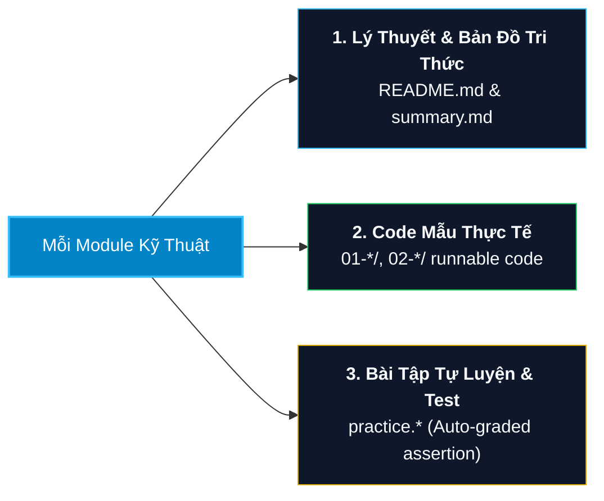
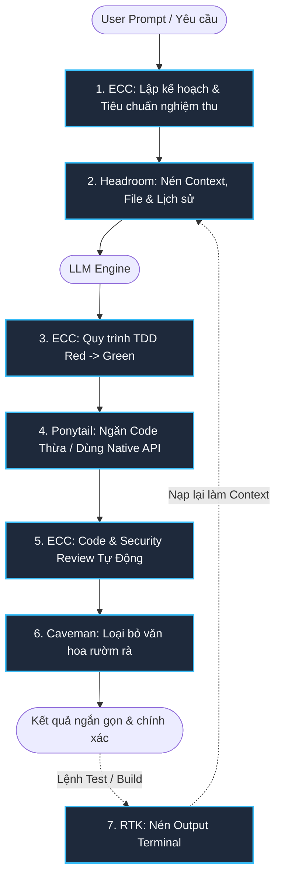

# 🚀 Developer Revision Documents & Engineering Knowledge Base

> **Kho tài liệu ôn tập kiến thức kỹ thuật phần mềm cốt lõi, cheat sheet, bài tập thực hành kèm test tự động và cẩm nang thực chiến RMIT Hackathon 2026.**

[](file:///d:/my-project/revision-document/LICENSE)
[](https://nodejs.org/)
[](https://www.typescriptlang.org/)
[](#-danh-mục-tài-liệu-chuyên-sâu-16-lĩnh-vực)
[](file:///d:/my-project/revision-document/README-AI-TOOLS.md)
[](file:///d:/my-project/revision-document/hackathon-rmit-2026/README.md)

---

## 📌 Mục Lục

1. [Tổng Quan Dự Án](#-tổng-quan-dự-án)
2. [Điểm Nổi Bật (Key Highlights)](#-điểm-nổi-bật-key-highlights)
3. [Danh Mục Tài Liệu Chuyên Sâu (16 Lĩnh Vực)](#-danh-mục-tài-liệu-chuyên-sâu-16-lĩnh-vực)
4. [Cấu Trúc Thống Nhất Trong Mỗi Thư Mục](#-cấu-trúc-thống-nhất-trong-mỗi-thư-mục)
5. [Cây Thư Mục Toàn Dự Án](#-cây-thư-mục-toàn-dự-án)
6. [Hướng Dẫn Cài Đặt & Chạy Kiểm Thử Tự Động](#-hướng-dẫn-cài-đặt--chạy-kiểm-thử-tự-động)
7. [Hệ Thống Tối Ưu Hóa & Chuẩn Hóa AI Agent (ECC + Token Stack)](#-hệ-thống-tối-ưu-hóa--chuẩn-hóa-ai-agent-ecc--token-stack)
8. [Đóng Góp & Giấy Phép](#-đóng-góp--giấy-phép)

---

## 🎯 Tổng Quan Dự Án

**Developer Revision Documents** là kho tri thức kỹ thuật phần mềm toàn diện được thiết kế có hệ thống dành cho:
- **Lập trình viên & Kỹ sư phần mềm**: Nắm vững nguyên lý cốt lõi, chuẩn bị phỏng vấn kỹ thuật (Coding, System Design, Security, Cloud) từ Junior tới Senior/Staff.
- **Sinh viên & Nghiên cứu sinh**: Ôn tập các môn học đại học (C/C++, Java, .NET, Database, Testing SWT301, DevOps).
- **Thí sinh Hackathon & AI Engineers**: Cẩm nang toàn thư từ A-Z tham gia **RMIT Hackathon 2026** (Kaggle Offline, LLM Security, Red/Blue Teaming, Multilingual RAG, Quantization).
- **AI Coding Agents**: Tích hợp các bộ quy tắc (skills, rules) tối ưu hóa context, token và quy trình TDD/Security.

---

## ⭐ Điểm Nổi Bật (Key Highlights)

- 🧩 **16 Lĩnh vực công nghệ hoàn chỉnh**: Từ khoa học máy tính cơ bản (Memory, Pointers, Concurrency) đến phân tán quy mô lớn (ByteByteGo, Sharding, Saga, Kafka).
- 🧪 **Kiểm thử tự động thực tế (TDD & Assertions)**: Mọi bài tập thực hành đều đi kèm bộ test case tự chấm đúng/sai ngay trên terminal.
- 🛡️ **Bảo mật chuyên sâu theo chuẩn Quốc tế**: Tích hợp OWASP Top 10, Zero Trust, OAuth2/OIDC, Cryptography, DevSecOps.
- ⚡ **Tiết kiệm 50% - 80% Token cho AI Agent**: Bộ ngũ công cụ tích hợp sẵn `RTK`, `Headroom`, `Caveman`, `Ponytail` và khung quy trình `ECC`.
- 🏆 **RMIT Hackathon 2026 Master Handbook**: Bộ giáo trình 15 chuyên đề, 5 starter code, bộ dataset mẫu, kịch bản pitch 5 phút và sổ tay cấp cứu OOM trên Kaggle.

---

## 📚 Danh Mục Tài Liệu Chuyên Sâu (16 Lĩnh Vực)

| # | Chủ Đề & Công Nghệ | Nội Dung Trọng Tâm | Tài Liệu & Cheat Sheet |
| :-: | :--- | :--- | :--- |
| **01** | **JavaScript** | Nền tảng JS, Scope & Closures, Async/Await & Event Loop, DOM & Web APIs, ES6+ đến ES.Next, OOP & Prototypes, Meta-programming | [javascript/](file:///d:/my-project/revision-document/javascript/README.md) \| [Cheat Sheet](file:///d:/my-project/revision-document/javascript/summary.md) |
| **02** | **TypeScript** | Type System, Interfaces & Types, Generics, Utility Types, Decorators, TSConfig Tuning, Type Narrowing | [typescript/](file:///d:/my-project/revision-document/typescript/README.md) \| [Cheat Sheet](file:///d:/my-project/revision-document/typescript/summary.md) |
| **03** | **React** | Component Lifecycle, Hooks hiện đại (`useId`, `useTransition`), Context, State Management, Profiler & Performance Optimization | [react/](file:///d:/my-project/revision-document/react/README.md) \| [Cheat Sheet](file:///d:/my-project/revision-document/react/summary.md) |
| **04** | **Database & SQL** | SQL Querying, Aggregations, Complex Joins, Subqueries & Window Functions, B-Tree Indexes, ACID & Isolation Levels, SQLi Defense | [database/](file:///d:/my-project/revision-document/database/README.md) \| [Cheat Sheet](file:///d:/my-project/revision-document/database/summary.md) |
| **05** | **.NET / C#** | C# Core, OOP & Pattern Matching, Generics, LINQ to Objects, Memory Management (`Span<T>`, `ref struct`), Async/Await, C# Zero to Hero | [dotnet/](file:///d:/my-project/revision-document/dotnet/README.md) \| [Cheat Sheet](file:///d:/my-project/revision-document/dotnet/summary.md) |
| **06** | **Java & JVM** | Java Core, JVM Architecture & Memory Model (Heap/Stack/Metaspace), OOP, Exception Handling, I/O Streams, Collections, Concurrency | [java/](file:///d:/my-project/revision-document/java/README.md) \| [Cheat Sheet](file:///d:/my-project/revision-document/java/summary.md) |
| **07** | **C / C++** | Con trỏ (Pointers Arithmetic), Stack vs Heap, Quản lý bộ nhớ động, Structs & Data Structures, File I/O, Modern C++ (RAII, Smart Pointers) | [c-cpp/](file:///d:/my-project/revision-document/c-cpp/README.md) \| [Cheat Sheet](file:///d:/my-project/revision-document/c-cpp/summary.md) |
| **08** | **Git & VCS** | Kiến trúc 3 Cây (HEAD, Index, Working Directory), Branching & Merge, Interactive Rebase, Conflict Resolution, Reflog, Hooks, LFS | [git/](file:///d:/my-project/revision-document/git/README.md) \| [Cheat Sheet](file:///d:/my-project/revision-document/git/summary.md) |
| **09** | **DevOps & Cloud Native** | Docker Multi-Stage Builds, Docker Compose, Kubernetes Architecture, Pods/Deployments/Services/Ingress, PVC/PV, CI/CD, GitOps | [devops/](file:///d:/my-project/revision-document/devops/README.md) \| [Cheat Sheet](file:///d:/my-project/revision-document/devops/summary.md) |
| **10** | **AWS Cloud Architecture** | IAM Least Privilege, VPC Networking (Subnets, NAT, IGW), EC2 & Auto-Scaling, S3, RDS & Aurora, DynamoDB, SQS/SNS, CloudWatch, IaC | [aws/](file:///d:/my-project/revision-document/aws/README.md) \| [Cheat Sheet](file:///d:/my-project/revision-document/aws/summary.md) |
| **11** | **System Design** | Scalability, Caching Patterns, CAP & PACELC, Sharding, Kafka & Event-Driven, ByteByteGo Vol 1 & 2, Geohash, Double-Entry Ledger, 4-Step Framework | [system-design/](file:///d:/my-project/revision-document/system-design/README.md) \| [Cheat Sheet](file:///d:/my-project/revision-document/system-design/summary.md) |
| **12** | **Web & API Security** | OWASP Top 10, Authentication & Session Hijacking, OAuth2 & PKCE, OIDC, JWT Security, Cryptography (AES-GCM, TLS 1.3), DevSecOps, STRIDE/DREAD | [security/](file:///d:/my-project/revision-document/security/README.md) \| [Cheat Sheet](file:///d:/my-project/revision-document/security/summary.md) |
| **13** | **Rust Systems** | Ownership, Borrowing & Lifetimes, Structs & Enums, Pattern Matching, Generics & Traits, Fearless Concurrency (Send/Sync, Arc/Mutex), Smart Pointers | [rust/](file:///d:/my-project/revision-document/rust/README.md) \| [Cheat Sheet](file:///d:/my-project/revision-document/rust/summary.md) |
| **14** | **RMIT Hackathon 2026** | Security × Generative AI × Low-Resource Languages (Kaggle Playbook, Red/Blue Teaming, RAG Triad, Quantization NF4, Pitching 5 Phút) | [hackathon-rmit-2026/](file:///d:/my-project/revision-document/hackathon-rmit-2026/README.md) \| [Cẩm Nang Toàn Thư](file:///d:/my-project/revision-document/hackathon-rmit-2026/MASTER_HANDBOOK_RMIT_2026.md) |
| **15** | **SWT301 - Software Testing** | Nghiên cứu ứng dụng LLM trong sinh Test Cases tự động, Prompting kiểm thử phần mềm, kịch bản thuyết trình bảo vệ 2 slides | [swt301/](file:///d:/my-project/revision-document/swt301/CAN_LLM_GENERATE_TEST_CASES.md) \| [Script Thuyết Trình](file:///d:/my-project/revision-document/swt301/SCRIPT_THUYET_TRINH_2_SLIDES.md) |
| **16** | **Matt Pocock Agent Skills** | Bộ kỹ năng agent chuẩn mực (TDD, Code Review, Refactoring, Best Practices) từ Matt Pocock dành cho AI Coding Assistant | [mattpocock-skills/](file:///d:/my-project/revision-document/mattpocock-skills/README.md) \| [Scope & Rules](file:///d:/my-project/revision-document/mattpocock-skills/SCOPE.md) |

---

## 🏗️ Cấu Trúc Thống Nhất Trong Mỗi Thư Mục

Mọi thư mục chủ đề kỹ thuật đều tuân thủ cấu trúc chuẩn 3 lớp:



1. **`README.md` & `summary.md`**:
   - Trình bày trực quan, ngắn gọn, đi thẳng vào bản chất vấn đề.
   - **Knowledge Links**: Bản đồ liên kết với các chủ đề liên quan.
   - **Interview Traps**: Tổng hợp các cạm bẫy phỏng vấn kỹ thuật và cách trả lời chuẩn mực.
2. **Các ví dụ thực tế (Runnable Code)**:
   - Các file mã nguồn minh họa nguyên lý, có thể chạy trực tiếp bằng `node`, `ts-node`, `dotnet`, `g++`, hoặc `cargo`.
3. **`practice.*` (Bài tập thực hành)**:
   - Chứa các hàm cần hoàn thiện (skeleton code) kèm theo bộ `assert` tự động kiểm tra tính đúng đắn khi chạy lệnh.

---

## 📂 Cây Thư Mục Toàn Dự Án

```text
revision-document/
├── .agents/                      # AI Agent Skills, Rules & Workflows
│   ├── rules/                    # Quy tắc điều hướng ngữ cảnh
│   ├── skills/                   # Bộ kỹ năng: caveman, tdd-workflow, security-review, code-review
│   └── workflows/                # Quy trình kiểm tra mã nguồn (code-review.md)
├── aws/                          # 5 Module AWS Cloud & Solutions Architect
├── c-cpp/                        # 5 Module C/C++ từ con trỏ tới C++20
├── database/                     # 6 Module Cơ sở dữ liệu & SQL chuyên sâu
├── devops/                       # 5 Module Docker, Kubernetes, CI/CD, GitOps
├── dotnet/                       # 5 Module .NET, C# & C# Zero to Hero
├── git/                          # 4 Module Git & Sổ tay Git cơ bản/nâng cao
├── hackathon-rmit-2026/          # Cẩm nang toàn thư RMIT Hackathon 2026
│   ├── 01-roadmap-leader/        # Lộ trình 4 tuần cho Team Leader
│   ├── 02-past-exams-analysis/   # Phân tích đề thi cũ & Barem SkywardAI
│   ├── 03-tech-knowledge/        # 15 Chuyên đề kỹ thuật LLM Security & RAG
│   ├── 04-starter-code/          # 8 File mã nguồn mẫu & pipeline Kaggle
│   ├── 05-team-strategy-and-ideas/# Chiến thuật 14h, Notebook template, Game theory
│   ├── 06-mock-datasets/         # Dữ liệu giả lập Task 1, 2, 3
│   ├── 07-pitching-and-slides/   # Script pitching 5 phút & 10 câu hỏi Q&A
│   ├── 08-troubleshooting-faq/   # Cấp cứu OOM, Kaggle offline, Emergency runbook
│   ├── MASTER_HANDBOOK_RMIT_2026.md # Sách điện tử toàn thư từ 0 đến vô địch
│   └── README.md                 # Playbook chiến lược cuộc thi
├── java/                         # 5 Module Java Core, JVM & Concurrency
├── javascript/                   # 11 Module JavaScript từ nền tảng tới Meta-programming
├── mattpocock-skills/            # Kho công cụ & kỹ năng Agent của Matt Pocock
├── react/                        # 4 Module React hiện đại, Hooks, State & Profiler
├── rust/                         # 5 Module Rust Systems Programming
├── security/                     # 8 Module Web Security, OWASP & DevSecOps
├── swt301/                       # Kiểm thử phần mềm & Sinh Test Case bằng LLM
├── system-design/                # 8 Module System Design & ByteByteGo 101
├── typescript/                   # 4 Module TypeScript chuyên sâu
├── AGENTS.md                     # Điều hướng ngữ cảnh cho AI Agents
├── CAVEMAN.md                    # Nén token output (lược bỏ từ ngữ thừa)
├── ECC.md                        # Khung chuẩn hóa quy trình kỹ thuật & TDD
├── HEADROOM.md                   # Nén ngữ cảnh đầu vào (Context compression)
├── PONYTAIL.md                   # Nén code sinh ra (ngăn over-engineering)
├── RTK.md                        # Nén output lệnh terminal / shell
├── README-AI-TOOLS.md            # Hướng dẫn chi tiết bộ ngũ tối ưu AI Agent
├── package.json                  # Cấu hình dự án & scripts test tự động
└── tsconfig.json                 # Cấu hình TypeScript compiler
```

---

## 🛠️ Hướng Dẫn Cài Đặt & Chạy Kiểm Thử Tự Động

### 1. Yêu Cầu Môi Trường
- **Node.js**: Phiên bản `>= 22.0.0` (hỗ trợ cờ `--experimental-transform-types`).
- **npm**: Phiên bản `>= 10.0.0`.
- **TypeScript**: Phiên bản `^7.0.2` (đã cài đặt trong `devDependencies`).

### 2. Cài Đặt Thư Viện

```bash
# Clone repository
git clone https://github.com/161seconds/revision-document.git
cd revision-document

# Cài đặt các gói phụ thuộc
npm install
```

### 3. Chạy Kiểm Tra Mã Nguồn & Bài Tập Thực Hành

```bash
# 1. Kiểm tra toàn bộ cú pháp TypeScript không xuất file build
npm run test:ts

# 2. Chạy toàn bộ bài tập thực hành TypeScript (Tự động chấm bằng assertion)
npm run test:ts:practice

# 3. Chạy toàn bộ bài tập thực hành React
npm run test:react:practice
```

---

## 🤖 Hệ Thống Tối Ưu Hóa & Chuẩn Hóa AI Agent (ECC + Token Stack)

Repository này được cấu hình sẵn hệ thống **5 lớp tối ưu hóa token và chuẩn hóa quy trình kỹ thuật**, giúp các AI Agent (Google Antigravity, Claude Code, Cursor, Codex) hoạt động với hiệu suất tối đa:



### Bảng Phân Vai 5 Công Cụ:

| Công Cụ | File Cấu Hình | Vị Trí Tác Động | Giá Trị Mang Lại |
| :--- | :--- | :--- | :--- |
| **RTK** | [RTK.md](file:///d:/my-project/revision-document/RTK.md) | Terminal / Bash Output | Nén sạch tới **90%** log rác từ lệnh test, git, build |
| **Headroom** | [HEADROOM.md](file:///d:/my-project/revision-document/HEADROOM.md) | Context & Prompt Input | Nén **50% - 80%** prompt tokens trước khi gửi tới model |
| **Caveman** | [CAVEMAN.md](file:///d:/my-project/revision-document/CAVEMAN.md) | Response Generation | Giảm **1.4× đến 3×** chi phí output token |
| **Ponytail** | [PONYTAIL.md](file:///d:/my-project/revision-document/PONYTAIL.md) | Code Generation | Cắt giảm **~54%** số dòng code thừa, ngăn over-engineering |
| **ECC** | [ECC.md](file:///d:/my-project/revision-document/ECC.md) | Development Lifecycle | Chuẩn hóa 100% quy trình TDD, Security và Code Review |

👉 Xem hướng dẫn kích hoạt tự động và thiết lập chi tiết tại: **[AI Agent Optimization Guide](file:///d:/my-project/revision-document/README-AI-TOOLS.md)**.

---

## 🤝 Đóng Góp & Giấy Phép

- **Báo cáo lỗi / Góp ý**: Mở Issue tại [GitHub Issues](https://github.com/161seconds/revision-document/issues).
- **Quy chuẩn gửi Pull Request**:
  1. Tuân thủ định dạng 3 lớp cho mỗi module.
  2. Đảm bảo chạy vượt qua toàn bộ lệnh `npm run test:ts:practice` và `npm run test:react:practice`.
  3. Viết mã nguồn ngắn gọn, tối ưu, chú thích rõ ràng bằng tiếng Việt hoặc tiếng Anh.
- **Giấy phép (License)**: Dự án phát hành theo giấy phép [ISC License](file:///d:/my-project/revision-document/LICENSE).

---
<p align="center">
  <b>Happy Coding & Engineering! May your code be bug-free and your systems always scalable.</b> 🌟
</p>
