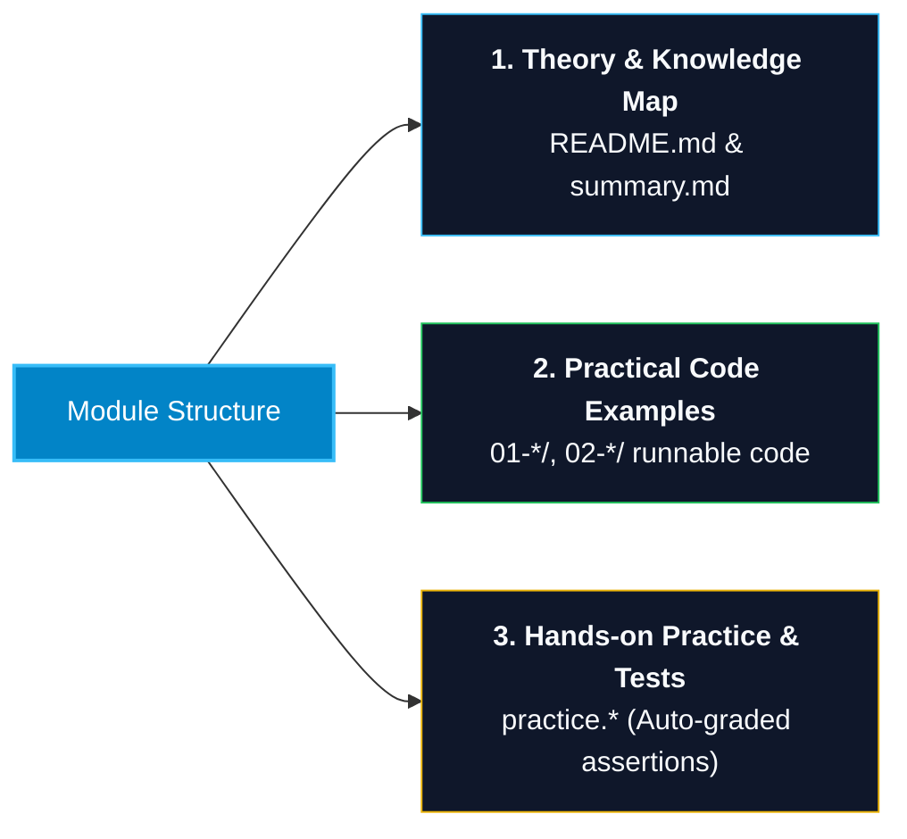
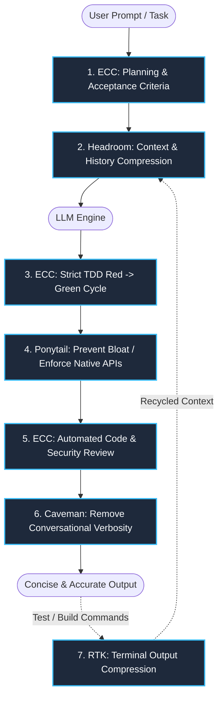

# Developer Revision Documents & Engineering Knowledge Base

> **A comprehensive knowledge base for core software engineering principles, cheat sheets, automated test-driven practice labs, and practical guides for RMIT Hackathon 2026.**

[](LICENSE)
[](https://nodejs.org/)
[](https://www.typescriptlang.org/)
[](#knowledge-base-directory-27-domains)
[](README-AI-TOOLS.md)
[](hackathon-rmit-2026/README.md)

---

## Table of Contents

1. [Project Overview](#project-overview)
2. [Key Highlights](#key-highlights)
3. [Knowledge Base Directory (27 Domains)](#knowledge-base-directory-27-domains)
4. [Standardized Module Architecture](#standardized-module-architecture)
5. [Repository Structure](#repository-structure)
6. [Installation & Automated Testing](#installation--automated-testing)
7. [AI Agent Optimization & Standards (ECC + Token Stack)](#ai-agent-optimization--standards-ecc--token-stack)
8. [Documentation Roadmap](#documentation-roadmap)
9. [Contributing & License](#contributing--license)

---

## Project Overview

**Developer Revision Documents** is a comprehensive software engineering knowledge base systematically structured for:
- **Software Engineers & Developers**: Mastering core engineering principles and preparing for technical interviews (Coding, System Design, Security, Cloud) from Junior to Senior/Staff levels.
- **Students & Researchers**: Reviewing university curriculum topics (C/C++, Java, .NET, Databases, Testing SWT301, DevOps).
- **Hackathon Competitors & AI Engineers**: Complete end-to-end playbook for **RMIT Hackathon 2026** (Kaggle Offline, LLM Security, Red/Blue Teaming, Multilingual RAG, Quantization).
- **AI Coding Agents**: Integrated skills and rules to optimize context windows, minimize token usage, and enforce rigorous TDD and security workflows.

---

## Key Highlights

- **27 Technical Domains**: Spanning fundamental computer science (Memory, Pointers, Concurrency) to large-scale distributed systems (ByteByteGo patterns, Sharding, Saga, Kafka), Clean Architecture, and modern full-stack development (Next.js, RSC).
- **Practical Automated Testing (TDD & Assertions)**: Every practice lab includes executable test suites evaluated directly in the terminal via assertions.
- **Enterprise-Grade Security Standards**: Comprehensive coverage of OWASP Top 10, Zero Trust, OAuth2/OIDC, Cryptography, and DevSecOps best practices.
- **50% - 80% Token Reduction for AI Agents**: Native integration of token optimization tools (`RTK`, `Headroom`, `Caveman`, `Ponytail`) combined with the `ECC` engineering workflow.
- **RMIT Hackathon 2026 Master Handbook**: A curated curriculum featuring 15 technical modules, starter pipelines, mock datasets, 5-minute pitching scripts, and Kaggle OOM emergency runbooks.
- **Hallmark UI Design**: A complete upstream source snapshot with 48 themes, custom design guidance, redesign and audit workflows, and browser-based interface checks.
- **Claude SEO**: A complete upstream source snapshot with 26 skills, 19 specialist agents, and 9 extensions for technical SEO, content, structured data, and AI search.
- **Superpowers**: A complete upstream source snapshot with 15 development skills covering brainstorming, implementation plans, TDD, debugging, code review, and Git worktrees.

---

## Knowledge Base Directory (27 Domains)

| # | Domain & Technology | Core Topics | Documentation & Cheat Sheets |
| :-: | :--- | :--- | :--- |
| **01** | **JavaScript** | Core foundations, Scope & Closures, Async/Await & Event Loop, DOM & Web APIs, ES6+ to ES.Next, OOP & Prototypes, Meta-programming | [javascript/](javascript/README.md) \| [Cheat Sheet](javascript/summary.md) |
| **02** | **TypeScript** | Type System, Interfaces & Types, Generics, Utility Types, Decorators, TSConfig Tuning, Type Narrowing | [typescript/](typescript/README.md) \| [Cheat Sheet](typescript/summary.md) |
| **03** | **React** | Component Lifecycle, Modern Hooks (`useId`, `useTransition`), Context, State Management, Profiler & Performance Optimization | [react/](react/README.md) \| [Cheat Sheet](react/summary.md) |
| **04** | **Next.js & Modern Full-Stack** | App Router, React Server Components (RSC), Rendering (SSR/SSG/ISR/Streaming), Server Actions, 4-tier Caching, Web Vitals | [nextjs/](nextjs/README.md) \| [Cheat Sheet](nextjs/summary.md) |
| **05** | **Database & SQL** | SQL Querying, Aggregations, Complex Joins, Subqueries & Window Functions, B-Tree Indexes, ACID & Isolation Levels, SQLi Defense | [database/](database/README.md) \| [Cheat Sheet](database/summary.md) |
| **06** | **.NET / C#** | C# Core, OOP & Pattern Matching, Generics, LINQ to Objects, Memory Management (`Span<T>`, `ref struct`), Async/Await, C# Zero to Hero | [dotnet/](dotnet/README.md) \| [Cheat Sheet](dotnet/summary.md) |
| **07** | **Java & JVM** | Java Core, JVM Architecture & Memory Model (Heap/Stack/Metaspace), OOP, Exception Handling, I/O Streams, Collections, Concurrency | [java/](java/README.md) \| [Cheat Sheet](java/summary.md) |
| **08** | **C / C++** | Pointer Arithmetic, Stack vs Heap, Dynamic Memory Management, Structs & Data Structures, File I/O, Modern C++ (RAII, Smart Pointers) | [c-cpp/](c-cpp/README.md) \| [Cheat Sheet](c-cpp/summary.md) |
| **09** | **Git & VCS** | 3-Tree Architecture (HEAD, Index, Working Directory), Branching & Merging, Interactive Rebase, Conflict Resolution, Reflog, Hooks, LFS | [git/](git/README.md) \| [Cheat Sheet](git/summary.md) |
| **10** | **DevOps & Cloud Native** | Multi-stage Docker Builds, Docker Compose, Kubernetes Architecture, Pods/Deployments/Services/Ingress, PVC/PV, CI/CD, GitOps | [devops/](devops/README.md) \| [Cheat Sheet](devops/summary.md) |
| **11** | **AWS Cloud Architecture** | IAM Least Privilege, VPC Networking (Subnets, NAT, IGW), EC2 & Auto-Scaling, S3, RDS & Aurora, DynamoDB, SQS/SNS, CloudWatch, IaC | [aws/](aws/README.md) \| [Cheat Sheet](aws/summary.md) |
| **12** | **System Design** | Scalability, Caching Patterns, CAP & PACELC, Sharding, Kafka & Event-Driven Architecture, ByteByteGo Vol 1 & 2, Geohash, Double-Entry Ledger, 4-Step Framework | [system-design/](system-design/README.md) \| [Cheat Sheet](system-design/summary.md) |
| **13** | **Web & API Security** | OWASP Top 10, Authentication & Session Hijacking, OAuth2 & PKCE, OIDC, JWT Security, Cryptography (AES-GCM, TLS 1.3), DevSecOps, STRIDE/DREAD | [security/](security/README.md) \| [Cheat Sheet](security/summary.md) |
| **14** | **Rust Systems** | Ownership, Borrowing & Lifetimes, Structs & Enums, Pattern Matching, Generics & Traits, Fearless Concurrency (Send/Sync, Arc/Mutex), Smart Pointers | [rust/](rust/README.md) \| [Cheat Sheet](rust/summary.md) |
| **15** | **RMIT Hackathon 2026** | Security × Generative AI × Low-Resource Languages (Kaggle Playbook, Red/Blue Teaming, RAG Triad, Quantization NF4, 5-Minute Pitching) | [hackathon-rmit-2026/](hackathon-rmit-2026/README.md) \| [Master Handbook](hackathon-rmit-2026/MASTER_HANDBOOK_RMIT_2026.md) |
| **16** | **SWT301 - Software Testing** | Automated test case generation using LLMs, Prompt engineering for software testing, 2-slide defense presentation script | [swt301/](swt301/CAN_LLM_GENERATE_TEST_CASES.md) \| [Presentation Script](swt301/SCRIPT_THUYET_TRINH_2_SLIDES.md) |
| **17** | **Matt Pocock Agent Skills** | Standardized agent skill suites (TDD, Code Review, Refactoring, Best Practices) from Matt Pocock for AI coding assistants | [mattpocock-skills/](mattpocock-skills/README.md) \| [Scope & Rules](mattpocock-skills/SCOPE.md) |
| **18** | **Clean Architecture & Application Architecture** | Dependency Rule, .NET architectural boundaries, Hexagonal Architecture, DDD/CQRS, Vertical Slice, Transactions, Architecture testing, ADRs, and Migration | [clean-architecture/](clean-architecture/README.md) \| [Cheat Sheet](clean-architecture/summary.md) \| [18 Sources](clean-architecture/sources.md) |
| **19** | **Practical Agent Harnesses** | Skill selection, scope fencing, debug/verify prompts, tool evaluation, handoffs, and RED/GREEN labs | [harness-practice/](harness-practice/README.md) \| [Cheat Sheet](harness-practice/summary.md) |
| **20** | **API Contracts** | HTTP/DTO design, keyset pagination, input validation, Problem Details, versioning, contract compatibility, and .NET HTTP lab | [api-contracts/](api-contracts/README.md) \| [Cheat Sheet](api-contracts/summary.md) |
| **21** | **PostgreSQL Concurrency** | MVCC, isolation levels, conditional writes, row locks, deadlocks, retry strategies, and hands-on PostgreSQL race-condition lab | [postgresql-concurrency/](postgresql-concurrency/README.md) \| [Cheat Sheet](postgresql-concurrency/summary.md) |
| **22** | **Integration Testing in .NET** | API-Service-Repository testing, xUnit, WebApplicationFactory, Testcontainers, database isolation, and verified persistence tests | [dotnet-integration-testing/](dotnet-integration-testing/README.md) \| [Cheat Sheet](dotnet-integration-testing/summary.md) |
| **23** | **DDD & Modular Monolith** | Context mapping, Aggregates, Invariants, Bounded Context ownership, module contracts, domain events, and Ordering-Billing lab | [ddd-modular-monolith/](ddd-modular-monolith/README.md) \| [Cheat Sheet](ddd-modular-monolith/summary.md) |
| **24** | **Reliable Payments & Webhooks** | Signatures, idempotency keys, inbox/outbox patterns, retries, reconciliation, and PostgreSQL replay/rollback lab | [reliable-payments/](reliable-payments/README.md) \| [Cheat Sheet](reliable-payments/summary.md) |
| **25** | **Hallmark UI Design** | 48 visual themes, custom page design, content-preserving redesign, UI audits, responsive layouts, and accessibility checks | [hallmark/](hallmark/README.md) \| [Skill Guide](hallmark/skills/hallmark/SKILL.md) |
| **26** | **Claude SEO Skills** | Technical SEO, Core Web Vitals, E-E-A-T, Schema.org, AI search/GEO, local and international SEO, e-commerce, and Google APIs | [seo-skills/](seo-skills/README.md) \| [Skill Guide](seo-skills/skills/seo/SKILL.md) \| [Commands](seo-skills/docs/COMMANDS.md) |
| **27** | **Superpowers Development Skills** | Brainstorming, implementation plans, TDD, root-cause debugging, code review, Git worktrees, parallel execution, and skill authoring | [superpowers/](superpowers/README.md) \| [Skill Guide](superpowers/skills/using-superpowers/SKILL.md) \| [Testing](superpowers/docs/testing.md) |

---

## Standardized Module Architecture

Learning modules use a consistent 3-tier structure; imported upstream repositories retain their original layouts:



1. **`README.md` & `summary.md`**:
   - Concise, conceptual breakdown targeting core engineering mechanics.
   - **Knowledge Links**: Cross-discipline dependency maps.
   - **Interview Traps**: Common technical interview pitfalls, edge cases, and model answers.
2. **Runnable Code Examples**:
   - Standalone implementations illustrating core patterns, directly executable with `node`, `ts-node`, `dotnet`, `g++`, or `cargo`.
3. **`practice.*` (Self-Paced Labs)**:
   - Skeleton challenges containing pre-configured automated assertion checks that provide instant pass/fail feedback in the terminal.

---

## Repository Structure

```text
revision-document/
├── .agents/                      # AI Agent Skills, Rules & Workflows
│   ├── rules/                    # Context routing rules
│   ├── skills/                   # Core skills and open-source integrations
│   └── workflows/                # Code review and auditing workflows
├── aws/                          # 5 AWS Cloud & Solutions Architecture modules
├── c-cpp/                        # 5 C/C++ modules from raw pointers to modern C++20
├── clean-architecture/           # 8 application architecture guides, history & .NET labs
├── reliable-payments/            # Webhooks, inbox/outbox, idempotency & recovery lab
├── ddd-modular-monolith/         # Contexts, aggregates, boundaries & cross-module contracts
├── dotnet-integration-testing/   # xUnit, WebApplicationFactory & PostgreSQL Testcontainers
├── postgresql-concurrency/       # MVCC, locking, isolation levels & concurrency lab
├── api-contracts/                # HTTP contracts, schema evolution & .NET API lab
├── database/                     # 6 In-depth Database & SQL modules
├── devops/                       # 5 Docker, Kubernetes, CI/CD & GitOps modules
├── dotnet/                       # 5 .NET, C# & C# Zero to Hero modules
├── git/                          # 4 Git internals, workflow & advanced recovery modules
├── hallmark/                     # Complete Hallmark UI design skill, themes, scripts & site
├── harness-practice/             # Agent harness guides, prompting & RED/GREEN labs
├── hackathon-rmit-2026/          # RMIT Hackathon 2026 Master Handbook & Playbook
│   ├── 01-roadmap-leader/        # 4-week team leader roadmap
│   ├── 02-past-exams-analysis/   # Past challenges breakdown & SkywardAI rubrics
│   ├── 03-tech-knowledge/        # 15 LLM Security & RAG deep dives
│   ├── 04-starter-code/          # 8 starter scripts & Kaggle pipelines
│   ├── 05-team-strategy-and-ideas/# 14-hour game theory, strategy & notebook templates
│   ├── 06-mock-datasets/         # Synthetic datasets for Tasks 1, 2, and 3
│   ├── 07-pitching-and-slides/   # 5-minute pitch script & Q&A preparation
│   ├── 08-troubleshooting-faq/   # Kaggle offline debugging, OOM runbook & FAQs
│   ├── MASTER_HANDBOOK_RMIT_2026.md # End-to-end competition handbook
│   └── README.md                 # Strategic competition playbook
├── java/                         # 5 Java Core, JVM internals & Concurrency modules
├── javascript/                   # 11 JavaScript modules from fundamentals to meta-programming
├── mattpocock-skills/            # Agent skill suite curated from Matt Pocock
├── nextjs/                       # 4 Next.js App Router, RSC & Server Actions modules
├── react/                        # 4 Modern React, Hooks, State & Profiler modules
├── rust/                         # 5 Rust systems programming modules
├── security/                     # 8 Web Security, OWASP Top 10 & DevSecOps modules
├── seo-skills/                   # Complete Claude SEO source, skills, agents, extensions & tests
├── superpowers/                  # Complete Superpowers source, 15 skills, hooks & tests
├── swt301/                       # Software testing & LLM test generation research
├── system-design/                # 8 System Design & ByteByteGo architectural patterns
├── typescript/                   # 4 Advanced TypeScript type gymnastics modules
├── AGENTS.md                     # Context routing index for AI agents
├── CAVEMAN.md                    # Output token compression rules
├── DOCUMENTATION-ROADMAP.md      # Topic expansion roadmap, gaps & priority labs
├── ECC.md                        # Engineering & TDD workflow standardization framework
├── HEADROOM.md                   # Input context compression rules
├── PONYTAIL.md                   # Code generation simplification rules
├── RTK.md                        # Terminal output token compression rules
├── README-AI-TOOLS.md            # AI agent token optimization guide
├── package.json                  # Project configuration & automated test scripts
└── tsconfig.json                 # TypeScript compiler configuration
```

---

## Installation & Automated Testing

### 1. Prerequisites
- **Node.js**: Version `>= 22.0.0` (supports native `--experimental-transform-types`).
- **npm**: Version `>= 10.0.0`.
- **TypeScript**: Version `^7.0.2` (configured in `devDependencies`).

### 2. Setup

```bash
# Clone the repository
git clone https://github.com/161seconds/revision-document.git
cd revision-document

# Install dependencies
npm install
```

### 3. Running Verification & Practice Tests

```bash
# 1. Type-check all TypeScript files without emitting build artifacts
npm run test:ts

# 2. Run all TypeScript practice labs (evaluated with automated assertions)
npm run test:ts:practice

# 3. Run all React practice labs
npm run test:react:practice

# 4. Run all Next.js App Router & Server Actions practice labs
npm run test:nextjs:practice
```

---

## AI Agent Optimization & Standards (ECC + Token Stack)

This repository comes pre-configured with a **5-tier token optimization and engineering standardization stack**, enabling AI coding agents (Google Antigravity, Claude Code, Cursor, Codex) to operate with maximum context efficiency:



### Tool Allocation & Responsibilities

| Tool | Configuration File | Operating Layer | Impact & Value |
| :--- | :--- | :--- | :--- |
| **RTK** | [RTK.md](RTK.md) | Terminal / Shell Output | Compresses up to **90%** of terminal noise from test, git, and build outputs |
| **Headroom** | [HEADROOM.md](HEADROOM.md) | Context & Prompt Input | Reduces prompt tokens by **50% - 80%** prior to model ingestion |
| **Caveman** | [CAVEMAN.md](CAVEMAN.md) | Response Generation | Cuts conversational token overhead by **1.4x to 3x** |
| **Ponytail** | [PONYTAIL.md](PONYTAIL.md) | Code Generation | Reduces redundant boilerplate by **~54%**, eliminating over-engineering |
| **ECC** | [ECC.md](ECC.md) | Development Lifecycle | Standardizes TDD, Security, and Code Review workflows |

For automated setup and in-depth configuration, refer to the **[AI Agent Optimization Guide](README-AI-TOOLS.md)**.

Supplementary skills covering agent harnesses, context compaction, tool design, evaluation, debugging, and verification are detailed in [HARNESS.md](HARNESS.md), including upstream references, pinned commits, and MIT licensing.

### Hallmark UI Design

[Hallmark](hallmark/README.md) provides design guidance for Claude Code, Codex, Cursor, and OpenCode. It includes 48 themes, custom design directions, redesign workflows that preserve content and wiring, and UI audits with static and browser-based checks.

- **Source snapshot**: [Nutlope/hallmark](https://github.com/Nutlope/hallmark), version `2.0.0`, pinned to commit [`7ec8682`](https://github.com/Nutlope/hallmark/commit/7ec868225c6caa040558c321ee0fefa0e73f83a8).
- **Start here**: [Skill guide](hallmark/skills/hallmark/SKILL.md), [theme catalog](hallmark/skills/hallmark/references/themes/index.json), and [design gates](hallmark/skills/hallmark/references/gates.md).
- **Installation**: The source is stored in `hallmark/`; it is not installed in `.agents/skills/`. Follow the [upstream installation instructions](hallmark/README.md#install) to enable it in a project.
- **Codex usage after installation**: `$hallmark <prompt>`, `$hallmark redesign <path>`, or `$hallmark audit <path>`.
- **Requirements**: Node.js `>= 18`; browser checks additionally require Chrome and `puppeteer-core`. Static checks remain available without the browser setup.

### Claude SEO

[Claude SEO](seo-skills/README.md) covers technical audits, Core Web Vitals, E-E-A-T content analysis, Schema.org markup, AI search/GEO, local SEO, hreflang, e-commerce, and Google API integrations. The snapshot includes 26 skills, 19 specialist agents, and 9 optional extensions.

- **Source snapshot**: [AgriciDaniel/claude-seo](https://github.com/AgriciDaniel/claude-seo), version `2.5.0`, imported on **2026-10-28**, pinned to commit [`6be93f45064ffbadced572b5d5c95f55fd263af0`](https://github.com/AgriciDaniel/claude-seo/tree/6be93f45064ffbadced572b5d5c95f55fd263af0).
- **Integrity**: All 467 upstream files (7,001,813 bytes), including hidden configuration, assets, scripts, tests, and licenses, were copied and verified against their Git blob hashes.
- **Start here**: [Skill guide](seo-skills/skills/seo/SKILL.md), [command reference](seo-skills/docs/COMMANDS.md), and [architecture](seo-skills/docs/ARCHITECTURE.md).
- **Installation**: Source is stored in `seo-skills/`; plugin activation and runtime setup remain separate. Follow the [upstream installation guide](seo-skills/docs/INSTALLATION.md). Skills are not registered in `.agents/skills/`.
- **Usage after installation**: `/seo page <url>`, `/seo audit <url>`, `/seo schema <url>`, or `/seo geo <url>`.
- **Requirements**: Claude Code `>= 1.0.33` and Python `>= 3.11`; `/seo setup` prepares the isolated runtime and Chromium. Optional API integrations require their own credentials.
- **License**: [MIT](seo-skills/LICENSE); the bundled [FLOW framework and prompts](seo-skills/skills/seo-flow/SKILL.md#attribution) retain Daniel Agrici's CC BY 4.0 attribution. Runtime behavior and live SEO audits have not been verified here.

### Superpowers

[Superpowers](superpowers/README.md) provides 15 composable development skills for clarifying requirements, writing implementation plans, TDD, debugging, review, Git worktrees, parallel execution, and authoring skills. The snapshot retains the upstream hooks, harness integrations, documentation, assets, and tests.

- **Source snapshot**: [obra/superpowers](https://github.com/obra/superpowers), version `7.0.1`, imported on **2026-10-28**, pinned to commit [`2ce8aa15d05bd57213e6f746f953aafb7ded7a8b`](https://github.com/obra/superpowers/tree/2ce8aa15d05bd57213e6f746f953aafb7ded7a8b).
- **Integrity**: All 231 upstream files (1,534,073 bytes) were copied and verified against their Git blob hashes, with executable Git modes preserved.
- **Start here**: [Skill guide](superpowers/skills/using-superpowers/SKILL.md), [skill library](superpowers/skills/), and [testing guide](superpowers/docs/testing.md).
- **Installation**: Source is stored in `superpowers/`; enable the plugin through the [installation instructions for your harness](superpowers/README.md#installation). Plugin activation and runtime tests have not been performed here.
- **Existing integration**: The older `systematic-debugging` and `verification-before-completion` copies in `.agents/skills/` remain unchanged. Their pinned source and local adaptations are documented in [HARNESS.md](HARNESS.md); this snapshot does not replace or activate additional skills there.
- **License**: [MIT](superpowers/LICENSE), copyright Jesse Vincent.

---

## Documentation Roadmap

Refer to [DOCUMENTATION-ROADMAP.md](DOCUMENTATION-ROADMAP.md) for planned topic expansions. Current development priorities include DDD/modular monoliths, API contracts, advanced PostgreSQL concurrency, integration testing patterns, and resilient payment integrations with automated retries. Each topic defines existing coverage, known gaps, and proposed labs.

---

## Contributing & License

- **Reporting Issues / Feedback**: Submit an issue via [GitHub Issues](https://github.com/161seconds/revision-document/issues).
- **Pull Request Guidelines**:
  1. Adhere to the standardized 3-tier structure for every module.
  2. Ensure all automated tests pass (`npm run test:ts:practice` and `npm run test:react:practice`).
  3. Keep code concise, idiomatic, and clearly commented.
- **License**: Original repository content is released under the [ISC License](LICENSE). Third-party sources retain their own licenses: Hallmark uses [MIT](hallmark/LICENSE), with [separate licenses for its listed photographs](hallmark/README.md#licence); Claude SEO uses [MIT](seo-skills/LICENSE), with [CC BY 4.0 attribution for its bundled FLOW framework and prompts](seo-skills/skills/seo-flow/SKILL.md#attribution); Superpowers uses [MIT](superpowers/LICENSE).

---

<p align="center">
  <b>Happy Coding & Engineering! May your code be bug-free and your systems always scalable.</b>
</p>
