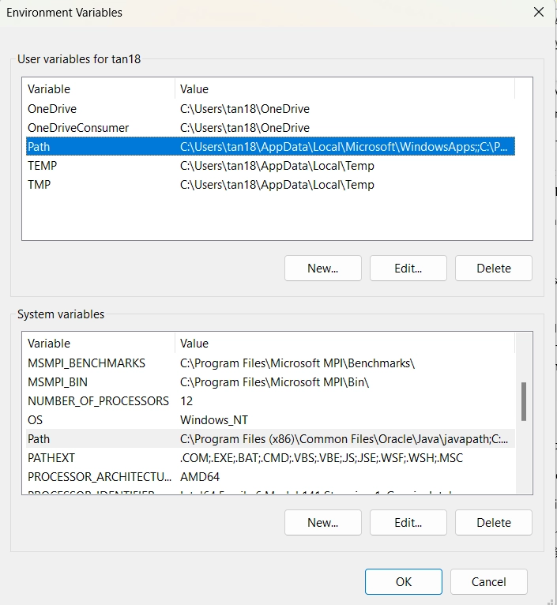
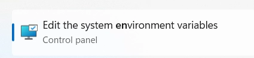

# SETUP ENVIRONMENT

> Tác giả: Ben Trần · Nhóm: Introduction
> Nguồn: [SETUP ENVIRONMENT](https://bentran1vn.notion.site/SETUP-ENVIRONMENT-57d2e34409984561b73e7d1906d92d5e) · Bản lưu: 27/10/2026

[Mục lục](../README.md)

## **Mục Lục**:

- [Làm sao để biết mình đã cài JDK ?](<03-setup-environment.md#93f8e93cdb6742e79c15b197c2519550>)

- [Biến là gì ?](<03-setup-environment.md#57f16b00acb141898fd1ebbb801696a9>)

- [Biến môi trường là gì ?](<03-setup-environment.md#304809a4a77a4a2883fee6761e3f295f>)

#### LÀM SAO ĐỂ BIẾT MÌNH ĐÃ CÀI JDK ?

- Máy tính có nhiều app khác nhau, mỗi máy tính tính có 1 hệ điều hành khác nhau. Ví dụ như app Word bình thường nó sẽ đứng 1 mình, Notepad, FoxiReaded là những app đọc file pdf. Trong 1 vài trường hợp có nhiều app cần nhiều dữ liệu từ những nơi khác nhau, NetBean, TomCat, Intellinat những app này dùng để chạy app Java thì cần JDK. Mà JDK lại đứng riêng 1 mình. Vậy làm sao để biết mình đã cài JDK

- JDK nó là nền tảng cho người khác chạy, của hệ điều hành, nơi cho mọi người cùng chơi.

- Để các App giao tiếp, nói chuyện với nhau, thì MSOFT mới nghĩ ra 1 trò tạo vùng RAM để chứa BIẾN MÔI TRƯỜNG. Mấy thằng Java mới xin tạo ra thằng biến môi trường JDK tên JAVA\_HOME = C:\\ProgramFile\\Java\\JDK18

- Mỗi người có quyền cài JDK khắp mọi nơi. Thằng Intellinet nó muốn hoạt động thì nó cần hỏi hệ điều hành cho xin thằng JDK, nó xin cái biến môi trường JAVA\_HOME ⇒ Biến này nó chứa địa chỉ JDK

#### BIẾN

- Biến là 1 tên gọi đại diện cho 1 giá trị. Giá trị này có thể thay đổi

#### BIẾN MÔI TRƯỜNG

- Mỗi Hệ điều hành có 1 vùng Ram, Ram này nó chứa biến môi trường

- Khi gõ npm và node mà tại sao vẫn chạy, mỗi thằng cài ở 1 ổ đĩa, ở 1 đường dẫn khác nhau thì tại sao nó vẫn tìm ra được

- Khi gõ trong môi trường CMD. Enter 1 cái, Win nó sẽ chụp được cái dòng này, nó biết là Enter từ cmd. Window nó sẽ chơi như sau
    - Window phải đi tìm những thằng này cài ở đâu
    
    - Khi vừa cài Window thì có 1 biến môi trường tên là PATH
    
    - Và nó đi kiểm tra đường dẫn cài Node vào đây
    
    - Bộ cài đặt của Npm và NodeJS sẽ tự động cài vào PATH

- Tại sao có 2 loại PATH
    - PATH ở tên là PATH dành cho mỗi USER LOGIN vào máy mình
    
    - PATH ở dưới là PATH dành cho tất cả các USER

- Dotnet.exe nó làm được nhiều trò lắm
    - Vào thanh Search gõ Cmd. Không ở Thư mục dotNET gõ dotNET vào cmd thì OS nó sẽ làm gì
    
    - Nó sẽ mò vô ENV kiếm PATH
    
    
    
    - Zô PATH kiếm, nếu có thì mở ra Version, không có thì trả ra lỗi

#### GIỚI THIỆU VỀ MÔI TRƯỜNG ĐỂ CHẠY DOTNET

- Bản chất dotNet phải có môi trường để chạy. Mình cài đồ chơi, cài giống kiểu JDK

- Trong Java có JDK thì .NET có SDK
    - Là nơi chứa toàn bộ máy ảo, chứa các thư viện để app chạy
    
    - Bên Java thư viện . jar, còn bên dotNet . dll

#### BẮT ĐẦU ZÔ CHƠI DOT NET THẬT SỰ

- Tạo 1 Dự án dotNET
