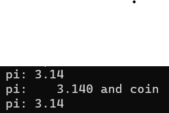

# C# DATATYPE

> Tác giả: Ben Trần · Nhóm: Introduction
> Nguồn: [C# DATATYPE](https://bentran1vn.notion.site/C-DATATYPE-0de4827b1a0a4bdca88aae1f01921037) · Bản lưu: 27/10/2026

[Mục lục](../README.md)

## IV. KIỂU DỮ LIỆU - DATATYPE ( GIỐNG VÀ KHÁC JAVA )

1. **Phân loại theo cách HÀNG GỐC và HÀNG ĐỘ ( Pre-defined, User-defined )**

| JAVA | C# |
| --- | --- |
| Byte, Short, Int, Long, Float, Char, Boolean, Double (Đây là kiểu dữ liệu đơn trị ) (Khai báo trong Ram như thế nào lưu y chang ) | Byte, Short, Int, Long, Float, Char, Boolean, Double, ( Đặc biệt String, Object ) |
| Đối với Java String, Object nó là Wrapper Class | Đối với C# String, Object nó là Primitive, Hàng gốc, những kiểu Data có sẵn, từ đó giúp ta tạo ra các kiểu phức tạp hơn – Gọi là User-Defined: class, interface, struct, enum, delegate |

> TÓM TẮT: STRING, OBJECT trong JAVA nó là 1 thứ gì đó ghê gớm. Trong C# thì nó rất bình thường.

2. **Phân loại theo cách lưu trữ trong RAM**

#### Java chia làm 2 loại Datatype

| Primitive | Object |
| --- | --- |
| Byte, Short,  Int, Long, Float, Char, Boolean, Double | Object, vô số các class khác… |

#### C# chia làm 2 loại Datatype

| Value-Type | Refference |
| --- | --- |
| Byte, Short, Int, Long, Float, Char, Boolean, Double | String, Object và còn vô số các Class có sẵn và do ta tạo ra |

#### Biến VALUE-TYPE ( JAVA CHÍNH LÀ PRIMITVE, primitive của JAVA thì bé hơn nhiều so với Value-type của C# )

- Chỉ dùng 1 vùng Ram để lưu giá trị, vùng Ram này bao nhiêu Byte Tùy thuộc vào Datatype

- Ví dụ: Byte : 1 Byte
    - Short : 2 byte
    
    - Int : 4 byte
    
    - Float : 4 byte
    
    - Long : 8 byte
    
    - Double : 8 Byte
    
    - Char : 2byte (unicode )

#### BIẾN REFERECENCE – TYPE ( JAVA THÌ GỌI LÀ OBJECT TYPE ) THÌ TỐN ĐẾN 2 VÙNG RAM

- 1 Vùng cho biến Object/ Biến con trỏ
    - TRỎ VÙNG NEW NẰM TRÊN HEAP CHỨA FULL INFOR CỦA OBJECT

## CÁC KIỂU IN RA MÀN HÌNH TRONG C#

#### KHỞI TẠO 2 GIÁ TRỊ a VÀ b

```
int a = 10;
int b = 3;
```

- **KIỂU TRUYỀN THỐNG**

```
Console.WriteLine("Dit me may " + a);
Console.WriteLine("Dit me may " + b); //truyền thống
```

- **KIỂU HIỆN ĐẠI - PLACEHOLDER**

```
Console.WriteLine("Dit me may {0} ", a);//PlaceHolder
Console.WriteLine("Dit me may {0} ", b); //mordern
Console.WriteLine("Dit me may {0}, {1} ", a, b);
```

- **KIỂU NỘI SUY - INTEPOLATION**

```
Console.WriteLine($"a Dit me may {a} {b}");//Intepolation
```

## KHAI BÁO

BIẾN MÀ NGẦM ĐỊNH KIỂU DỮ LIỆU - IMPLICIT ( var )

- Như vậy kiểu dữ liệu sẽ ngầm được xác định khi ta gán value cho biến

- Bắt buộc phải gán vào lúc khai báo

```
var c = 69;
Console.WriteLine($"c has value of {c}");
```

## **KIỂU DỮ LIỆU TRONG C#**

- Kiểu dữ liệu của số nguyên là gì

```
Console.WriteLine("The datatype of a varibale is " + a.GetType().ToString());//System.Int32
Console.WriteLine("The datatype of c varibale is " + c.GetType().ToString());//System.Int32
```

#### KIỂU DỮ LIỆU CƠ BẢN CỦA C# thì nó cũng hơi hơi giống C, Java

- **LONG để dài quá thì nên cắt ra cho dễ nhìn**

```
long d = 3000000000;//Khi như v khó nhìn quá
long e = 3_000_000_000;
```

- **CHƠI VỚI HỆ 16**

```
int f = 0xFA;
```

#### MẶC ĐỊNH TRONG C#, SỐ THỰC SẼ LÀ DOUBLE

- Có nghĩa là khi gõ 1 con số nguyên nào đó ra nó sẽ biến thành double và xài float phải ép kiểu về

```
float pi = 3.14;//Như vầy là bị lỗi liền nè
```

⇒ Để vậy thì bị lỗi phải thêm chữ F vào

```
float pi = 3.14F;
```

- Số Pi mặc định là double
    - Nên không cần đổi về Float và thêm F ở đuôi

```
double piNew = 3.14;
```

#### CONST TRONG C#

```
const double vat = 0.08;
//vat = 0.1, không đổi được giá trị của hằng số
```

#### CĂN LỀ TRONG KHI IN

```
Console.WriteLine("pi: " + pi);
Console.WriteLine($"pi: {pi, 8:N3} and coin");//8 là căn lề, 3 là lấy 3 chữ số
Console.WriteLine("pi: {0}", pi);
```

KẾT QUẢ



## FUNCTION

- Static thì chỉ chơi với static

#### PASS BY VALUE

```
static void PassByValue(int n)
{
//biến đổi n, bên ngoài đưa vào mấy không care, ta sửa
Console.WriteLine("In function PassByValue, before morifying n/parameter = " + n);
n = 5;//5 tỏi
Console.WriteLine("In function PassByValue, after morifying n/parameter = " + n);
}
```

- Hàm nhận vào 1 con số nguyên, tạm gọi tên là n

- Viết kiểu này gọi là truyền tham trị !!! Y Chang Bên C, Java

- n sẽ hứng value từ 1 biến khác ở nơi gọi cái hàm này

- Ai gọi hàm này thì phải truyền 1 value cho hàm, value thường nằm trong biến nào đó

```
static void Main(string[] args)
{
    Console.WriteLine("hello, world!");
int sum = Sum(100);//5050
    Console.WriteLine("sum form 1 to 100: " + sum);//5050
    Console.WriteLine("sum form 1 to 100: " + Sum(100));//5050
    Console.WriteLine($"sum form 1 to 100: {Sum(100)}");//5050
int n = 69;
    Console.WriteLine("in main, before calling f(), n = " + n);//69
    Console.WriteLine(n);
    Console.WriteLine("in main, after calling f(), n = " + n);//69
}
```

⇒ KHÔNG THAY ĐỔI GIÁ TRỊ ĐỐI SỐ TRUYỀN VÀO Ở BÊN NGOÀI

## ĐIỂM KHÁC BIỆT CỦA C#

- C# nó cung cấp thêm 2 món lạ liên quan đến tham số của hàm !

- Đó là **out** và **ref**

- Kiểu như truyền tham số là 1 con trỏ

- 2 cái này giúp cho việc mở rộng việc trả về của 1 hàm

## PASS BY REFERENCE

#### Xài ref là kiểu gà rồi

- Nó giống như là con trỏ trong C

- Thay đổi ở ngoài thì bên trong cũng thay đổi và ngược lại

- Khi chơi với biến ref bắt buộc phải có cái biến trước khi truyền vào (Phải có giá trị mặc định)

- Muốn chơi với ref, biến nơi gọi phải có sẵn 1 value nào đó

- Là hồi hàm sửa sau

- Nhưng hàm không có quyền thêm sửa ( Ref thôi mà )

```
static void PassByReference(ref int n)
{
//bề ngoài ơi, nơi gọi tôi ơi, hãy đưa cho tôi nơi bạn muốn tới
//bắn canon tới
//trong này sửa, ngoài kia toang, đứng ở đây bùm ở nơi gọi !!!
n = 5;
}
```

### Xài out

- Khi chơi với out là bắt buộc bên trong phải sửa lại tham số

- Chơi với out, trong hàm bắt buộc phải có lệnh sửa value của biến out

- TAO HỨA SẼ OUT 1 CÁI GÌ ĐÓ

```
static void PassByReferenceV2(out int n)
{
n = 60;
Console.WriteLine(n);
}
```

Kết quả

```
static void Main(string[] args)// svm: call main shorthand
{
int n = 3979;
Console.WriteLine("in main, before calling f(), n = " + n);//3979
PassByReferenceV2(out n);//60
Console.WriteLine("in main, after calling f(), n = " + n);//60
}
```

#### TÀ THUẬT CỦA OUT

- Thử viết 1 hàm tính tổng các số từ 1…n, Cấm dùng Return mà vẫn trả về giá trị

```
static void Sum(int n, out int sum)
{
	sum = 0;
for (int i = 0; i <= n; i++)
{
		sum += i;
}
}
```

- out nó không quan tâm truyền như nào nó chỉ quan tâm sửa bên trong thôi

```
static void Main(string[] args)
{
PassByReferenceV2(out int n); // VÃI KIỂU KHAI BÁO NÀY //Inline Declaration
Console.WriteLine("after calling f(), n = " + n);//60
Sum(100, out int sum);
Console.WriteLine("after calling f(), n = " + sum);//NHẬN KẾT QUẢ TRẢ VỀ NGAY TRÊN THAM SÔ//5050
}
```
