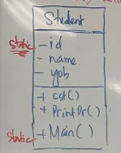
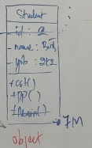
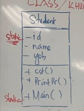
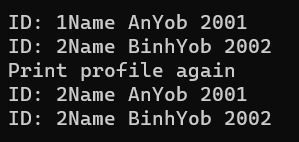

# CLASS - STATIC

> Tác giả: Ben Trần · Nhóm: OOP
> Nguồn: [CLASS - STATIC](https://bentran1vn.notion.site/CLASS-STATIC-7ad51b9636b84d7f9550fc96b4951e80) · Bản lưu: 27/10/2026

[Mục lục](../README.md)

## Class trong C#

#### Giống Java và các ngôn ngữ OOP khác

- Tên Class : Noun, Pascal Case

- Chứa bên trong các đặc tính/ trạng thái/ mô tả/ state
    - Còn gọi là instance variable, backed-field, data field
    
    - Ví dụ:
        - private int yob;
        
        - private string name;

- Nếu không có “private” mặc định hiểu là private

- Chứa bên trong các hành vi behavior, method, function

- Có thể là public, private, mặc định không nói gì là private

## XÉT RIÊNG CHO ĐẶC TÍNH

### **CÓ 3 KĨ THUẬT SỬ DỤNG ĐẶC TÍNH CỦA CLASS**

1. **KĨ THUẬT TRUYỀN THỐNG GIỐNG JAVA**
    ```
    private string _name
    
    //public string GetName( ) { return _name; }
    //hoặc dùng expression body
    public string GetName( ) ⇒ _name
    	
    //public string SetName( String name ) {  _name = name }
    //hoặc dùng expression body
    public string SetName( ) ⇒ _name = name
    ```

2. **KĨ THUẬT TRUYỀN THỐNG GIỐNG JAVA NHƯNG GETTER/SETTER SỬ DỤNG KĨ THUẬT MỚI PROPERTY VẪN DÙNG BACKED FIELD**
    ```
    private String _name
    
    public StringName
    {
    get { return _yob; },
    set { _yob = value; }
    }
    ```
    
    dùng expression body
    
    ```
    private String _name
    
    public String Name
    {
    get => _yob;
    set => _yob = value;
    }
    ```

3. **KĨ THUẬT ẨN ĐI CÁI BACKED FIELD LUÔN**

```
public String Name
{
get;set;
}
```

- Thực tế kĩ thuật này lúc mà runtime dotNET tự add thêm ngầm phía sau như cách 2

> **KĨ THUẬT PROPERTY GIÚP NHÌN OBJECT TỰ NHIÊN HƠN SO VỚI JAVA**
> 
> Java:
> 
> - hoang.getName( )
>     - Lấy được tên in đâu đó nếu muốn - gọi Get( ) trực tiếp
> 
> - hoang.setname( “ Hoàng Ngọc Trinh “ )
> 
> C#
> 
> - hoang.Name;
>     - Lấy được tên in đâu đó nếu muốn - gọi Get Ngầm
> 
> - [hoang.Name](<http://hoang.name/>) = “Hoang Ngoc Trinh”
>     - Tự hiên hơn, gán tên mới vào đặc tính Name

## **NEW AN OBJECT**

#### **1 Class có thể không tạo contructor, khi đó, bạn vẫn new bình thường**

- new tên-Class () ; Khi runtime dotNet sẽ tự tạo sẵn cho bạn 1 Constructor default, rỗng, không tham số đầu vào
    - Ví dụ:
        - Student x = new Student( );
        
        - Student y = new ( );
            - Bỏ luôn cả Student do đã biết trước đó y là Student

#### **VÀ NẾU CLASS ĐỊNH NGHĨA SẴN CÁC PROPERTY, THÌ TA CÓ QUYỀN VỪA NEW VỪA GÁN PROPERTY THEO 2 KĨ THUẬT NHƯ SAU**

- TRUYỀN THỐNG ( JAVA )

```
Student x = new ( )

x.Id = 1;

x.Name = “ Hoàng Ngọc Trinh “;

x.Yob = 2003;
```

- CÁCH ĐẸP TRAI ( C# )

```
Student x = new( ) {Id = 1, Name = “ HoangNT”, Yob = 2003};
Student y = new Student( ) {Id = 1, Name = “ HoangNT”, Yob = 2003};
Student y = new Student{Id = 1, Name = “ HoangNT”, Yob = 2003};
```

⇒ ĐẰNG SAU TOÁN TỬ NEW LÀ LIỆT KÊ CÁC PROPERTY CẦN GÁN VALUE = VALUE NHÉT TẤT CẢ TRONG ĐẤU NGOẶC NHỌN

> 3 LỆNH TRÊN LÀ NEW QUA CONSTRUCTOR RỖNG ( ), NGOẶC NHỌN BÊN NGOÀI LÀ DANH CÁC GETTER, SETTER, PROTERTY ĐƯỢC GỌI ĐỂ GÁN VALUE, VỪA KHAI BÁO VỪA VÁN VALUE CHO SETTER

### **CONSTRUCTOR RỖNG VÀ CONSTRUCTOR CÓ THAM SỐ**

- KHI 1 CLASS MÀ BẠN CHỦ ĐỘNG TẠO CONSTRUCTOR RỖNG THÌ DĨ NHIÊN C# KHÔNG TỰ TẠO THÊM CONSTRUCTOR DEFAULT ( 2 THẰNG TRÙNG TÊN NHAU LÀ VỚ VẤN)

- KHI BẠN TẠO THÊM CÁC CONSTRUCTOR KHÁC ( CÓ THAM SỐ ) THÌ .NET KHÔNG TỰ TẠO THÊM CONSTRUCTOR RỖNG/DEFAULT CHO BẠN

- NẾU KHÔNG TẠO RỖNG BẰNG TAY, MÀ TỰ TẠO CONSTRUCTOR KHÁC ( CÓ THAM SỐ ) THÌ .NET KHÔNG THÈM TẠO THÊM RỖNG CHO BẠN, TRỪ KHI TA CHỦ ĐỘNG TẠO

### **KHI NEW THÌ TA CŨNG CÓ NHIỀU CÁC NEW**

- new Student( tham số đầu vào cách nhau dấu phẩy 5, “HoangNT”, 2003)

- new “ tham số đầu vào”s

- new ( tham số đầu vào như ở trên, cú pháp là tên tham số : value //Name Argument)

- KĨ THUẬT NÀY NAME ARGUMENT cũng được áp dụng cho các hàm bình thường khi Đọc được Gọi

- **NEW VỚI CONSTRUCTOR KHÔNG THAM SỐ**
    ```
    //constructor không tham số
    //và có thể gắn value cho các đặc tính
    //qua con đường set( )
    Student s1 = new Student();
    Student s2 = new();
    Student s3 = new() { Id = 1 };
    Student s4 = new() { Id = 1, Name = "HoangNY" };
    Student s5 = new() { Id = 1, Description = "giao lang" };
    Student s6 = new() { Id = 1, Name = "HoangNY", Description = "giao lang" };
    Student s7 = new() { Description = "giao lang" };
    Student s8 = new Student { Id = 1, Name = "HoangNY", Description = "giao lang" };
    Student s9 = new Student() { Id = 1, Name = "HoangNY", Description = "giao lang" };
    ```

- **NEW VỚI CONTRUCTOR CÓ THAM SỐ**

```
//contructor có tham số
Student s10 = new Student(1, "HoangNT", "g.l");
Student s11 = new(1, "HoangNT", "g.l");
Student s12 = new(id: 1, name : "HoangNT", description : "g.l");
Student s13 = new Student(id: 1, name: "HoangNT", description: "g.l");
//name argument, đưa value cho hàm
//nhưng ghi luôn tham số cho đẹp, dễ theo dõi
```

## BÀN VỀ KĨ VỀ STATIC

- Tạo 1 Class Student và khai báo Id property là Static
    ```
    internal class Student
    {
    public static int Id { get; set; }
    public string Name { get; set; } //instance property
    public int Yob { get; set; }
    public Student(int id, string name, int yob)
    {
            Id = id;
            Name = name;
            Yob = yob;
    }
    public Student()
    {
    }
    public void PrintProfile()
    {
            Console.WriteLine("ID: " + Id + "Name " + Name + "Yob " + Yob);
    }
    }
    ```
    
    
    
    - CÓ BIẾN CÓ VÙNG RAM
    
    - CÓ NEW CÓ VÙNG NHỚ HEAP
    
    s1 và s2 chứa thông tin địa chỉ tên tuổi ngày tháng thông tin
    
    - Nhiều quá chứa không nổi mới mang lên vùng nhớ HEAP để chứa
    
    Trong vùng nhớ HEAP có 1 vùng RAM tên là Student
    
    - Có NEW là có vùng RAM
    
    - New có nghĩ là sinh vùng RAM
    
    - Nó clone toàn bộ thông tin sang vùng nhớ
    
    
    
    CLONE QUA ⇒
    
    
    
    - Sau đó gọi constructor đổ value vào
    
    ⇒ Bây giờ những thằng này gọi là vùng RAM chứa value
    
    

- 2 GB là 2 tỷ byte

- Vùng NEW sinh viên phải nằm đầu đó trong vùng ram

- Khi mà vừa NEW 1 cái thì sẽ lưu lại cái địa chỉ

- s1 s2 là lưu địa chỉ của vùng nhớ RAM trong HEAP

- Nếu mà gõ s1.name thì tới vùng 8M xem xem có thg name nào không và nó bung ra giá trị
    - Dấu chấm là đi vào vùng đó và xem có cái gì ⇒ Cái này gọi là Reference

- Thằng này được gọi là Object . Đôi khi Object còn được gọi là Instance
    

- Thằng này được gọi là Class. 1 chữ rất hay gọi là BluePrint
    

- s1 và s2 gọi là Biến Object
    

- Quá trình tạo mới 1 đối tượng và đổ Constructor gọi là Instanciation. Hiện thân đi, hiển linh đi
    

#### BẮT ĐẦU CHƠI VỚI STATIC

- Static giống như thằng ngồi trên cao coi mấy thằng ở dưới đánh nhau

- Thằng nào là Static thì ra chiều khác ngồi, một vùng nhớ khác, một vùng riêng

→ Như v ID ngồi đây, Main Ngồi đây


Hàm main

```
static void Main(string[] args)
{
Student s1 = new(1, "An", 2001);
    s1.PrintProfile();
Student s2 = new(2, "Binh", 2002);
//Student s2 = new() { Id = 2, Name = "Binh", Yob = 2002};

    s2.PrintProfile();
    Console.WriteLine("Print profile again");

    s1.PrintProfile();
    s2.PrintProfile();

    Console.WriteLine(Id);//Lozz này ở static 
    Console.WriteLine(Name);//Lozz này nó ko ở static nên ko gọi tự nhiên đc như v
}
```

Kết quả



> Giải thích : Tại 1 thời điểm 1 biến ID trong static chỉ lưu được 1 giá trị thoi nên là ID của s1 sẽ bị thay đổi theo

[IMG_8753.mov 1085835.7KB](https://bentran1vn.notion.site/CLASS-STATIC-7ad51b9636b84d7f9550fc96b4951e80#4591b96c86904ef18ee90f83275c3be0) — tệp tại nguồn, chưa tải video.
