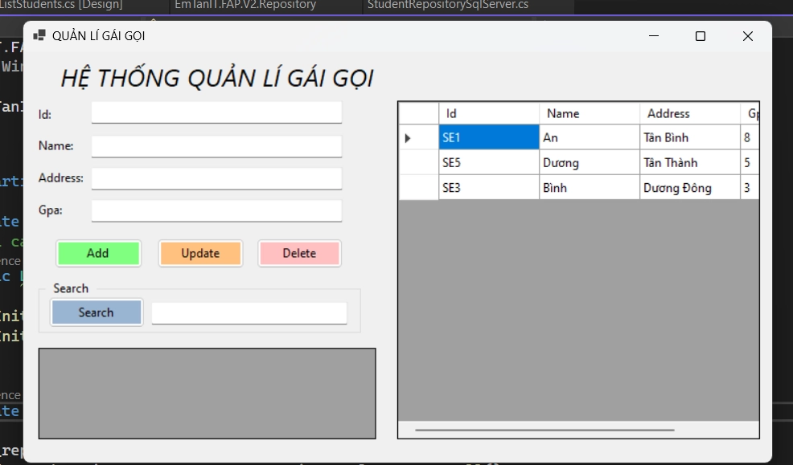

# GUI - 02

> Tác giả: Ben Trần · Nhóm: GUI
> Nguồn: [GUI - 02](https://bentran1vn.notion.site/GUI-02-925995df96c74e1a9e8a2b681d7594f6) · Bản lưu: 27/10/2026

[Mục lục](../README.md)

## Cách viết code hiện nay gọi là style All – IN – ONE,

#### 1 project của 1 solution,

- Toàn Bộ FORM – UI

- TRONG FORM CHỨA CODE XỬ LÍ SỰ KIỆN

- TRONG FORM CHỨA LUÔN CẢ CODE LIÊN QUAN ĐẾN DATA

- 1 PROJECT 1 FORM CHỨA VỪA DESIGN & CODE EVENT & CODE DATA

⇒ NẾU TA CẦN DATA KHÔNG PHẢI TỪ RAM NHƯ HIỆN NAY ( NEW LIST ) MÀ LÀ TỪ DATABASE SQLSERVER, CODE SẼ NÊN SỬA NHƯ THẾ NÀO ??? ALL-IN-ONE CÒN ĐỦ TỐT

⇒ KO TỐT VÌ CODE EVENT TRỘN VỚI CODE XỬ LÍ DATA

( NGHIỆP VỤ KHÁCH HÀNG: KHÔNG MƯỢN QUÁ 5 CUỐN, TÍNH GIẢM GIÁ ), KHÔNG TỐT VỀ FIX VỚI SQLSERVER

DATA KHÔNG TỪ SQLSERVER, MÀ TỪ MYSQL, HOẶC … CODE PHẢI COPY/ PASTE SANG DỰ ÁN KHÁC, SỬA

DÂN DEV GẶP NHIỀU ÁC MỘNG, TRONG ĐÓ CÓ ÁC MỘNG MAINTAIN 2 APP ĐỒNG THỜI, SQLSERVER, MYSQL UI THÌ GIỐNG, DB THÌ KHÁC, CÂU LỆNH SELECT KHÁC.

#### VẬY NÊN

- TÁCH UI (FORM VÀ EVENT) RA RIÊNG

- XỬ LÍ DATA RA 1 CHỖ RIÊNG -\> THAY THOẢI MÁI PHẦN NÀY THÔI



## Repository

Initialization

Student.cs

```
public class Student
{
public string Id { get; set; }
public string Name { get; set; }
public string Address { get; set; }
public double Gpa { get; set; }
}
```

## Repository Nó Làm Gì ?

- Class này là nguồn Data Cho Các UI FORM

- Nó chịu trách nhiệm lấy data từ CSDL mang lên

- Chứa các lệnh móc vào CSDL, lấy data vào cho form

- Nó chứa các hàm như
    - GetAll
    
    - Add
    
    - Update
    
    - Delete
    
    - Search ( Project )

```
public class StudentRepositorySqlServer
{
private List<Student> _ds = new List<Student>()
{
new Student() {Id = "SE1", Name = "An", Address = "Tân Bình", Gpa = 8.0},
new Student() {Id = "SE5", Name = "Dương", Address = "Tân Thành", Gpa = 5.0},
new Student() {Id = "SE3", Name = "Bình", Address = "Dương Đông", Gpa = 3.0},
};
/// <summary>
/// Hàm trả về danh sách sinh viên
/// </summary>
/// <returns></returns>
public List<Student> GetAll()
{
//đọc DB select * from Student ấy
return _ds;
}
/// <summary>
/// Hàm nhận vào một sinh viên là lưu vào cơ sở dữ liệu
/// </summary>
/// <param name="x"></param>
public bool Add(Student x)
{
bool check = true;
var existingStudent = _ds.FirstOrDefault(xxx => xxx.Id == x.Id);
if (existingStudent != null)
{
            _ds.Add(x);
            check = false;
}
return check;
}
public bool Update(Student x)
{
bool check = false;
//LINQ quay trở lại, tìm sv, 1 sv, update info
var existingStudent = _ds.FirstOrDefault(xxx => xxx.Id == x.Id);
//Nếu tìm thấy thì trả ra, nếu không thì trả ra Null
//Không trả new Student()
//Trả về tham chiếu/ trỏ Student đã new từ trước
if(existingStudent != null)
{
            existingStudent.Name = x.Name;
            existingStudent.Address = x.Address;
            existingStudent.Gpa = x.Gpa;
            check = true;
}
return check;
}
public bool Delete(Student x)
{
bool check = false;
var existingStudent = _ds.FirstOrDefault(xxx => xxx.Id==x.Id);
if(existingStudent != null)
{
            _ds.Remove(existingStudent);
            check = true;
}
return check;
}
public List<Student> Search(string keyword)
{
var result = _ds.Where(xxx => xxx.Name.ToLower().Contains(keyword.ToLower()) ||
                                                                xxx.Address.ToLower().Contains(keyword.ToLower())).ToList();
return result;
}
}
```

Tạo 1 form theo yêu cầu.

#### Để xài được cái Kho Ta Khai báo ở đầu Form ( Nhớ Add Dependecy bằng Project )

- Muốn vừa mở ra trong cái lưới có sẵn dữ liệu luôn. Tạo một cái hàm lấy dữ liệu và quăng vào Lưới

```
private void InitializeStudentRepository()
{
        _repositorySqlServer = new StudentRepositorySqlServer();
        dgvStudentList.DataSource = _repositorySqlServer.GetAll();
}
```

- Sau đó Bỏ nó vào Hàm Init Khi vừa mới mở cái Form ra !!!

```
public partial class ListStudents : Form
{
private StudentRepositorySqlServer _repositorySqlServer;
//xài cái kho dữ liệu lấy từ SQLServer
public ListStudents()
{
InitializeComponent();
InitializeStudentRepository();
}
private void InitializeStudentRepository()
{
        _repositorySqlServer = new StudentRepositorySqlServer();
        dgvStudentList.DataSource = _repositorySqlServer.GetAll();
}
}
```

- Viết Hàm Add Mới

Hàm này chỉ móc dữ liệu từ các Ô TextBox

Còn việc xử lý dữ liệu ra sao → Repository Lo !!!

```
private void AddNew(object sender, EventArgs e)
{
try
{
var id = txtId.Text;
if (txtId.Text == null || txtId.Text.Length == 0)
{
throw new Exception("Id can not be Empty!");
}
var name = txtName.Text;
if (txtName.Text == null || txtName.Text.Length == 0)
{
throw new Exception("Name can not be Empty!");
}
var add = txtAddress.Text;
if (txtAddress.Text == null || txtName.Text.Length == 0)
{
throw new Exception("Address can not be Empty!");
}
var gpa = double.Parse(txtGpa.Text);
bool result = _repositorySqlServer.Add(new Student() { Id = id, Name = name, Address = add, Gpa = gpa });
if (result)
{
            dgvStudentList.DataSource = null;
            dgvStudentList.DataSource = _repositorySqlServer.GetAll();
}
else
{
DialogResult mess = MessageBox.Show("A girl with ID: `" + txtId.Text + "` is Existed! Create New!",
"Khẩn Cấp, Khấn Cấp",
                MessageBoxButtons.YesNoCancel,
                MessageBoxIcon.Warning);
if(mess == DialogResult.Cancel)
{
this.Close();
}
}
}
catch (FormatException ex)
{
        MessageBox.Show("Gpa can not be a String!",
"Khẩn Cấp, Khấn Cấp",
            MessageBoxButtons.OK,
            MessageBoxIcon.Error);
}catch (Exception ex)
{
        MessageBox.Show(ex.Message,
"Khẩn Cấp, Khấn Cấp",
            MessageBoxButtons.OK,
            MessageBoxIcon.Error);
}
}
```

- Viết Hàm Update

```
private void UpdateStudent(object sender, EventArgs e)
{
try
{
var id = txtId.Text;
if (txtId.Text == null || txtId.Text.Length == 0)
{
throw new Exception("Id can not be Empty!");
}
var name = txtName.Text;
if (txtName.Text == null || txtName.Text.Length == 0)
{
throw new Exception("Name can not be Empty!");
}
var add = txtAddress.Text;
if (txtAddress.Text == null || txtName.Text.Length == 0)
{
throw new Exception("Address can not be Empty!");
}
var gpa = double.Parse(txtGpa.Text);
bool result = _repositorySqlServer.Update(new Student() { Id = id, Name = name, Address = add, Gpa = gpa });
if (result)
{
            dgvStudentList.DataSource = null;
            dgvStudentList.DataSource = _repositorySqlServer.GetAll();
DialogResult mess = MessageBox.Show("Update Success!");
}
else
{
DialogResult mess = MessageBox.Show("Can not Find!");
}
}
catch (FormatException ex)
{
        MessageBox.Show("Gpa can not be a String!",
"Khẩn Cấp, Khấn Cấp",
            MessageBoxButtons.OK,
            MessageBoxIcon.Error);
}
catch (Exception ex)
{
        MessageBox.Show(ex.Message,
"Khẩn Cấp, Khấn Cấp",
            MessageBoxButtons.OK,
            MessageBoxIcon.Error);
}
}
```

- Viết Hàm Delete

```
private void DeleteStudent(object sender, EventArgs e)
{
try
{
var id = txtId.Text;
if (txtId.Text == null || txtId.Text.Length == 0)
{
throw new Exception("Id can not be Empty!");
}
var name = txtName.Text;
if (txtName.Text == null || txtName.Text.Length == 0)
{
throw new Exception("Name can not be Empty!");
}
var add = txtAddress.Text;
if (txtAddress.Text == null || txtName.Text.Length == 0)
{
throw new Exception("Address can not be Empty!");
}
var gpa = double.Parse(txtGpa.Text);
bool result = _repositorySqlServer.Delete(new Student() { Id = id, Name = name, Address = add, Gpa = gpa });
if (result)
{
            dgvStudentList.DataSource = null;
            dgvStudentList.DataSource = _repositorySqlServer.GetAll();
DialogResult mess = MessageBox.Show("Update Success!");
}
else
{
DialogResult mess = MessageBox.Show("Can not Find!");
}
}
catch (FormatException ex)
{
        MessageBox.Show("Gpa can not be a String!",
"Khẩn Cấp, Khấn Cấp",
            MessageBoxButtons.OK,
            MessageBoxIcon.Error);
}
catch (Exception ex)
{
        MessageBox.Show(ex.Message,
"Khẩn Cấp, Khấn Cấp",
            MessageBoxButtons.OK,
            MessageBoxIcon.Error);
}
}
```

- Viết Hàm Search

```
private void SearchStudent(object sender, EventArgs e)
{
try
{
var key = txtKeyword.Text;
if (txtKeyword.Text == null || txtKeyword.Text.Length == 0)
{
throw new Exception("Key Word can not be Empty!");
}
var result = _repositorySqlServer.Search(key);
if (result != null)
{
            dgvResult.DataSource = result;
DialogResult mess = MessageBox.Show("Search Success!");
}
else
{
DialogResult mess = MessageBox.Show("Search Fail!");
}
}
catch (Exception ex)
{
        MessageBox.Show(ex.Message,
"Khẩn Cấp, Khấn Cấp",
            MessageBoxButtons.OK,
            MessageBoxIcon.Error);
}
}
```

- Viết Hàm sờ vào hiện thông tin

```
private void ViewAStudent(object sender, EventArgs e)
{
if(dgvStudentList.SelectedRows.Count > 0)
{
//count == 0 là header
DataGridViewRow row = dgvStudentList.SelectedRows[0];
        txtId.Text = row.Cells[0].Value.ToString();//1 Object nên phải kép kiểu
        txtName.Text = row.Cells[1].Value.ToString();
        txtAddress.Text = row.Cells[2].Value.ToString();
        txtGpa.Text = row.Cells[3].Value.ToString();
}
}
```
