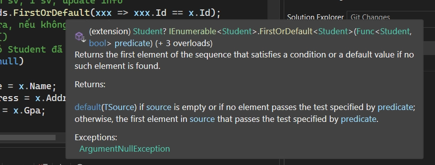
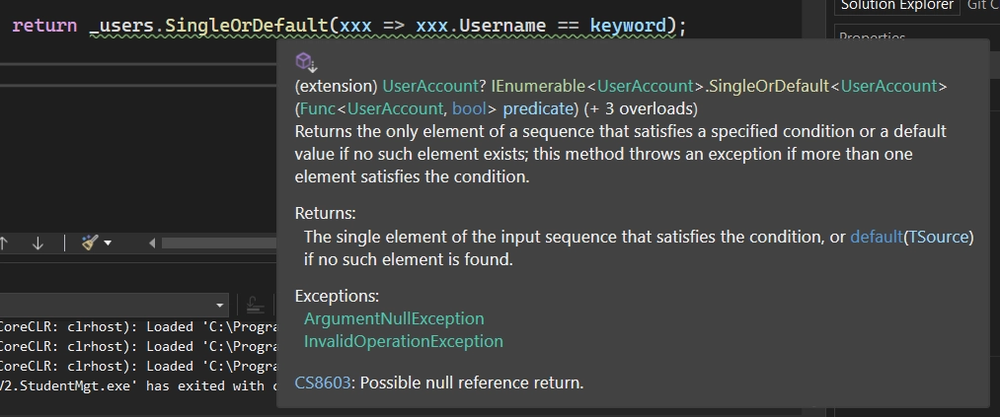

# GUI - 04

> Tác giả: Ben Trần · Nhóm: GUI
> Nguồn: [GUI - 04](https://bentran1vn.notion.site/GUI-04-b25b9f0001ee4323a6f12d759baecdd1) · Bản lưu: 27/10/2026

[Mục lục](../README.md)

### Áp dụng Three Layered Architecture

- Presentation Layer

- Business Layer

- DataAccess Layer

Khi xây dựng chúng ta sẽ xây dựng từ dưới lên DataAccess Layer → Business Layer → Presentation Layer

## Student Management Version 3

## [Data Access Layer](<27-three-layered-architecture.md#46588c0802064ec28f95d7a1c2656f2f>) ( Repository )

Vì ta thao tác với 2 Table nên phải tạo 2 Class thể hiện 2 thực thể: Student và User

Ininitialization

Student.cs

```
public class Student
{
    public string Id { get; set; }

    public string Name { get; set; }

    public string Address { get; set; }

    public double Gpa { get; set; }
}
```

UserAccount.cs

```
public class UserAccount
{
    public string Username { get; set; }

    public string Password { get; set; }

    public string Email { get; set; }
}
```

Ok tạo thêm ra Class xong rồi giờ làm gì tiếp. Để chứa được dữ liệu thì ta phải tạo ra những cái Kho để chứa chứ. → Repository

IStudentRepository

```
public interface IStudentRepository//CLB ĐƯA RA TIÊU CHÍ NÓI CHUNG
//ĐỂ ANH EM TỰ IMPLEMENT
{
    //định nghĩa, đặt ra cuộc chơi yêu cầu anh em nếu muốn chơi thì
//phải tuân thủ - tức là phải có những hàm đã khai báo ở đây
//phải viết code cho những hàm ở đây, ko care code như thế nào
//chỉ cần tuân thủ tên hàm
//CHỨA HÀM KO CODE - ABSTRACT METHOD
//INTEFACE VẪN CHO PHÉP HÀM CÓ CODE! NHƯNG...
public List<Student> GetAll();
public bool Add(Student student);
public bool Update(Student student);
public bool Delete(string id);
public List<Student> Search(string keyword);
}
```

IUserAccountRepository

```
public interface IUserAccountRepository
{
    //public List<UserAccount> GetAll();
//public void Add(UserAccount account);
//public void Update(UserAccount account);
//public void Delete(string username);
public UserAccount Search(string keyword);

}
```

#### Tại sao lại có IRepository, Tại sao lại là Interface, Tại sao lại mắc công như vậy. Tạo Class Viết Hàm luôn đi

- Interface: 1 Câu lạc bộ có các hành động, tiêu chí chung. Nhưng việc chơi như thế nào là của anh em ( MySQL, SQL, MongoDB, Redis ). Việc Truy Xuất như thế nào là của anh em Truy Xuất ( Cùng 1 hàm add, mỗi database lại có cách add khác nhau )

StudentRepositoryMySQL - Kho Student ở MySQL

```
public class SudentRepositoryMySQL : IStudentRepository
{
    private List<Student> _ds = new List<Student>()
    {
        new Student() {Id = "SE1", Name = "MySQl", Address = "RDBMS", Gpa = 8.0},
    };
//các hàm móc vào CSDL lấy data
//các hàm CRUD cung cấp cho UI
/// <summary>
/// Hàm trả về danh sách sinh viên
/// </summary>
/// <returns></returns>
public List<Student> GetAll()
    {
        //đọc DB select * from Student ấy
return _ds;
    }

    /// <summary>
/// Hàm nhận vào một sinh viên là lưu vào cơ sở dữ liệu
/// </summary>
/// <param name="x"></param>
public bool Add(Student x)
    {
        bool check = true;
        var existingStudent = _ds.FirstOrDefault(xxx => xxx.Id == x.Id);
if (existingStudent != null)
        {
            _ds.Add(x);
check = false;
        }
        return check;

    }
    public bool Update(Student x)
    {
        bool check = false;
//LINQ quay trở lại, tìm sv, 1 sv, update info
        var existingStudent = _ds.FirstOrDefault(xxx => xxx.Id == x.Id);
//Nếu tìm thấy thì trả ra, nếu không thì trả ra Null
//Không trả new Student()
//Trả về tham chiếu/ trỏ Student đã new từ trước
if (existingStudent != null)
        {
            existingStudent.Name = x.Name;
            existingStudent.Address = x.Address;
            existingStudent.Gpa = x.Gpa;
check = true;
        }
        return check;

    }
    public bool Delete(string id)
    {
        bool check = false;
        var existingStudent = _ds.FirstOrDefault(xxx => xxx.Id == id);
if (existingStudent != null)
        {
            _ds.Remove(existingStudent);
check = true;
        }
        return check;
    }

    public List<Student> Search(string keyword)
    {
        var result = _ds.Where(xxx => xxx.Name.ToLower().Contains(keyword.ToLower()) ||
                                                                xxx.Address.ToLower().Contains(keyword.ToLower())).ToList();
return result;
    }
}
```

#### LINQ - FirstOrDefault



```
var existingStudent = _ds.FirstOrDefault(xxx => xxx.Id == x.Id);
```

- Nếu tìm thấy thì trả ra, nếu không thì trả ra Null

- Không trả new Student()

- Trả về tham chiếu/ trỏ Student đã new từ trước

StudentRepositorySqlServer- Kho Student ở SqlServer

```
public class StudentRepositorySqlServer : IStudentRepository
{
    private List<Student> _ds = new List<Student>()
    {
        new Student() {Id = "SE1", Name = "SQLServer", Address = "MS", Gpa = 8.0},
        new Student() {Id = "SE5", Name = "Dương", Address = "Tân Thành", Gpa = 5.0},
        new Student() {Id = "SE3", Name = "Bình", Address = "Dương Đông", Gpa = 3.0},
    };
//các hàm móc vào CSDL lấy data
//các hàm CRUD cung cấp cho UI
/// <summary>
/// Hàm trả về danh sách sinh viên
/// </summary>
/// <returns></returns>
public List<Student> GetAll()
    {
        //đọc DB select * from Student ấy
return _ds;
    }

    /// <summary>
/// Hàm nhận vào một sinh viên là lưu vào cơ sở dữ liệu
/// </summary>
/// <param name="x"></param>
public bool Add(Student x)
    {
        bool check = true;
        var existingStudent = _ds.FirstOrDefault(xxx => xxx.Id == x.Id);
if (existingStudent != null)
        {
            _ds.Add(x);
check = false;
        }
        return check;
        
    }
    public bool Update(Student x)
    {
        bool check = false;
//LINQ quay trở lại, tìm sv, 1 sv, update info
        var existingStudent = _ds.FirstOrDefault(xxx => xxx.Id == x.Id);
//Nếu tìm thấy thì trả ra, nếu không thì trả ra Null
//Không trả new Student()
//Trả về tham chiếu/ trỏ Student đã new từ trước
if(existingStudent != null)
        {
            existingStudent.Name = x.Name;
            existingStudent.Address = x.Address;
            existingStudent.Gpa = x.Gpa;
check = true;
        }
        return check;

    }
    public bool Delete(string id)
    {
        bool check = false;
        var existingStudent = _ds.FirstOrDefault(xxx => xxx.Id == id);
if(existingStudent != null)
        {
            _ds.Remove(existingStudent);
check = true;
        }
        return check;
    }

    public List<Student> Search(string keyword)
    {
        var result = _ds.Where(xxx => xxx.Name.ToLower().Contains(keyword.ToLower()) ||
                                                                xxx.Address.ToLower().Contains(keyword.ToLower())).ToList();
return result;
    }
}
```

UserAccountRepositoryMySQL - Kho của User ở MySQL

```
public class UserAccountRepositoryMySQL : IUserAccountRepository
{
    List<UserAccount> _users = new List<UserAccount>() 
    {
        new UserAccount() { Username = "hoang", Password = "ngoctrinh", Email = ""},
        new UserAccount() { Username = "jack", Password = "5to?i", Email = ""},
    };
public UserAccount Search(string keyword)
    {
        return _users.SingleOrDefault(xxx => xxx.Username == keyword);
    }
}
```

#### LINQ - SingleOrDefault



### Different SingleOrDefault and FirstOrDefault

If your result set returns 0 records:

- `SingleOrDefault` returns the default value for the type (e.g. default for int is 0)

- `FirstOrDefault` returns the default value for the type

If you result set returns 1 record:

- `SingleOrDefault` returns that record

- `FirstOrDefault` returns that record

If your result set returns many records:

- `SingleOrDefault` throws an exception

- `FirstOrDefault` returns the first record

Conclusion:

If you want an exception to be thrown if the result set contains many records, use `SingleOrDefault`.

If you always want 1 record no matter what the result set contains, use `FirstOrDefault`

## [Bussiness Layer](<27-three-layered-architecture.md#bcb5f71b68bc4d558d86bae3d36c773e>) ( Service ) ( Input là ở UI, Output là ở DL )

UserAccountService.cs

```
public class UserAccountService
{
    private IUserAccountRepository _userRepo = new UserAccountRepositoryMySQL();
public bool CheckLogin(string username, string password)
    {
        UserAccount userAccount = _userRepo.Search(username);
if (userAccount == null || userAccount.Password != password)
        {
            return false;
        }
        return true;
    }
}
```

Bussiness Layer sẽ sử lí logic, dữ liệu lấy ở Data Access Layer

Muốn lấy 1 dữ liệu từ MySQL:

```
private IUserAccountRepository _userRepo = new UserAccountRepositoryMySQL();
```

Muốn lấy 1 dữ liệu từ SQLServer:

```
private IUserAccountRepository _userRepo = new UserAccountRepositorySQLServer();
```

## Presentation Layer ( GUI )

Service có sẵn rồi, giờ người dùng tương tác với nút bấm nào, ô nhập vào mặc kệ không cần quan tâm sử lý sao.Tao thu nhặt thông tin người dùng → Quăng về Business Layer - Service Lo !!!

Login.cs - Form Login

```
public partial class Login : Form
{
    //private IUserAccountRepository _acc;
    private UserAccountService service = new UserAccountService();
public Login()
    {
        InitializeComponent();
//khởi động để đọc bảng User từ MySQL
//_acc = new UserAccountService();
//Ta có dữ liệu từ MySQL database
    }

    private void Authenticate(object sender, EventArgs e)
    {
        bool result = service.CheckLogin(txtUsername.Text, txtPassword.Text);
if (result)
        {
            ListStudents mainForm = new ListStudents();
            mainForm.Show();
//this.Close();//giết luôn cái app
            this.Hide();//vẫn còn chạy ẳn trong RAM
        }
        else
        {
            MessageBox.Show("Invalid Account !!!",
"Wrong !!!",
                    MessageBoxButtons.OK,
                    MessageBoxIcon.Error);
        }
    }
}
```

#### Muốn xài các Service liên quan tới User. Khai báo, new mới 1 Service

```
private UserAccountService service = new UserAccountService();
```

#### Để mở một cái form mới: Tạo đối tượng → Form.Show ( )

```
ListStudents mainForm = new ListStudents();
mainForm.Show();
```

#### Close là giết luôn App, Hide là cho chạy ngầm á nha

```
//this.Close();//giết luôn cái app
this.Hide();//vẫn còn chạy ẳn trong RAM
```
