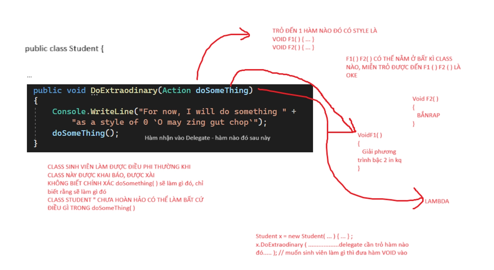

# APPLICATION OF DELEGATE

> Tác giả: Ben Trần · Nhóm: OOP - EXTEND
> Nguồn: [APPLICATION OF DELEGATE](https://bentran1vn.notion.site/APPLICATION-OF-DELEGATE-96d3f0a975de4e6fb18b66b4cb37b3dd) · Bản lưu: 27/10/2026

[Mục lục](README.md)

## TỔNG KẾT NHANH VỀ DATA TYPE

### DATA TYPE LÀ GÌ? - KIỂU DỮ LIỆU LÀ GÌ?

- Là cách ta/máy tính biểu diễn, thể hiện ra các thông tin quanh cuộc sống chúng ta, và cách chúng được lưu trữ trong RAM

#### C# cung cấp nhiều loại dữ liệu khác nhau, tùy vào ý nghĩa, mục đích, đặc trưng của loại kiểu dữ liệu đó

- Xét theo tiêu chí biểu diễn thông tin ra bên ngoài cho ta nhìn thấy ta có các kiểu số liệu sau:
    - Số: Số nguyên, số thực, số nhìn dạng nhị phân ( BINARY ), thập phân ( DECIMAL ), bát phân ( OCTAL ), thập lục phân ( HEXA )
    
    - Chữ: 1 kí tự nào đó
    
    - Ngày tháng
    
    - Đúng - Sai

- Xét theo tiêu chí cách dữ liệu nào đó được lưu trữ trong RAM, ta có 2 kiểu dữ liệu sau
    - VALUE TYPE: Tham trị, tốn 1 vùng RAM để lưu giá trị
        - \[ BIẾN VÙNG RAM LƯU THẲNG VALUE LUÔN \]
        
        - Ví dụ:
            - int ( Int32 )
            
            - long ( Int64 )
            
            - float ( single )
            
            - double ( Double )
    
    - REFERENCE TYPE: Kiểu tham chiếu
        - Có 2 loại tham chiếu:
            - Có sẵn do .NET cung cấp: string, object, Random, List, ….
            
            - Do ta tự tạo để lưu trữ Info nào đó:
                - Student, Lecture
            
            - Ví dụ:
            
            ```
            public class XXX
            {
            _backed fields;
              Properties;
            Method();
            //HÀM XỬ LÍ INFO GÌ ĐÓ,
            //XỬ LÍ INFO CÓ SẴN BÊN TRONG CÁC _back field,
            //Prop hoặc gọi hàm khác hoặc nhận tham số đưa vào
            }
            public interface YYY
            {
            Method():
            }
            ```
            
            - Hai kiểu Class và Interface rất truyền thống giúp ta lưu trữ và xử lí các INFO
                - Lưu trữ INFO qua Biến/ BACKED FIELD và HÀM/ METHOD

## BIG CHANGE

C# Đưa Ra 1 Cách Khác Biệt Nữa Để Tạo Ra 1 Loại Data Type Mới:

Thay vì dùng để lưu trữ INFO + XỬ LÝ ( CLASS/ INTERFACE )

- Kiểu mới này nó đi sưu tập tên các hàm mà nằm ở đâu đó khắp cái app của mình

- Một kiểu dữ liệu mới, một từ khóa mới tạo ra Object chuyên đi thu gom tên của các hành động

#### xin giới thiệu: DELEGATE - ỦY QUYỀN !!!

- Thay vì dùng class, interface để lưu Info + Hàm xử lý Info, bây giờ ta dùng DELEGATE để tạo 1 không gian chỉ lưu trữ tên của các hàm

- Đời thường: 1 Bản Tin ghi ra, liệt kê ra các hoạt động, hành động tên Hàm

## APPLICATION OF DELEGATE

Tạo mới một class Student

```
internal class Student
{
public string Id { get; set; }
public string Name { get; set; }
public int Yob { get; set; }
public override string ToString()
{
return Id + " " + Name + " " + Yob;
}
public void LearningMath()
{
				Console.WriteLine("Fuck Im Learning Math Bitch")
}
}
```

Mọi thứ diễn ra rất là bình thường. Hihi

```
static void Main(string[] args)
{
Student s = new Student() { Id = "SE17", Name = "Tan Tran", Yob = 2003 };
		 s.LearningMath();
}
```

Nhưng mà đến 1 lúc nào đó, Thằng Tân này nó lớn hơn, nó zô đại học, nó phải học Code, học Cấu Trúc Giải Thuật. OK zô student tạo thêm bth. Vậy lỡ mốt nó đi làm thì sao ai mà rảnh tạo mãi được !!!

Hmm. Phải làm sao đây. Ái chà nhớ lại thằng DELEGATE, Một bộ sưu tập hàm, một bộ sưu tập chứa các hàm ở đâu đó và cả **những thằng chưa nghĩ ra ( trong tương lai )**

Sửa lại !!!

```
internal class Student
{
public string Id { get; set; }
public string Name { get; set; }
public int Yob { get; set; }
public override string ToString()
{
return Id + " " + Name + " " + Yob;
}
public void DoExtraodinary(Action doSomeThing)
{
        Console.WriteLine("For now, I will do something " +
"as a style of 0 `O may zing gut chop`");
doSomeThing();
}
public void DoComputation(Func<int, long> doCalcutlation, int n)
{
        Console.WriteLine("For now, I will compute something on " + n);
        Console.WriteLine(doCalcutlation(n));
}
}
```

Thay vì hàm nhận vào 1 biến bình thường int, long, string hay 1 object nào đó, ta nhận nào 1 delegate

Muốn Sinh Viên làm gì, thì truyền hàm đó qua DELEGATE

KĨ THUẬT MỞ RỌNG KHẢ NĂNG CỦA 1 OBJECT

⇒ DEPENDENCY INJECTION

Program.cs

```
internal class Program
{
static void Main(string[] args)
{
Student s = new Student() { Id = "SE17", Name = "Tan Tran", Yob = 2003 };

        s.DoExtraodinary(SayHello);

        s.DoExtraodinary(() => Console.WriteLine("WOWOW"));

        s.DoExtraodinary(PrintIntegerList);
//sinh viên có thể tính giai thừa ở nơi khác!!!
        s.DoComputation(GetFactorial,5);
}
static void PrintIntegerList()
{
        Console.WriteLine("The list of Number from 1 to 100");
for (int i = 0; i < 100; i++)
{
            Console.WriteLine(i + " ");
}
}
static void SayHello() => Console.WriteLine("DitMeMay");
}
```


