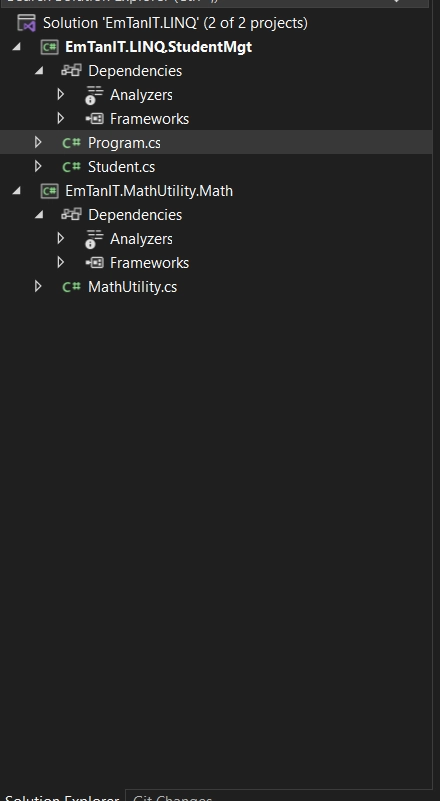
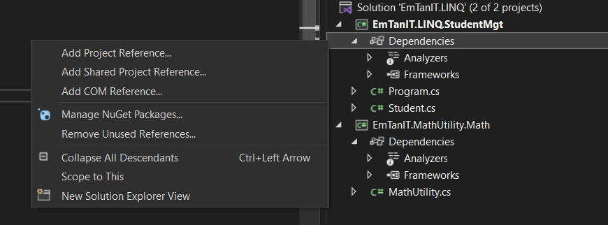
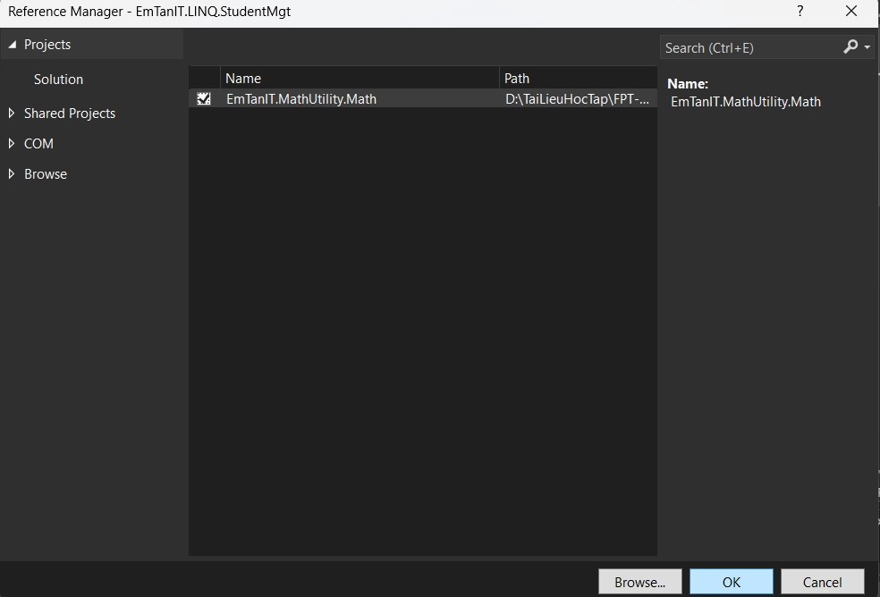
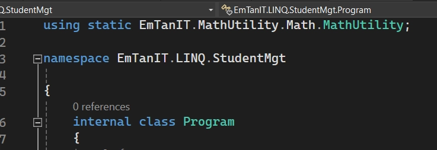
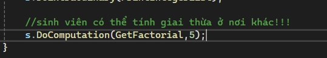

# PROJECT AS DEPENDENCY

> Tác giả: Ben Trần · Nhóm: OOP - EXTEND
> Nguồn: [PROJECT AS DEPENDENCY](https://bentran1vn.notion.site/PROJECT-AS-DEPENDENCY-2512b0489625431684992eebf083742f) · Bản lưu: 27/10/2026

[Mục lục](README.md)

## PROJECT AS DEPENDENCY

Bây giờ tui có 2 cái Project A và B. Project A có mấy cái Hàm Ngon lành quá tui muốn mang qua project B để xài bây giờ phải làm sao giờ !!!

Project A

```
public class Point
{
public double X { get; set; }
public double Y { get; set; }
}
/// <summary>
/// Class này dùng để chứa các hàm toán học hay dùng, và 1 số tính toán mở rộng
/// </summary>
public class MathUtility
{
/// <summary>
/// Hằng số PI trong tính toán diện tích chu vi hình tròn
/// </summary>
public const double PI = 3.14; //mặc định const public sẽ được xem là STATIC
/// <summary>
/// Hàm này dùng để tính n! = 1, 2, 3, 4 ... n Không có âm giai thừa cho số âm
/// </summary>
/// <param name="n">n phải nằm trong khoảng từ 0 ... 20. Vượt 20 bị tràn kiểu long</param>
/// <returns>Hàm trả về tích 1.2.3.4 ... n. 0! = 1</returns>
public static long GetFactorial(int n)
{
if (n < 0 || n > 20) throw new ArgumentException("n must be between 0 -> 20 please");
if(n == 0 || n == 1) return 1;
return n * GetFactorial(n - 1);
}
}
```

Bonus: Để viết Summary ( Tóm tắt cho một Hàm, một Class ta bấm dấu  “/” 3 lần )

Project B

```
using static EmTanIT.MathUtility.Math.MathUtility;
namespace EmTanIT.LINQ.StudentMgt
{
internal class Program
{
static void Main(string[] args)
{
Student s = new Student() { Id = "SE17", Name = "Tan Tran", Yob = 2003 };

            s.DoExtraodinary(SayHello);

            s.DoExtraodinary(() => Console.WriteLine("WOWOW"));

            s.DoExtraodinary(PrintIntegerList);
//sinh viên có thể tính giai thừa ở nơi khác!!!
            s.DoComputation(GetFactorial,5);
}
static void PrintIntegerList()
{
            Console.WriteLine("The list of Number from 1 to 100");
for (int i = 0; i < 100; i++)
{
                Console.WriteLine(i + " ");
}
}
static void SayHello() => Console.WriteLine("DitMeMay");
}
}
```

Bước 1: Ở thanh bên phải



Bước 2: Chuột phải vào cái Dependencies của cái Project muốn add mới một dependency



Bước 5: Gọi ra xài bth thoi 
​

ra cái bảng này.

Bước 3: Sau đó chọn cái Project cùng Solution và nhấn OK



Bước 4:  Thêm Using static EmTanIT.MathUtility.Math.MathUtility;




