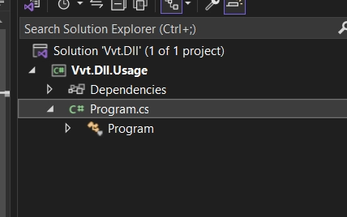
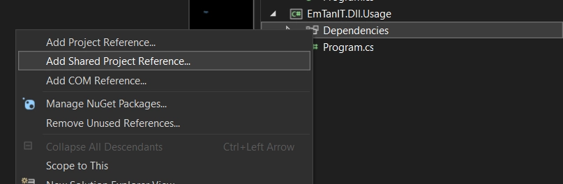
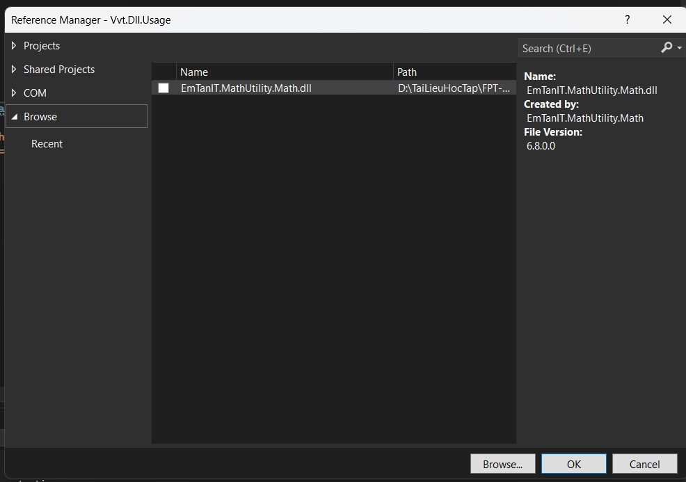
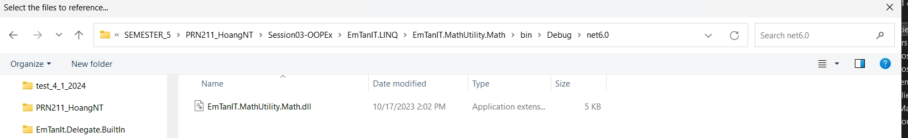
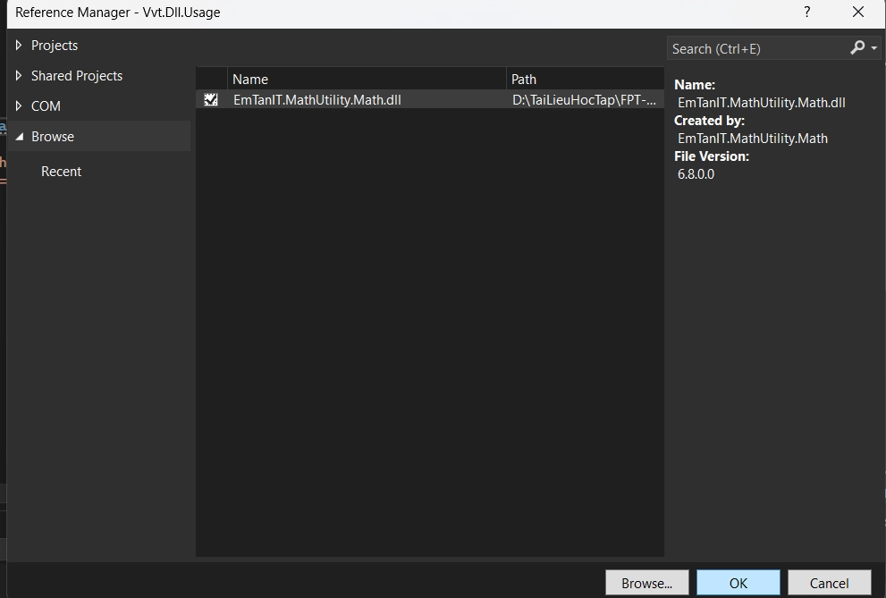
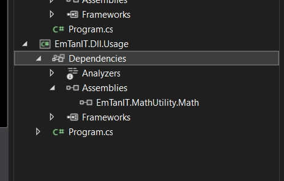
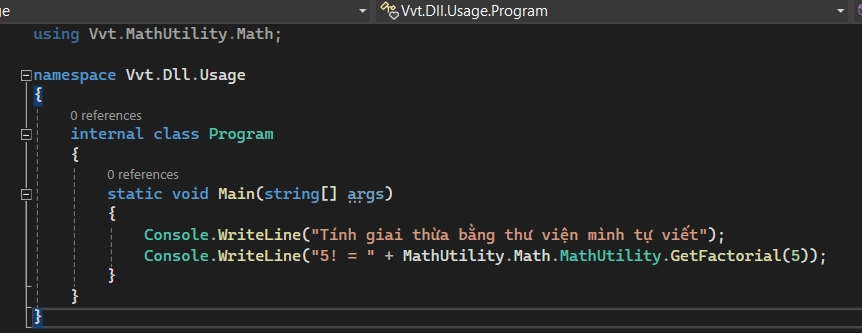

# CLASS LIBRARY DLL AS DEPENDENCY

> Tác giả: Ben Trần · Nhóm: OOP - EXTEND
> Nguồn: [CLASS LIBRARY DLL AS DEPENDENCY](https://bentran1vn.notion.site/CLASS-LIBRARY-DLL-AS-DEPENDENCY-a6322900fbde4dbabc25d6dfb646cc2f) · Bản lưu: 27/10/2026

[Mục lục](README.md)

## CLASS LIBRARY DLL AS DEPENDENCY

Context

Giờ có tui đang tham gia dự án khác 1 solution mới, mà tui vẫn còn lưu luyến mấy cái solution cũ. Hmm Bây giờ phải làm sao đây !!! Có cách !

Bước 1: Chuột phải vào Depedencies của Project mà muốn Add vào

Bước 2: Chọn Browse

Bước 3: Đi vào đường dẫn này của Solution có cái hàm mà muốn ăn cướp. Chọn File Dll

Bước 4: Tích vào và chọn OK

Tèn tèn bạn đã có

Gọi ra xài thoi

