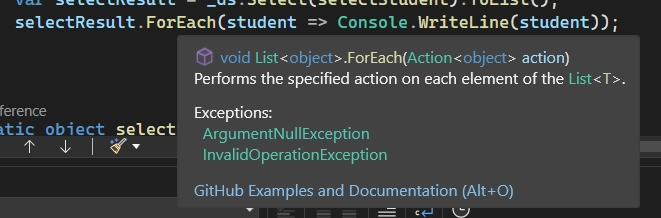
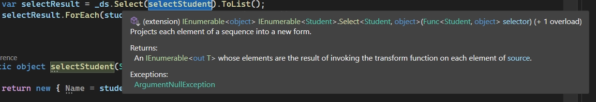
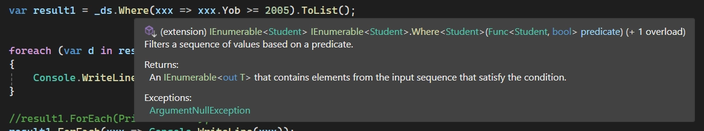

# LINQ - 02

> Tác giả: Ben Trần · Nhóm: LINQ
> Nguồn: [LINQ - 02](https://bentran1vn.notion.site/LINQ-02-06374350f46d4a06a58c4ab3150431e9) · Bản lưu: 27/10/2026

[Mục lục](README.md)

#### Initialization

Class Student

```
public class Student
{
public string Id { get; set; }
public string Name { get; set; }
public string Address { get; set; }
public int Yob { get; set; }
public double Gpa { get; set; }
public override string ToString()
{
return Id + " - " + Name + " - " + Address + " - " + Yob + " - " + Gpa;
}
}
```

#### For Each trong C#

```
static void Main(string[] args)
{
List<Student> _ds = new List<Student>()
{
new Student(){Id = "SE1", Address = "Dĩ An", Name = "An", Gpa = 8.8, Yob = 2003},
new Student(){Id = "SE2", Address = "Bình Dương", Name = "Bình", Gpa = 9.0, Yob = 2008},
new Student(){Id = "SE3", Address = "Tân Bình", Name = "Dương", Gpa = 5.0, Yob = 2005},
new Student(){Id = "SE4", Address = "Châu Thành", Name = "Dũng", Gpa = 5.0, Yob = 2006},
new Student(){Id = "SE4", Address = "Long An", Name = "Thành", Gpa = 8.0, Yob = 2000},
};
    
    selectResult.ForEach(student => Console.WriteLine(student));
}
```

Thằng For Each này bản chất nó cũng là 1 Delegate. Nhận vào 1 Action Ủy Quyền để làm 1 cái gì đó



### Bây giờ muốn Truy Xuất dữ liệu trong một danh sách theo 1 điều kiện nhất định thì sao.

Tranditional:

- Lấy cái mảng

- Tạo 1 cái hàm duyệt mảng nhận vào 1 Delegate Ủy Quyền

- Trong cái hàm đó duyệt mảng theo yêu cầu đã nhận vào

- Ói ra cái mảng chứa các phần tử thỏa điều kiện

2024 rồi ai còn làm thế ! Thằng C# nó hỗ trợ Truy Xuất dữ liệu vip pro hơn !

#### Select

- .Select(cần biểu thức lambda ... )

- ~~~~~ select cột, cột2



Initialization

```
static object selectStudent(Student student)
{
return new { Name = student.Name, Address = student.Address };
}
```

Program.cs

```
static void Main(string[] args)
{
List<Student> _ds = new List<Student>()
{
new Student(){Id = "SE1", Address = "Dĩ An", Name = "An", Gpa = 8.8, Yob = 2003},
new Student(){Id = "SE2", Address = "Bình Dương", Name = "Bình", Gpa = 9.0, Yob = 2008},
new Student(){Id = "SE3", Address = "Tân Bình", Name = "Dương", Gpa = 5.0, Yob = 2005},
new Student(){Id = "SE4", Address = "Châu Thành", Name = "Dũng", Gpa = 5.0, Yob = 2006},
new Student(){Id = "SE4", Address = "Long An", Name = "Thành", Gpa = 8.0, Yob = 2000},
};
var selectResult = _ds.Select(selectStudent).ToList();
    selectResult.ForEach(student => Console.WriteLine(student));
}
```

#### Anonymous Object

- anonymous object - nghĩa là object được tạo ra mà không có tên class cụ thể

⇒ Bên thằng JavaScript có thằng tương tự vậy gọi là Plain Object ( Object phẳng )

```
var ct = new { Name = "Ngọc Trinh", Province = "Trà Vinh" };
Console.WriteLine(ct.Name);
```

#### Where

- .Where(Cần 1 biểu thức lambda -\> Hàm nhận vào Student trả về Bool)

- ~~~~~ select \* from ...... Where



```
static void Main(string[] args)
{
List<Student> _ds = new List<Student>()
{
new Student(){Id = "SE1", Address = "Dĩ An", Name = "An", Gpa = 8.8, Yob = 2003},
new Student(){Id = "SE2", Address = "Bình Dương", Name = "Bình", Gpa = 9.0, Yob = 2008},
new Student(){Id = "SE3", Address = "Tân Bình", Name = "Dương", Gpa = 5.0, Yob = 2005},
new Student(){Id = "SE4", Address = "Châu Thành", Name = "Dũng", Gpa = 5.0, Yob = 2006},
new Student(){Id = "SE4", Address = "Long An", Name = "Thành", Gpa = 8.0, Yob = 2000},
};
//in cho tui danh sách sinh viên ở Bình Dương
//có sẵn rồi không cần tự viết hàm nữa
var result = _ds.Where(xxx => xxx.Address == "Bình Dương");
var result1 = _ds.Where(xxx => xxx.Yob >= 2005).ToList();
foreach (var d in result1)
{
        Console.WriteLine(d);
}
//result1.ForEach(PrintAStudent);
    result1.ForEach(xxx => Console.WriteLine(xxx));
}
static void PrintAStudent(Student student) => Console.WriteLine(student);
```

#### Ôn lại Anonymous !

```
//Ôn lại anonymous
var result1 = _ds.Where(delegate (Student xxx)
{
if (xxx.Yob >= 2005) return true;
return false;
}
);
foreach (var d in result1)
{
    Console.WriteLine(d);
}
```

#### Phân Tích  var result = \_ds.Where(xxx =\> xxx.Address == "Bình Dương");

- Giống StreamAPI bên JAVA

- Ghi nhận 1 danh sách sinh viên nhưng không new, không clone 1 danh sách

- Duyệt động trên danh sách gốc, không tạo 1 danh sách mới -\> IEnumurable

- Nếu muốn có cái list đê xài thoải mái, ta convert thành danh sách thật

#### String Literal - Hằng, Chuỗi có sẵn trong Code

- khi đó nó năm trong 1 vùng Ram riêng

```
string p1 = "BD";
string p2 = "BD";
```

- Lúc này cả p1 và p2 đều trỏ vào BD

- 2 thằng này bằng nhau về logic vì đều trỏ vào vùng nhớ Bình Dương

- Nếu câu lệnh nhập từ bàn phím vào thì phải so sánh bằng chấm

- Khi đó đoạn chuỗi đó được lưu ở vùng heap
