# GUI - 01

> Tác giả: Ben Trần · Nhóm: GUI
> Nguồn: [GUI - 01](https://bentran1vn.notion.site/GUI-01-b490af673dea475eaee31b43a3143479) · Bản lưu: 27/10/2026

[Mục lục](README.md)

#### Quản Lý Gái Gọi Project

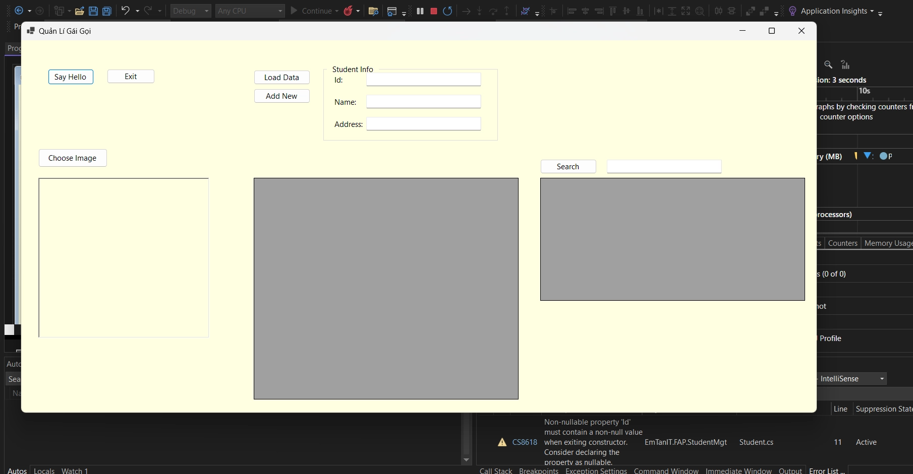

## CHIẾN NÀO

Cái cửa sổ phần mềm mà nó hiện ra gọi là 1 Form ( Window Form )

Để thiết kế được những Item như Font chữ, Button, Ô dữ liệu thì trước hết ta cần 1 thanh menu để có thể chọn những thằng đó !

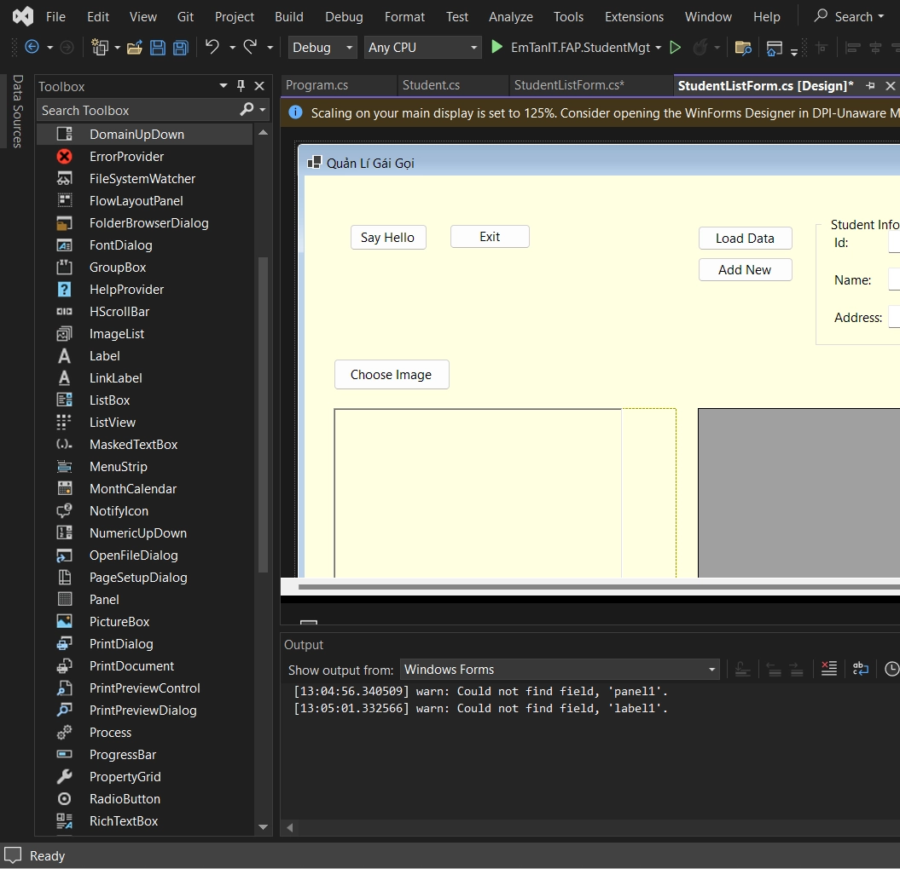

Ở thanh Navigation Bar → Chọn View → Chọn ToolBox

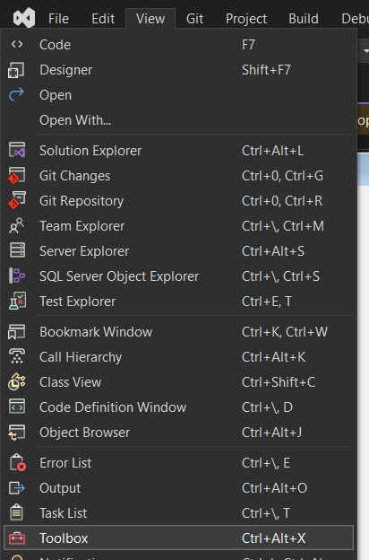

Lần đầu tiên thì nó sẽ bị lag → Bạn hãy Tắt và Mở lại Window Form

### Tạo thử 1 Button ( Nút Nhấn ) Bấm zô thì hiện ra chữ Hãy Follow Git của Tôi xem nào

ToolBox → Chọn Button → Kéo qua cái Form

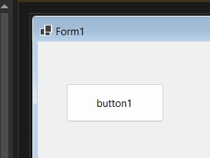

Bây giờ ở bên phải góc dưới sẽ hiện 1 bảng gọi là Property

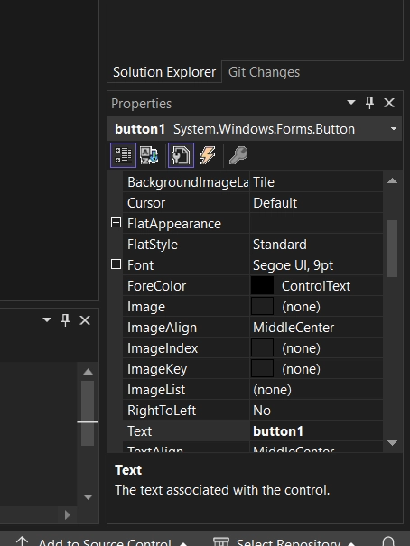

Lúc này ta ngẫm nghĩ lại hmm. Một button mà nó cũng có Property ah sao nó na na 1 object vậy ta

⇒ Mọi thứ đều là Object.

⇒ Form là 1 Object, có các property ( thuộc tính ) là button, label ( nhãn ) hay màn hình data gì gì đó

⇒ Và 1 Button cũng là 1 Object, có các property ( thuộc tính ) là tên, click ( Bấm zô sẽ làm gì đó ) ( Hint ở đây Click thôi nhen )

#### Đổi tên cho nút bấm có tên là “ Hãy Follow Git của Tôi ”

Nhìn ở Table Property → Kiếm Text

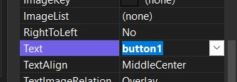

Sửa button1 → Hãy Follow Git của Tôi

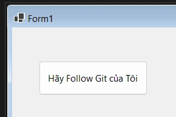

Ok ngon lành rồi đó. Sửa tiếp thằng Name, Nhìn ở Table Property → Kiếm Name

Đổi thành btnSayFollow

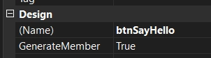

#### Thằng Name này nó khác với thằng Text chỗ nào:

Nó thể hiện của Button ( Instance ) giống như new mới 1 Student ấy

`Student stu = new Student ( )`

Thì btnSayFollow ở đây nó giống như stu đó

Xong rồi mình dùng btnSayFollow chấm chấm ra các hàm đó

Text thì nó chỉ thể hiện cái chữ, cái nhãn của cái nút bấm thôi

#### Tạo sự kiện cho nút bấm, bấm zô thì sẽ làm 1 cái gì đó

Ở ô property chọn hình tia sét

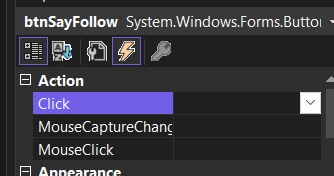

Mình đặt tên cái hàm mình muốn làm một hành động gì đó khi nhấn nút.

Đặt tên → Bấm Enter nó sẽ bay qua cái hàm. Ở đây tôi đặt tên là SayFollow

#### MessageBox

C# cung cấp 1 thằng có thể Ói ra 1 cái thông báo như thằng alert bên html/css

Để ói ra xài  `MessageBox.Show ( text, caption, MessageBoxButton, MessageBoxIcon )`

```
private void SayFollow(object sender, EventArgs e)
{
    MessageBox.Show("Github của tôi bentran1vn",
"Notification",
        MessageBoxButtons.OK,
        MessageBoxIcon.Information);
}
```

Chạy Chương trình và bấm vô thử nè

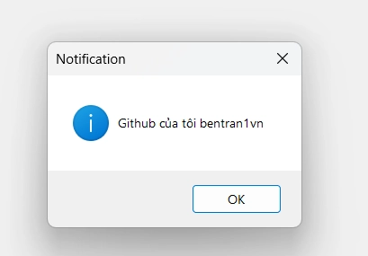

Ở đây

- text: Github của tôi bentran1vn

- caption: Notification

- MessageBoxButton: Loại Thông báo có nút bấm OK

- MessageBoxIcon: Loại Icon chữ I

### Tạo thử 1 Button ( Nút Nhấn ) Bấm zô dừng chương trình !

- Zô ToolBox → Kéo button qua

- Đổi Text Button thành Exit

- Đổi Name Button thành btnExist

- Vào Click đặt tên cho cái hàm muốn chạy khi Nhấn vào Click

Cũng như Message Box nhưng bây giờ mình hứng kết quả của nó

```
private void SayGoodBye(object sender, EventArgs e)
{
DialogResult result = MessageBox.Show("Goodbye. Do you really want to exist ?",
"Confirm",
        MessageBoxButtons.YesNo,
        MessageBoxIcon.Exclamation);
if (result == DialogResult.Yes)
{
this.Close();
}
}
```

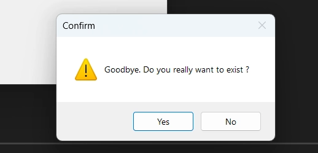

Khi tương tác Yes or No nó sẽ Ói ra 1 kết quả đó là Yes hoặc No

Sau đó mình check nếu mà Yes thì mình dừng chương trình lại bằng `this.Close();` với this là cái Form này

### Tạo 1 Nút Bấm Chọn Ảnh Từ Thư Mục Và Thể hiện lên Form. Sau đó hiện cả đường dẫn của Ảnh

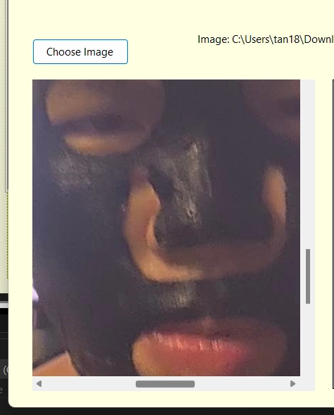

Tạo Nút Bấm, bấm zô hiện thư mục chọn ảnh

- Zô ToolBox → Kéo Button qua

- Đổi Text Button thành Choose Image

- Đổi Name Button thành btnImage

- Vào Click đặt tên cho cái hàm muốn chạy khi Nhấn vào Click

Tạo 1 Nhãn ( Label ) Để chứa đường Link Ảnh

- Zô ToolBox → Kéo Label qua

- Đổi Text Button thành Rỗng

- Đổi Name Label thành lblAvatar

#### Để mở File ta cần 1 thằng nó gọi là OpenFileDialog

- Zô ToolBox → Kéo OpenFileDialog qua

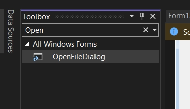

Đặt tên cho OpenFileDialog

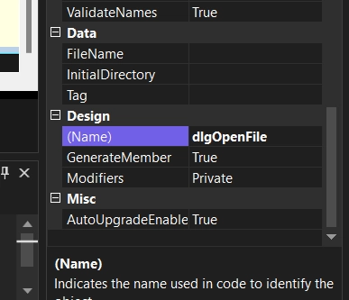

SetUp Chỉ nhận vào file ảnh ( JPEG files |.jpg;.jpeg|PNG files|\*.png )

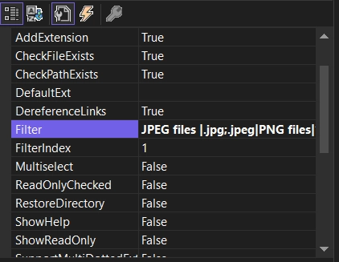

#### Để chứa tấm ảnh ta vừa mở, cần xài 1 thằng gọi là Picture Box

- Zô ToolBox → Kéo PictureBox qua

- Đặt tên cho PictureBox: picAvatar

- Kiếm Sizemode: Chỉnh thành Autosize cho nó bung full ra

```
private void ChooseImage(object sender, EventArgs e)
{
DialogResult result = dlgOpenFile.ShowDialog();
if (result == DialogResult.OK)
{
//MessageBox.Show(dlgOpenFile.FileName);
        lblAvatar.Text += "Image: " + dlgOpenFile.FileName;

        picAvatar.Image = new Bitmap(dlgOpenFile.FileName);
}
else
{
this.Close();
}
}
```

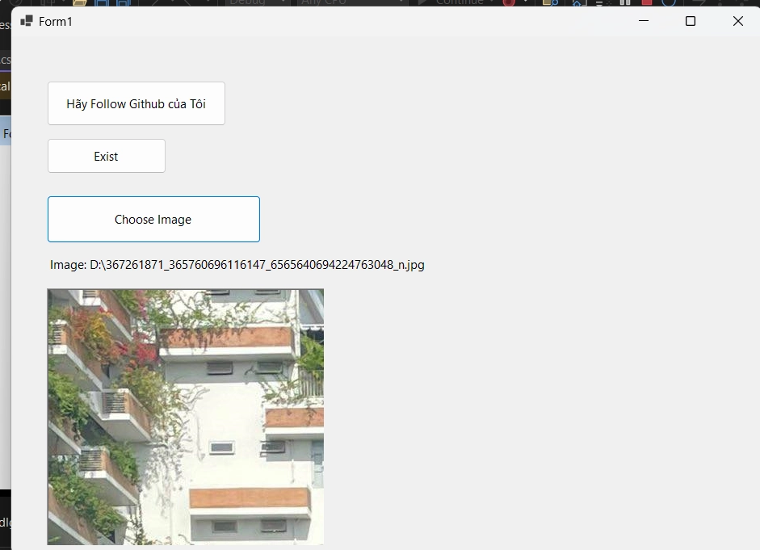

hmm bây giờ import được tấm ảnh rồi đó. Muốn trượt qua lại để coi thêm được nội dung tấm ảnh này thì sao !

#### Muốn Trượt Tấm Ảnh Qua Lại Thì Thêm 1 Thằng Panel

- Kéo to khiến nó bao cả Picture Box

- Kiếm AutoScroll: Chỉnh thành True

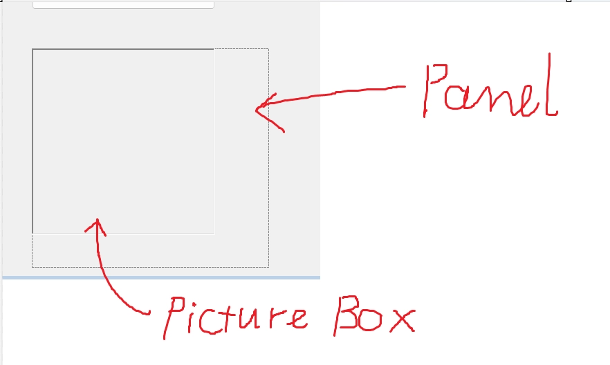

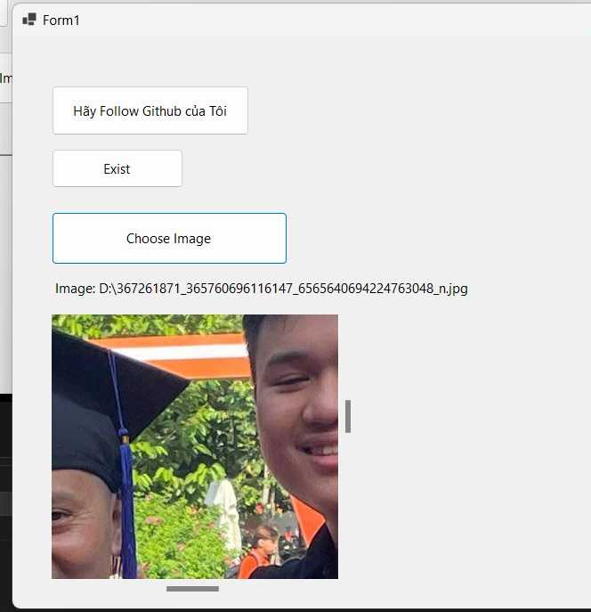

### Làm 1 chỗ Quản Lý Nhân Viên

- Load Nhân Viên đã có sẵn

- Ghi Thông tin Của Nhân Viên mới và Nạp Vào Hệ Thống

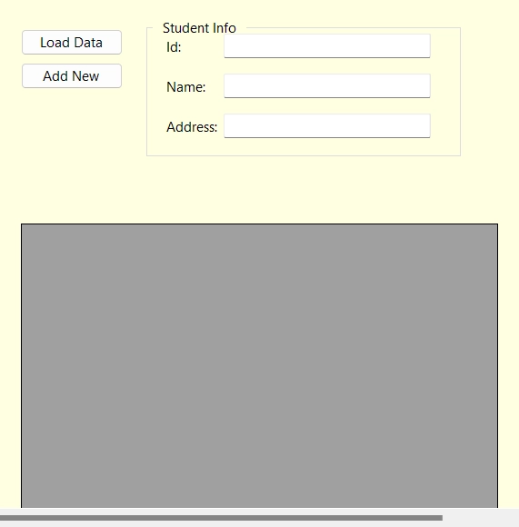

#### Tạo 2 button Load Data và Add New

- Zô ToolBox → Kéo button qua

- Đổi Text Button đổi tên

- Đổi Name Button thành btnLoadData và btnAddNew

- Vào Click đặt tên cho cái hàm muốn chạy khi Nhấn vào Click

#### Tạo Các Ô Nhập Dữ Liệu Id, Name, Address ( Label, TextBox )

- Zô ToolBox → Kéo Label, TextBox qua

- Đổi Text Label đổi tên → Id :

- Đổi Name Label, TextBox thành lblId và txtId

→ Tương tự với Name, Address

#### Bọc mấy cái Thông tin Lại cho nó đẹp ( GroupBox )

- Zô ToolBox → Kéo GroupBox  qua

- Đổi Text GroupBox đổi tên → Student Info

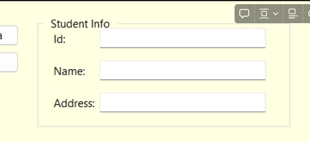

#### Bây giờ cần chứa Data thì cần 1 thằng nó gọi là DataGridView

- Zô ToolBox → Kéo DataGridView qua

- Đổi Name DataGridView thành dgvStudentList

### Nói là Quản Lý Gái Gọi Vậy Thôi Chứ Thực Ra Là Quản Lý Student → Phải Tạo 1 Class Đối Tượng Student

Chuột phải vào Project Thêm mới 1 Class

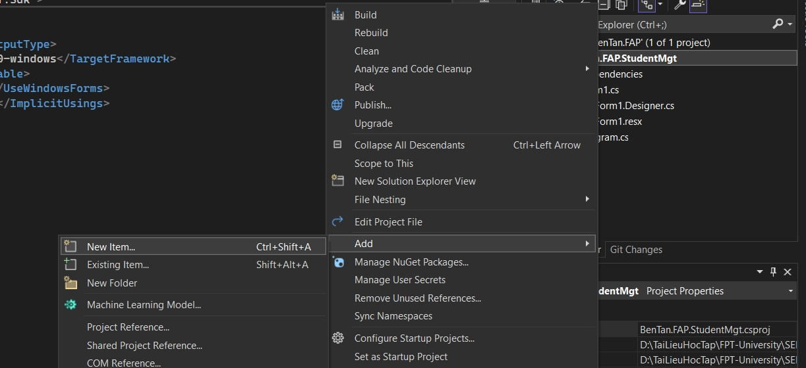

Chọn Class và Đặt Tên

[Khối nhúng trống tại nguồn](https://bentran1vn.notion.site/GUI-01-b490af673dea475eaee31b43a3143479#7440eab0212c47f5afb27abd1374dc89).

Student.cs

```
internal class Student
{
public string Id { get; set; }
public string Name { get; set; }
public string Address { get; set; }
}
```

Để Hiện Tất Cả Các Code Của Form, Chuột phải vào Form chọn View Code

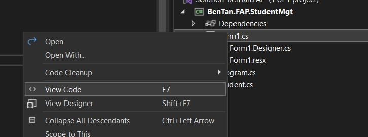

Vì lưu trũ Data mà, nên mình phải tạo một cái List để lưu trữ

→ Ở đầu Form tạo một cái List học sinh

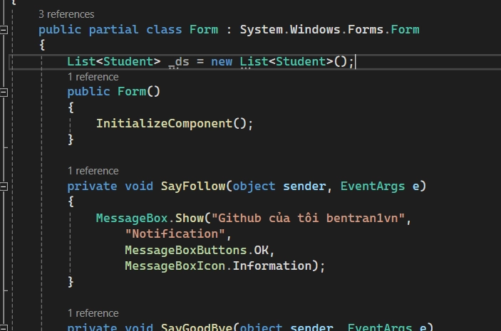

#### Xử Lý Hàm LoadData !!!

```
private void LoadData(object sender, EventArgs e)
{
    _ds.Add(new Student() { Id = "SE1", Name = "An", Address = "Dương Đông" });
    _ds.Add(new Student() { Id = "SE2", Name = "Dương", Address = "Tân Bình" });
    _ds.Add(new Student() { Id = "SE3", Name = "Dũng", Address = "Tân An" });

    dgvStudentList.DataSource = _ds;
}
```

Để thêm dữ liệu vào lưới `dgvStudentList.DataSource = _ds;`

#### Xử Lý Hàm AddData !!!

```
private void AddNew(object sender, EventArgs e)
{
    _ds.Add(new Student() { 
				Id = txtId.Text,
				Name = txtName.Text,
				Address = txtAddress.Text 
		});

    dgvStudentList.DataSource = null;

    dgvStudentList.DataSource = _ds;
}
```

Add mới dự liệu vào thì nó lưới nó chưa cập nhập liền được

→ Reset cái lưới

→ Gán lại dữ liệu mới

### Sờ vô 1 dòng trong DataGridView thì hiện Full Thông Tin

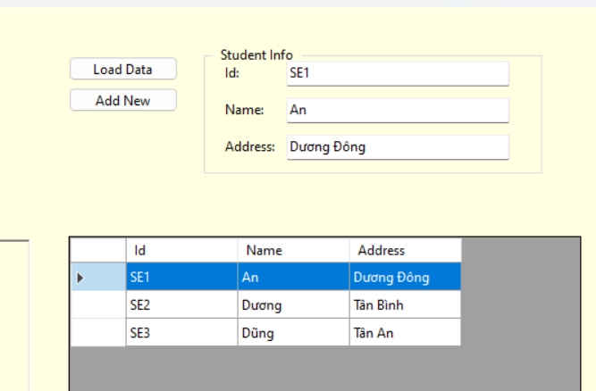

Vào DataGridView Property đặt tên hàm cho SelectionChanged

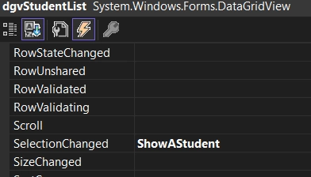

#### Ta sẽ xài các hàm, thuộc tính của dgv qua dấu chấm

- toàn bộ những gì trên form đều là các biến object trỏ vùng new
​

```
DataGridView dgv = new DataGridView() 
```

- dgv.DataSource = danh sách sinh viên

- dgv.Click += chừa chỗ cái hàm của ai đó

- dgv.Click thì làm gì, gọi hàm này

- xài các chấm khác để biết dòng nào được chọn, lấy từng cell

```
private void ShowAStudent(object sender, EventArgs e)
{
if (dgvStudentList.SelectedRows.Count > 0)
{
//Header là O
// >0 là chọn những dòng
//Lấy ra dòng đầu tiên trong nhiều dòng vừa chọn,
// trích từng Cel
DataGridViewRow selectedRow = dgvStudentList.SelectedRows[0];
        txtId.Text = selectedRow.Cells[0].Value.ToString();
        txtName.Text = selectedRow.Cells[1].Value.ToString();
        txtAddress.Text = selectedRow.Cells[2].Value.ToString();
}
}
```

### Chức năng Search Tên và Địa chỉ chứa kí tự

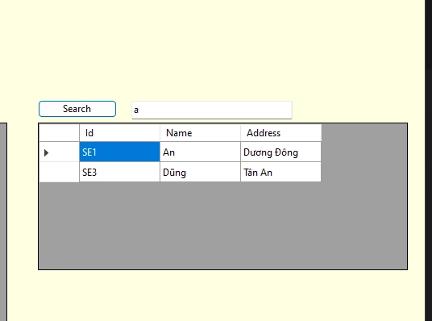

Tạo Nút Search, Tạo Ô để nhập, Tạo Thêm 1 Cái lưới DataGridView để chứa kết quả tìm thấy

```
private void Search(object sender, EventArgs e)
{
string keyword = txtSearch.Text;
if (!string.IsNullOrEmpty(keyword))
{
var result = _ds.Where(xxx =>xxx.Name.ToLower().Contains(keyword.ToLower()) ||
                                xxx.Address.ToLower().Contains(keyword.ToLower())).ToList();
        dgvStudentList.DataSource= result;
}
}
```

## Kết Quả

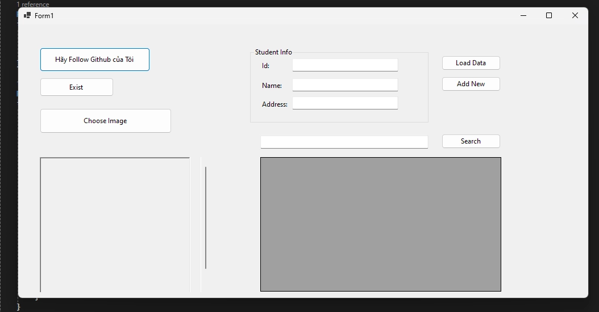
