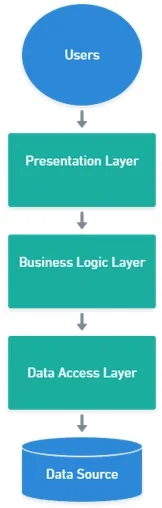
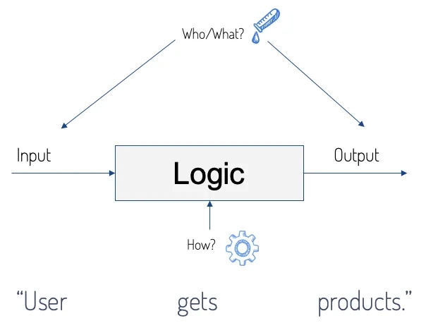
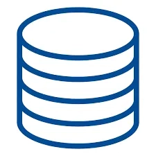

# THREE LAYERED ARCHITECTURE

> Tác giả: Ben Trần · Nhóm: GUI
> Nguồn: [THREE LAYERED ARCHITECTURE](https://bentran1vn.notion.site/THREE-LAYERED-ARCHITECTURE-be34ac4e34b647a78b5f14acdc123cff) · Bản lưu: 27/10/2026

[Mục lục](README.md)

## Three Layered Architecture

### Tách riêng 2 thành phần UI và DATA

#### UI:

- HIỂN THỊ VÀ QUẢN LÍ SỰ KIỆN, TRIỆU GỌI DATA TỪ ĐÂU ĐÓ

#### DATA:

- CUNG CẤP DATA CHO UI, NHẬN YÊU CẦU XỬ LÍ DATA TỪ UI: lấy hết data, search ai đó, update ai đó, xóa 1 ai đó

- CUNG CẤP DATA CHO NHIỀU UI KHÁC: WEB, FORMS, MOBILE
    ⇒ RE-USE MỨC CAO
    
    ⇒ VIẾT THEO STYLE THƯ VIỆN – LIBRARY – DEPENDENCY - .DLL TÁCH RỜI CHO NHIỀU NƠI REFERENCE VÀO
    
    ⇒ TÁCH PROJECT, THÊM PROJECT MỚI. BAO NHIÊU PROJECT, BẤY NHIÊU .DLL ( .JAR CỦA BÊN JAVA )

### TƯ DUY VIẾT CODE- CẤU TRÚC VIẾT CODE

| UI | Chưa Data Phục Vụ Form | Định Dạng dữ liệu phục vụ |
| --- | --- | --- |
| Class Form ListStudent.cs UI | StudentRepositorySqlServer | class Student ( Get Set ) |
|  | List\<Student\> \_ds; |  |
| dgvStudentList | GetAll() -\> List\<Student\> |  |
| btnAdd ( ) | Add(Student x) |  |
| btnUpdate ( ) | Update(Student x) |  |
| btn Delete ( ) | Delete(id) |  |
| btn Search ( ) | Search(id) |  |

⇒ TUI MÚN CHUYỂN SANG SÀI MYSQL, TA CẦN 1 CLASS KHÁC CUNG CẤP DATA PHỤC VỤ FORM NHƯNG DATA LẤY TỪ MYSQL

#### Mapping Giữa Class và 1 Entity Trong Database

```
Class Product
{
public int Id { get, set }
public String name { get, set }
}
New Prodcut() { Id = ???, name = ??? }
```

```
create table Product
{
		id int indentity primary key

		name nvarchar(40)
}

insert into Product(name) value(“String DĐ”)
```

#### Traditional

- Công nghệ ngày xưa gọi là ( ADO.NET ~~~~ JDBC ) ( .NET ~~~~ JAVA)

- Xài Driver CSDL

- Class/ Method

#### Current

- ( ENTITY FRAMEWORK ~~~~ Hibernate )

- Dowload về dưới dạng thư viện – Dependency

- NUGET  or  MAVEN, GRADLE  or  NPM

- Xài bằng GUI/ CMD

- .NET Cung cấp 1 cái gọi là Entity Framework một ( ORM – OBJECT RELATIONAL MAPPING )

## Three Layered Architecture - Chuẩn Nhất



#### Layers

- Một ứng dụng bao gồm nhiều lớp, mỗi 1 lớp là những phần trừu tượng.

- Mỗi lớp thì thể hiện một Lever và 1 Type Of Abstraction khác nhau

- Phân lớp giúp hệ thống chia nhỏ thành những Unit - đơn vị mà dễ quản lí hơn, và có thể được tái sự dụng

- Khi một User đăng nhập và Request một thứ gì đó từ Server, Input-data sẽ đi qua từng lớp.

- Mỗi Layer thì không nên dính liếu gì tới các Layer khác

Mapping into Window Form

| Presentation Layer | Business Logic Layer | Data Access Layer |
| --- | --- | --- |
| UI trong Window Form | Business Class | Repository Class |

## **Presentation Layer**

The presentation layer is the highest layer of the software. It is where the user interface of the software is placed. It contains logic only related to how the data is presented and the beginning of each CRUD (**C**reate, **R**ead, **U**pdate or **D**elete) operation flow. In C# is where all of the controllers and views will be placed. In this layer, the logic should be the simplest.

Bonus:

• Lớp này có nhiệm vụ chính là giao tiếp với người dùng. Nó gồm các thành phần giao diện ( Controller, winform, webform, …) và thực hiện các công việc như nhập liệu, hiển thị dữ liệu, kiểm tra tính đúng đắn dữ liệu trước khi gọi lớp Business Logic Layer (BLL).

<a id="bcb5f71b68bc4d558d86bae3d36c773e"></a>

## **Business Logic Layer (BL)**

As the name of this layer, most of the logic of the application will be placed in this layer. **The BL layer should not have intimate knowledge of any data model so it can’t possibly fire a query against the database**. The layer input is a data structure received from the presentation layer and the layer output is a data structure received from the DAL. The BL layer allows developers to design applications that support multiple user interfaces, this minimizes the chances of needless code duplication. Usually, this layer is divided into smaller pieces that are easy to manage.

Bonus:

- Đây là nơi đáp ứng các yêu cầu thao tác dữ liệu của Presentation Layer **(** GUI layer, Controller ), xử lý chính nguồn dữ liệu từ Presentation Layer trước khi truyền xuống Data Access Layer và lưu xuống hệ quản trị CSDL.

- Đây còn là nơi kiểm tra các ràng buộc, tính toàn vẹn và hợp lệ dữ liệu, thực hiện tính toán và xử lý các yêu cầu nghiệp vụ, trước khi trả kết quả về Presentation Layer.



<a id="46588c0802064ec28f95d7a1c2656f2f"></a>

## **Data Access Layer (DAL)**

This layer is separated into two: DAL abstractions and DAL. The data access layer is the layer that implements the communication with the data source (usually a database). A data access abstractions layer follows the idea of “separation of concerns” whereby all of the logic required for your business logic to interact with your data layer is isolated to a single set of classes (layer). This allows you to more easily change the backend physical data-storage technology (move from XML files to a database, or from SQL Server to Oracle or MySQL, for example) without having a large impact (and if done right having zero impact) on your business logic.

Bonus:

- Lớp này có chức năng giao tiếp với hệ quản trị CSDL như thực hiện các công việc liên quan đến lưu trữ và truy vấn dữ liệu ( tìm kiếm, thêm, xóa, sửa,…).


