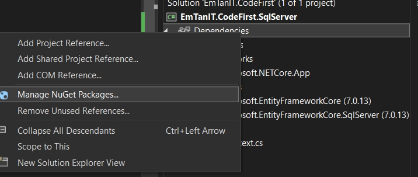
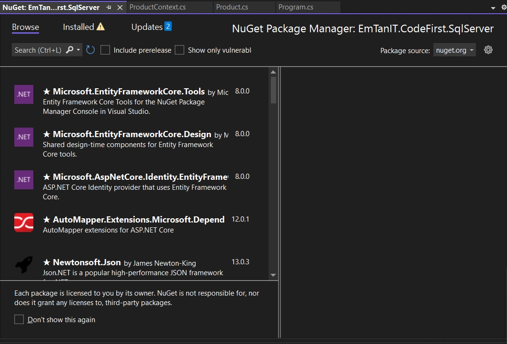
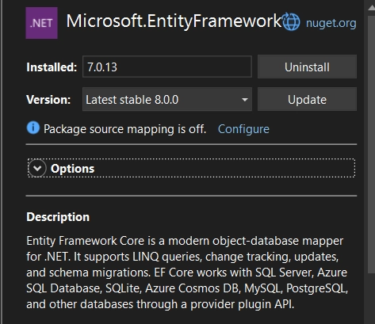
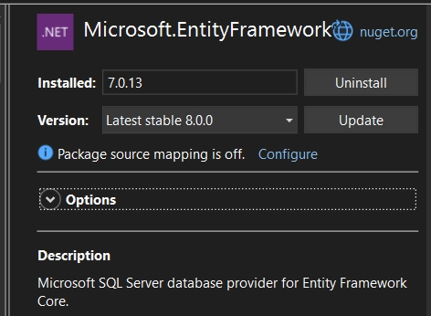

# CODE FIRST - ENTITY FRAMEWORK

> Tác giả: Ben Trần · Nhóm: DATABASE
> Nguồn: [CODE FIRST - ENTITY FRAMEWORK](https://bentran1vn.notion.site/CODE-FIRST-ENTITY-FRAMEWORK-4ee497f46d61405eb9eba9fd99f4bb1d) · Bản lưu: 27/10/2026

[Mục lục](README.md)

Trước hết muốn xài Entity Framework thì ta phải cài nó. Vậy cài nó ở đâu 1 câu hỏi lớn.

## Nuget là gì ?

- Là một hệ thống quản lý gói (package manager) dành cho nền tảng phát triển phần mềm của Microsoft, mà chính yếu là .NET. Được giới thiệu vào năm 2010, sau đó đến phiên bản Visual Studio 2012 thì được tích hợp mặc định khi cài đặt, đến nay NuGet Gallery – một dạng như là repository – đã có đến 337.307 packa

- Có sẵn trong Visual Studio luôn. Cứ thế mà xài thôi
    Vào Dependencies → Chuột phải
    
    
    
    Giao diện của nó đây
    
    

## .NET có Nuget. Bạn của Nó có gì

- Bên NodeJS, ReactJS thì có Npm

- Bên Java thì có Maven, Gradle
    - Nói 1 chút về Ant của Java:
        - Ngày xưa ngày xưa ở 1 thế giới Java khi ấy người dân lúc đó ai cũng xài Ant aka Người Kiến. Nó giúp quản lý các thư viện của Java
        
        - Một ngày nọ ông Ben Trần ổng chán ở quê lắm rồi, hmmmm. Ổng muốn lên kinh thành xa hoa, phố thị để sinh sống. Trước khi ổng đi, ổng suy nghĩ rằng là. Giờ mình phải bán hết của cải trong nhà ( Niêu, nồi, xoong chảo ) tại trên đường lên kinh thành nặng lắm và sau đó mình lên kinh thành xa hoa, phố thị mình mua lại ( Vì ở đâu chả có ) cũng được mà.
        
        - Maven và Gradle sinh ra là để giải quyết vấn đề của ông Ben Trần. Ngày xưa Ant, người ta chưa có hiện đại như bây giờ, muốn xài thư viện nào → Phải cài driver rất là lằng nhằng. Và khi đó ai đó muốn xài code của mình hoặc chuyển giao dự án ( lên kinh thành xa hoa, phố thị để sinh sống ) thì phải chuyển cái dự án đó cùng với cái driver thì nó rất nặng. 1 2 thì không sao 1000, 1 tỷ thì sao !!!
        
        - Hiện đại hơn Maven, Gradle. Dự án xài công nghệ, thư viện nào ok tui xài, tui tải công nghệ, thư viện đó và tui “ Note lại cái tên ”. Khi mà tui đưa code cho người khác, tui chỉ đưa code, tui không đưa toàn bộ thư viện mà tui chỉ đưa cái tên Công Nghệ, Thư Viện thôi.
        
        ⇒ Bạn lấy code của tui về xài. Tui cho bạn tên công nghệ rồi đó, miễn là bạn có Internet bạn có thể tự tải công nghệ !

### Chốt lại: Nuget giúp giải quyết vấn đề của Ông Ben Trần aka Dev. Giúp việc lưu trữ nhẹ nhàng hơn !

## Entity Framework

Zô nuget kiếm EntityFramework



Entity Framework thì hỗ trợ nhiều thằng mà. Muốn chỉ đích danh dành cho thằng nào thì gõ thêm tên thằng đó. Ở đây ta xài SQL Server



Vì là ORM tiếp theo ta cần tạo ra Class thể hiện 1 thực thể cụ thể trong Database

Product.cs

```
public class Product
{
public int Id { get; set; }
public string Name { get; set; }
public string Description { get; set; }
public string ToString()
{
return Id + "--" + Name + "--" + Description;
}
}
```

ORM yêu cầu chúng ta phải tạo ra 1 Context Class. Vì liên kết với 1 thực thể trong Database, thế nên chúng ta cần có 1 thằng để đại diện nó thực thiện các thao tác CRUD và Context Class là chính nó !

```
public class ProductContext : DbContext //Đại diện 1 DB mình sẽ xài
{
private string connectionString = @"Server=localhost,1433;
                                    Initial Catalog=ProductDB;
                                    Integrated Security=True;
                                    Trusted_Connection=true;
                                    Encrypt=false";
public DbSet<Product> Products { get; set; }
//tui - table Products trong tương lai sẽ chứa nhiều new Product
protected override void OnConfiguring(DbContextOptionsBuilder optionsBuilder)
{
//base.OnConfiguring(optionsBuilder);
        optionsBuilder.UseSqlServer(connectionString);
}
}
```

Đọc thêm về Context Class

[Context class in Entity Framework](<https://www.entityframeworktutorial.net/entityframework6/context-class-in-entity-framework.aspx>)

Learn what is the context class in EF 6 and EF Core and how to use it.

#### Hàng họ có vẻ đủ rồi đó, Chơi thôi , CRUD thôi !

- Add mới sản phẩm thử coi

- Móc sản phẩm ra coi thử coi

```
static void Main(string[] args)
{
using (var db = new ProductContext())
{
//db.Database.EnsureCreated();
//tạo database nếu nó chưa tồn tại
var prod = new Product()
{
            Name = "String dâu xanh",
            Description = "Nước tăng lực xanh..."
};
        db.Products.Add(prod);
        db.Products.Add(new Product()
{
            Name = "Lipovitan",
            Description = "Nước tăng lực mật ong"
});
        db.Products.Add(new Product()
{
            Name = "Cafe Chú Long",
            Description = "Cafe muối vừa đủ"
});
        db.SaveChanges();
        Console.WriteLine("Insert Successfully!!!");
}
//Sau khi ra code chạy xong, ra khỏi cái ngoặc kép thì cái 
//biến này nó tự hủy luôn, tự động dọn dẹp trong vùng Ram
// Biến xài rồi bỏ luôn -> Xài Using
//Lấy DataShow Ra, lùng LINQ
using (var db = new ProductContext())
{
var result = db.Products.Where(xxx => true).ToList();
foreach (var product in result)
{
            Console.WriteLine(product.ToString());
}
}
}
```

#### Tạo 1 DB nếu nó chưa tồn tại !

```
db.Database.EnsureCreated();
```

#### Using. Xài 1 lần rồi bỏ

```
using (var db = new ProductContext())
{
//db.Database.EnsureCreated();
//tạo database nếu nó chưa tồn tại
var prod = new Product()
{
      Name = "String dâu xanh",
      Description = "Nước tăng lực xanh..."
};
  db.Products.Add(prod);
  db.Products.Add(new Product()
{
      Name = "Lipovitan",
      Description = "Nước tăng lực mật ong"
});
  db.Products.Add(new Product()
{
      Name = "Cafe Chú Long",
      Description = "Cafe muối vừa đủ"
});
  db.SaveChanges();
  Console.WriteLine("Insert Successfully!!!");
}
```

- Sau khi ra code chạy xong, ra khỏi cái ngoặc kép thì cái biến này nó tự hủy luôn, tự động dọn dẹp trong vùng Ram

⇒ Biến xài rồi bỏ luôn -\> Xài Using
