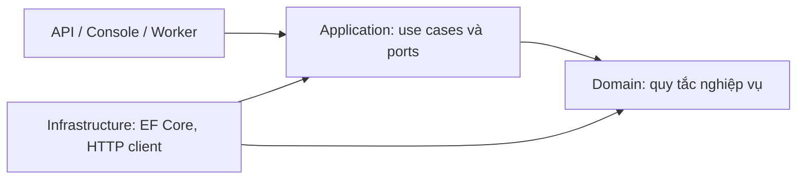

# 01. Dependency Rule: nghiệp vụ ở trung tâm

## Bản đồ liên kết

Đọc cùng [DIP và IoC](../dotnet/csharp-from-zero-to-hero/05-solid-principles/05-dependency-inversion-and-ioc.md), sau đó chuyển sang [ranh giới .NET](02-dotnet-boundaries.md).

## Bản chất

Clean Architecture tách **policy** khỏi **detail**. Policy trả lời ứng dụng phải làm gì theo nghiệp vụ. Detail là công nghệ dùng để nhận yêu cầu, lưu dữ liệu hoặc gọi hệ thống khác.

Ví dụ, “đơn đã giao không được hủy” là policy. EF Core, PostgreSQL, controller và JSON là detail. Đổi giao diện từ HTTP sang worker không làm quy tắc hủy đơn biến mất.

Dependency Rule nói về **phụ thuộc trong mã nguồn**: phần bên trong không biết kiểu dữ liệu hoặc cách triển khai của phần bên ngoài. Đặt bốn thư mục đúng tên nhưng cho Domain gọi `DbContext` vẫn vi phạm mục tiêu này.



Các cạnh trong sơ đồ là phụ thuộc mã nguồn; không phải thứ tự gọi hàm. Domain không có cạnh phụ thuộc trở lại API hoặc Infrastructure.

## Luồng chạy có thể đi ra ngoài

Khi thực thi, use case vẫn cần đọc dữ liệu từ database. Application gọi `IOrderRepository`, một port do bên trong định nghĩa. Infrastructure triển khai port đó; composition root nối hai phần khi khởi động.

```text
Lúc chạy: driver gọi use case; use case gọi port; adapter truy cập database.
Lúc biên dịch: use case biết port; adapter biết port; use case không biết adapter.
```

Dependency Inversion giúp hai chiều này khác nhau. Dependency injection chỉ là một cách cung cấp adapter; có DI container không đồng nghĩa có Clean Architecture.

## Quy tắc nằm ở đâu?

| Yêu cầu | Nơi chịu trách nhiệm chính | Lý do |
| --- | --- | --- |
| Đơn đã giao không được hủy | Domain | Phải đúng từ mọi entry point. |
| Tìm đơn rồi thực hiện hủy và lưu | Application | Điều phối một mục tiêu của người dùng. |
| Parse route ID hoặc JSON | API adapter | Gắn với giao thức nhận yêu cầu. |
| Ánh xạ lỗi nghiệp vụ thành HTTP response | API adapter | Domain không cần biết status code. |
| Ánh xạ entity sang bảng, cột và index | Infrastructure | Gắn với persistence. |
| Chọn connection string và nối DI | Composition root | Gắn với môi trường chạy. |

## Dữ liệu qua ranh giới

DTO truyền đủ dữ liệu use case cần, tránh đưa `HttpContext`, `IActionResult`, EF tracking entry hoặc SDK response vào lõi nghiệp vụ. Quyết định dùng chung hay tách request DTO phụ thuộc mức thay đổi; không cần ba bản sao có cùng trường chỉ để đủ layer.

Nếu chọn ranh giới persistence chặt, port không trả về `IQueryable`: người gọi có thể vô tình phụ thuộc query provider, thời điểm thực thi và lifetime của `DbContext`.

Application trả kết quả nghiệp vụ; adapter quyết định biểu diễn nó thành HTTP, CLI hoặc thông điệp. Response công khai nên có hợp đồng ổn định, tránh serialize thẳng entity có trường nội bộ hoặc navigation property.

## Bẫy thường gặp

- **Domain tham chiếu Infrastructure vì cần interface**: chuyển interface đến layer sở hữu nhu cầu hoặc contract phù hợp; không tạo vòng tham chiếu.
- **Mỗi class đều phải có interface**: port hữu ích ở ranh giới thay đổi hoặc I/O. Entity và hàm tính toán không cần interface mặc định.
- **Đổi database sẽ không cần sửa gì**: tách dependency giảm phạm vi ảnh hưởng, không loại bỏ khác biệt transaction, query, migration và kiểu dữ liệu.
- **Luôn phải có bốn project**: bài gốc không yêu cầu đúng bốn vòng hay bốn assembly. Chọn cách enforce phù hợp quy mô.
- **Có MediatR là đã Clean**: thư viện dispatch không quyết định nghiệp vụ đang phụ thuộc ai.

## Tự kiểm tra

1. Application gọi `IOrderRepository`, adapter dùng EF Core. Cạnh dependency nào đi ra ngoài lõi? **Không có nếu port thuộc lõi và không lộ kiểu EF.**
2. Controller chứa quy tắc cấm hủy đơn đã giao. Worker gọi trực tiếp service có thể bỏ qua không? **Có; chuyển invariant vào Domain.**
3. Domain phụ thuộc `System.Guid` có vi phạm không? **Không tự động vi phạm; thư viện nền tảng khác với adapter hay framework bên ngoài.**

Nguồn: [CA-01](sources.md#ca-01), [CA-03](sources.md#ca-03).
