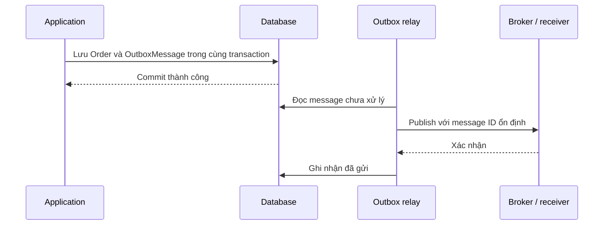

# 05. Transaction, concurrency và side effect

## Bản đồ liên kết

Kết hợp [DDD và CQRS](04-ddd-cqrs-and-vertical-slices.md) với [transaction nền tảng](../database/06-indexes-transactions-and-security/02-transactions-and-acid.md) và [Transactional Outbox](../system-design/04-messaging-and-event-driven/03-delivery-guarantees-outbox-and-idempotency.md).

## Use case cần một ranh giới thành công rõ

Giả sử hủy đơn phải cập nhật trạng thái, lưu audit và tạo yêu cầu thông báo. Câu hỏi đầu tiên là những thay đổi nào phải commit cùng nhau. Số lượng repository không trả lời câu hỏi đó.

Với provider hỗ trợ transaction, EF Core mặc định áp dụng các thay đổi của **một lần `SaveChanges`** một cách nguyên tử. Điều này không có nghĩa mọi `SaveChanges` trong một HTTP request tự động nằm chung transaction.

| Tình huống | Cách xử lý cần xem xét |
| --- | --- |
| Một `DbContext`, một lần lưu các thay đổi | Cơ chế transaction mặc định thường đủ. |
| Nhiều lần lưu cần thành một đơn vị | Transaction rõ ràng; phối hợp đúng execution strategy nếu có retry. |
| Nhiều `DbContext` hoặc connection | Xác định cách chia sẻ transaction/provider; không giả định cùng request là cùng transaction. |
| Database và broker/HTTP provider | Không có atomicity mặc định; cần outbox, orchestration hoặc cơ chế tích hợp thích hợp. |

Application sở hữu ý nghĩa “use case thành công”; Infrastructure thực hiện transaction. Chọn port hoặc transaction boundary phù hợp, tránh để từng repository tự commit ngoài sự điều phối.

## Quy tắc domain không ngăn được race một mình

Hai request đều có thể đọc cùng trạng thái hợp lệ:

```text
A đọc Order = Pending, version = 7.
B đọc Order = Pending, version = 7.
B chuyển sang Shipped và commit version = 8.
A chuyển bản cũ sang Cancelled rồi ghi đè nếu không kiểm tra version.
```

`Order.Cancel()` đúng với dữ liệu nó được đưa vào, nhưng dữ liệu đó đã cũ. Domain model không thay thế concurrency control của persistence.

Với optimistic concurrency, adapter cập nhật dựa trên cả ID và version đã đọc. Không có hàng nào khớp thì báo conflict thay vì ghi đè. Trong EF Core, concurrency token phải được cấu hình; không tự xuất hiện vì có thuộc tính tên `Version`.

`rowversion` là tính năng SQL Server. PostgreSQL, SQLite và các provider khác cần cơ chế phù hợp; không sao chép mapping giữa provider mà không kiểm tra.

Khi gặp conflict, có thể trả lỗi để người dùng tải lại hoặc chạy lại toàn bộ quyết định trên dữ liệu mới nếu nghiệp vụ cho phép. Retry một lệnh ghi với kết quả tính trên trạng thái cũ không giải quyết vấn đề.

## Side effect có cửa sổ thất bại

| Thứ tự | Trường hợp hỏng |
| --- | --- |
| Gửi thông báo trước rồi commit | Thông báo nói đã hủy nhưng transaction rollback. |
| Commit rồi gửi thông báo trực tiếp | Tiến trình chết giữa hai bước, thay đổi đã lưu nhưng thông báo mất. |
| Retry cả use case có gọi provider | Có thể gửi thông báo hoặc thực hiện thanh toán lặp. |

Một domain event trong bộ nhớ không tự đóng các cửa sổ này.

## Outbox giải quyết việc ghi ý định cùng dữ liệu



Relay có thể chết sau publish nhưng trước khi đánh dấu đã gửi. Vì vậy outbox vẫn có thể phát lặp; consumer cần idempotency. Outbox không cung cấp lời hứa “exactly once end-to-end” chỉ bằng một bảng.

Một consumer cập nhật dữ liệu và ghi nhận message ID đã xử lý phải bảo đảm hai việc đó nguyên tử. Nếu ghi marker trước rồi thất bại khi cập nhật, retry có thể bỏ qua công việc chưa hoàn thành.

Không cần outbox cho mọi thông báo không quan trọng. Dùng khi việc mất thông điệp sau commit có hậu quả cần ngăn; ghi rõ cơ chế retry, theo dõi và xử lý message lỗi.

## Test phải dùng đúng công cụ

- Unit test: đơn Shipped không được hủy; save failure được truyền ra.
- Database integration test: trạng thái và audit/outbox rollback cùng nhau.
- Concurrency test: hai transaction đọc cùng version rồi cạnh tranh cập nhật; chỉ quyết định hợp lệ được giữ.
- Recovery test: relay chết ở cửa sổ sau publish, consumer xử lý message lặp an toàn.

Fake repository trong [example.cs](example.cs) chỉ kiểm tra orchestration và tính bất biến của đối tượng cũ. Nó không chứng minh rollback database, isolation hoặc chống lost update.

Nguồn: [CA-08](sources.md#ca-08), [CA-09](sources.md#ca-09), [CA-10](sources.md#ca-10).
