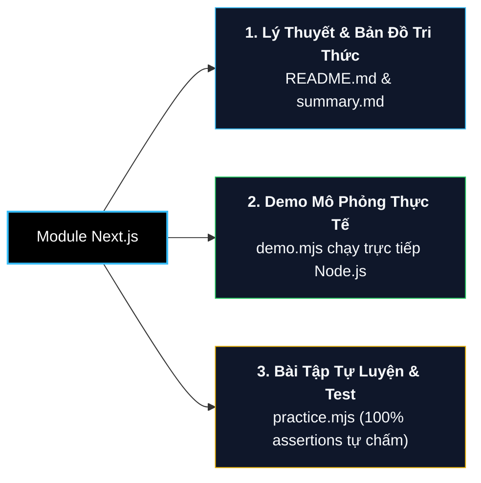

# Next.js & Modern Full-Stack Revision Guide

Lộ trình và kho tài liệu ôn tập toàn diện về **Next.js (App Router)**, kiến trúc **React Server Components (RSC)**, các chiến lược Rendering (**SSR, SSG, ISR, Streaming**), cơ chế đột phá **Server Actions**, hệ thống **4 tầng Caching**, tối ưu hóa **Core Web Vitals** và chuẩn mực bảo mật Full-Stack hiện đại.

---

## 📌 Danh Mục Các Module Học Tập

| Thư mục / Tài liệu | Nội dung trọng tâm | Trạng thái |
| :--- | :--- | :--- |
| **[summary.md](file:///d:/my-project/revision-document/nextjs/summary.md)** | **Bảng tóm tắt toàn diện (Master Next.js Cheat Sheet)**: App Router vs Pages Router, RSC Payload, 4 Tầng Caching, Server Actions, 10 Bẫy phỏng vấn Senior/Staff | Hoàn thành |
| **[01-app-router-and-routing/](file:///d:/my-project/revision-document/nextjs/01-app-router-and-routing/README.md)** | Cấu trúc file chuẩn (`layout`, `page`, `template`, `loading`, `error`), Dynamic Segments, Route Groups `(group)`, Parallel `@slot` & Intercepting Routes `(.)` | Sẵn sàng |
| **[02-rsc-and-rendering-strategies/](file:///d:/my-project/revision-document/nextjs/02-rsc-and-rendering-strategies/README.md)** | React Server Components vs Client Components (`"use client"`), Zero-Bundle-Size, SSR, SSG (`generateStaticParams`), ISR, Streaming SSR với `<Suspense />` | Sẵn sàng |
| **[03-server-actions-and-mutations/](file:///d:/my-project/revision-document/nextjs/03-server-actions-and-mutations/README.md)** | Server Actions (`"use server"`), Form Validation với Zod, React 19 `useActionState`, `useFormStatus`, Optimistic UI (`useOptimistic`), CSRF & Security | Sẵn sàng |
| **[04-caching-and-performance/](file:///d:/my-project/revision-document/nextjs/04-caching-and-performance/README.md)** | Giải phẫu 4 tầng Caching (Request Memoization, Data Cache, Full Route Cache, Router Cache), `revalidatePath`, `revalidateTag`, `next/image`, Core Web Vitals | Sẵn sàng |

---

## 🏗️ Chuẩn Cấu Trúc Của Từng Thư Mục Con

Mỗi module trong chuyên đề Next.js tuân thủ tuyệt đối cấu trúc 3 lớp thống nhất của toàn bộ kho lưu trữ:



1. **`README.md`**:
   - Phân tích cặn kẽ bản chất cơ chế bên dưới (Under the hood).
   - **Knowledge Links**: Bản đồ liên kết với React, TypeScript, Security, System Design.
   - **Classic Pitfalls**: Các bẫy kinh điển (Client-Server boundary leaks, Cache stale, Hydration mismatch).
2. **`demo.mjs`**:
   - Mô phỏng độc lập cơ chế hoạt động của Next.js (Router segment parser, RSC streaming serializer, 4-tier cache pipeline, Server Action state transitions) trực tiếp bằng Node.js v22.
3. **`practice.mjs`**:
   - Bộ bài tập thực hành gồm các hàm cần hoàn thiện, tự động chấm điểm đúng/sai bằng thư viện chuẩn `node:assert`.

---

## 🔗 Bản Đồ Liên Kết (Knowledge Links)

- **Kiến thức nền tảng:**
  - [JavaScript Guide](file:///d:/my-project/revision-document/javascript/README.md) (Async/Await, Closures, Event Loop)
  - [TypeScript Guide](file:///d:/my-project/revision-document/typescript/README.md) (Type Narrowing, Generics, Server-Client Types)
  - [React Revision Guide](file:///d:/my-project/revision-document/react/README.md) (Hooks, Context, Fiber Reconciler, React 18/19 Transitions)
- **Kiến trúc & Hạ tầng mở rộng:**
  - [Web Security](file:///d:/my-project/revision-document/security/README.md) (XSS, CSRF, Token Storage, Zero Trust)
  - [System Design](file:///d:/my-project/revision-document/system-design/README.md) (Caching Layers, CDN Invalidation, Distributed Sessions)
  - [DevOps](file:///d:/my-project/revision-document/devops/README.md) (Dockerizing Next.js Standalone, Kubernetes Deployments)

---

## ⚡ Lệnh Chạy Kiểm Thử Nhanh

```bash
# Chạy toàn bộ bài tập thực hành Next.js có assertions tự động chấm
npm run test:nextjs:practice
```
