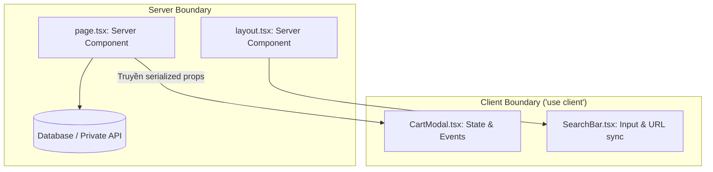
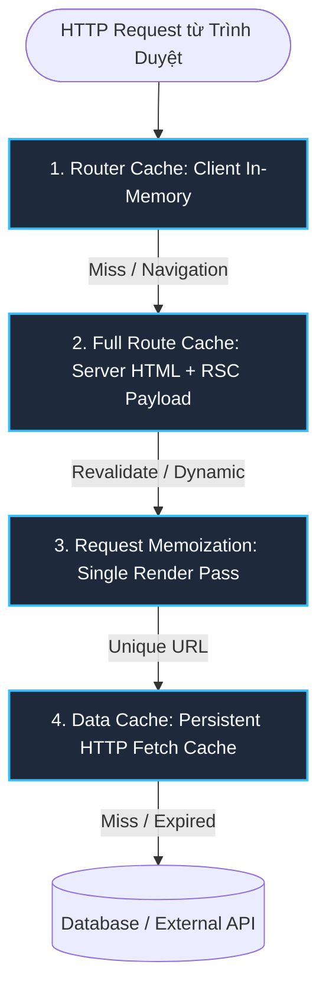

# Next.js Master Cheat Sheet (App Router & Modern Full-Stack)

> **Bản tóm tắt toàn diện về Next.js App Router, React Server Components (RSC), Rendering Strategies (SSR/SSG/ISR/Streaming), 4 Tầng Caching, Server Actions, Route Handlers, Tối ưu Web Vitals và 10 Bẫy phỏng vấn Senior/Staff.**

---

## 1. App Router vs. Pages Router: Bước Chuyển Mình Kiến Trúc

```
Pages Router (Legacy: /pages)              App Router (Modern: /app)
┌─────────────────────────────────┐        ┌─────────────────────────────────┐
│ • getServerSideProps (SSR)       │        │ • React Server Components (RSC) │
│ • getStaticProps / Paths (SSG)  │        │ • Async/Await trực tiếp ở Server│
│ • Tất cả code tải về Client JS  │  ───>  │ • Zero-Bundle-Size cho Server   │
│ • Render toàn trang nguyên khối  │        │ • Streaming HTML với Suspense   │
│ • Nested layouts rất khó khăn   │        │ • Nested Layouts mặc định       │
│ • Client-side API routes (/api) │        │ • Server Actions ("use server") │
└─────────────────────────────────┘        └─────────────────────────────────┘
```

---

## 2. React Server Components (RSC) vs. Client Components

Mặc định **mọi Component trong App Router đều là Server Component** trừ khi có chỉ thị `"use client"` ở dòng đầu tiên của file.

### Bảng So Sánh Chi Tiết:

| Tiêu Chí | Server Component (Mặc định) | Client Component (`"use client"`) |
| :--- | :--- | :--- |
| **Môi trường thực thi** | Chỉ chạy trên Server (Node.js/Edge Runtime) | Chạy cả Server (Pre-render HTML) và Client (Hydration) |
| **Kích thước JS Bundle** | **0 KB (Zero Bundle Size)**, code không bị tải về Client | Tăng kích thước JS bundle tải về trình duyệt |
| **Truy cập cơ sở dữ liệu** | Trực tiếp (`prisma`, `drizzle`, `pg`, `fs`) an toàn | ❌ Không thể (phải gọi API hoặc Server Action) |
| **Lưu trữ bí mật (Secrets)**| An toàn 100% (API keys, DB connection strings) | ❌ Rò rỉ nếu truyền xuống (chỉ dùng `NEXT_PUBLIC_*`) |
| **React Hooks** | ❌ Không dùng (`useState`, `useEffect`, `useRef`) | ✅ Đầy đủ (`useState`, `useEffect`, custom hooks) |
| **Tương tác giao diện** | ❌ Không có (`onClick`, `onChange`, `onSubmit`) | ✅ Đầy đủ event listeners |
| **Browser APIs** | ❌ Không thể (`window`, `localStorage`, `navigator`) | ✅ Truy cập được sau khi Hydrate (`useEffect`) |
| **Chức năng chính** | Fetch data, render HTML tĩnh, bọc khung bảo mật | Tương tác người dùng, state UI, hiệu ứng animation |



> [!IMPORTANT]
> **Quy Tắc Vàng Về Ranh Giới (Interleaving Pattern):**
> Server Component có thể import và render Client Component.
> Ngược lại, Client Component **KHÔNG ĐƯỢC** import trực tiếp Server Component. Thay vào đó, hãy truyền Server Component dưới dạng `children` hoặc props (`slots`) để giữ nguyên khả năng Zero-Bundle-Size!

---

## 3. Các Chiến Lược Rendering: SSR, SSG, ISR & Streaming

```
Chiến Lược        Thời Điểm Render              Cơ Chế Kích Hoạt / Next.js Syntax
─────────────────────────────────────────────────────────────────────────────────────────────
Static (SSG)      Build-Time (Mặc định)        fetch('...', { cache: 'force-cache' })
                                               hoặc không có dynamic functions
Dynamic (SSR)     Request-Time                 cookies(), headers(), searchParams,
                                               fetch('...', { cache: 'no-store' })
ISR               Theo chu kỳ / On-Demand      fetch('...', { next: { revalidate: 60 } })
                                               hoặc export const revalidate = 60
Streaming SSR     Truyền từng phần qua HTTP    <Suspense fallback={<Skeleton />}>
```

### 1. Static Rendering (SSG)
- Trang được render trước tại thời điểm `next build` và lưu trên CDN.
- Cực kỳ nhanh, độ trễ gần bằng 0ms.
- Phù hợp: Blog, tài liệu, landing page, trang giới thiệu.
- Với Dynamic Routes: Sử dụng hàm `generateStaticParams()` để sinh trước các đường dẫn:
  ```tsx
  export async function generateStaticParams() {
    const posts = await getPosts();
    return posts.map((post) => ({ slug: post.slug }));
  }
  ```

### 2. Dynamic Rendering (SSR)
- Trang được render lại trên Server mỗi khi có người dùng gửi HTTP Request.
- Tự động kích hoạt khi xuất hiện **Dynamic Functions**: `cookies()`, `headers()`, hoặc truy cập `searchParams` trong Page.
- Phù hợp: Trang thông tin cá nhân, Dashboard, bảng dữ liệu biến động thời gian thực.

### 3. Incremental Static Regeneration (ISR)
- Kết hợp điểm mạnh của cả Static và Dynamic: Giữ tốc độ của CDN nhưng cập nhật ngầm dữ liệu mới:
  - **Time-based revalidation**: Tự làm mới sau một khoảng thời gian (ví dụ 60 giây).
  - **On-demand revalidation**: Làm mới ngay lập tức khi có sự kiện thay đổi dữ liệu bằng `revalidatePath('/posts')` hoặc `revalidateTag('products')`.

### 4. Streaming SSR với React `<Suspense />`
- Cho phép Server gửi phần khung HTML tĩnh (Layout, Nav) ngay lập tức cho người dùng, sau đó stream tiếp các khối dữ liệu chậm (Reviews, Recommendations) khi chúng đã fetch xong mà không chặn toàn trang:
  ```tsx
  export default function ProductPage() {
    return (
      <div>
        <ProductHeader /> {/* Gửi ngay lập tức */}
        <Suspense fallback={<ReviewsSkeleton />}>
          <SlowReviews /> {/* Stream về sau */}
        </Suspense>
      </div>
    );
  }
  ```

---

## 4. Giải Phẫu 4 Tầng Caching Trong Next.js

Next.js App Router sở hữu hệ thống cache 4 tầng phức tạp bậc nhất trong thế giới web:



| Tầng Cache | Vị Trí | Mục Đích Lưu Trữ | Thời Gian Tồn Tại | Cách Vô Hiệu Hóa / Revalidate |
| :--- | :--- | :--- | :--- | :--- |
| **1. Request Memoization** | Server (RAM) | Cache các lời gọi `fetch` có cùng URL + Options trong một chu kỳ render | 1 chu kỳ request (tự hủy sau khi trả về HTML) | Dùng `AbortController` hoặc không dùng chung hàm fetch |
| **2. Data Cache** | Server (Disk / Storage) | Lưu kết quả dữ liệu giữa các user requests | Vĩnh viễn (cho tới khi revalidate) | `revalidateTag(tag)`, `revalidatePath(path)`, `{ cache: 'no-store' }` |
| **3. Full Route Cache** | Server (Disk / CDN) | Lưu HTML và RSC Payload tĩnh của cả trang | Vĩnh viễn (cho trang tĩnh) | Khi Data Cache tương ứng bị revalidate, hoặc deploy build mới |
| **4. Router Cache** | Trình duyệt (RAM) | Lưu RSC payload của các route đã viếng thăm và prefetch | Session trình duyệt (30s cho dynamic, 5m cho static) | `router.refresh()`, Server Action gọi `revalidatePath` |

---

## 5. Server Actions: Đột Phá Thao Tác Dữ Liệu (Mutations)

Server Actions là các hàm bất đồng bộ được thực thi trực tiếp trên Server, được đánh dấu bằng chỉ thị `"use server"`. Chúng cho phép form gửi dữ liệu mà **không cần tạo REST/GraphQL API endpoints thủ công**.

### Code Mẫu Chuẩn React 19 / Next.js:

```tsx
// app/actions/create-post.ts
"use server";

import { revalidatePath } from "next/cache";
import { z } from "zod";

const PostSchema = z.object({
  title: z.string().min(3, "Tiêu đề ít nhất 3 ký tự"),
  content: z.string().min(10, "Nội dung quá ngắn")
});

export async function createPostAction(prevState: any, formData: FormData) {
  // 1. Parse & Validate dữ liệu đầu vào
  const validated = PostSchema.safeParse({
    title: formData.get("title"),
    content: formData.get("content")
  });

  if (!validated.success) {
    return { success: false, errors: validated.error.flatten().fieldErrors };
  }

  // 2. Thao tác cơ sở dữ liệu an toàn
  await db.post.create({ data: validated.data });

  // 3. Xóa cache để cập nhật danh sách
  revalidatePath("/posts");

  return { success: true, errors: null };
}
```

```tsx
// app/posts/create-form.tsx (Client Component)
"use client";

import { useActionState } from "react";
import { useFormStatus } from "react-dom";
import { createPostAction } from "@/app/actions/create-post";

function SubmitButton() {
  const { pending } = useFormStatus();
  return (
    <button type="submit" disabled={pending}>
      {pending ? "Đang lưu..." : "Tạo bài viết"}
    </button>
  );
}

export function CreatePostForm() {
  const [state, formAction] = useActionState(createPostAction, { success: false, errors: null });

  return (
    <form action={formAction}>
      <input name="title" placeholder="Tiêu đề" />
      {state.errors?.title && <p className="error">{state.errors.title[0]}</p>}
      
      <textarea name="content" placeholder="Nội dung" />
      {state.errors?.content && <p className="error">{state.errors.content[0]}</p>}
      
      <SubmitButton />
    </form>
  );
}
```

---

## 6. Toàn Bộ Quy Ước File Chuẩn Trong App Router

| Tên File | Vai Trò & Chức Năng | Ghi Chú |
| :--- | :--- | :--- |
| **`layout.tsx`** | Layout bao bọc phân đoạn, bảo toàn state khi chuyển trang con | Không re-render khi route con thay đổi |
| **`page.tsx`** | Giao diện chính của URL route | Bắt buộc phải có để URL có thể truy cập |
| **`loading.tsx`** | UI trạng thái chờ (tự động bọc `page.tsx` trong `<Suspense />`) | Hiển thị Skeleton tức thì |
| **`error.tsx`** | UI bắt lỗi runtime (tự động bọc trong Error Boundary) | **Bắt buộc phải là `"use client"`** |
| **`not-found.tsx`**| UI hiển thị khi gọi hàm `notFound()` | Trả về mã HTTP 404 |
| **`template.tsx`**| Tương tự `layout.tsx` nhưng **tạo instance mới** mỗi khi đổi trang | Thích hợp cho Enter/Exit Animations |
| **`route.ts`** | API Route Handler (GET, POST, PUT, DELETE, PATCH) | Thay thế `/pages/api` cũ |
| **`default.tsx`** | Fallback UI cho Parallel Routes (`@slot`) khi refresh trang | Bắt buộc khi dùng Parallel Routes |

### Cú Pháp Routing Nâng Cao:
- **Dynamic Segments:** `app/blog/[slug]/page.tsx` $\rightarrow$ `/blog/hello-world`
- **Catch-all Segments:** `app/docs/[...slug]/page.tsx` $\rightarrow$ `/docs/api/v1/auth`
- **Optional Catch-all:** `app/shop/[[...slug]]/page.tsx` $\rightarrow$ `/shop` và `/shop/clothing/shoes`
- **Route Groups (Không ảnh hưởng URL):** `app/(auth)/login/page.tsx` $\rightarrow$ `/login`
- **Parallel Routes:** `app/@analytics/page.tsx` và `app/@team/page.tsx` được truyền vào `layout.tsx` dưới dạng props song song.
- **Intercepting Routes:** `app/feed/(..)photo/[id]/page.tsx` chặn modal xem ảnh ngay trong feed mà không rời trang, nhưng khi F5 thì mở trang xem ảnh độc lập.

---

## 7. Tối Ưu Hiệu Năng & Core Web Vitals (LCP, FID/INP, CLS)

### 1. `next/image`
- Tự động convert ảnh sang WebP/AVIF hiện đại.
- Chống Layout Shift (**CLS = 0**) bằng cách bắt buộc khai báo `width`/`height` hoặc `fill`.
- Thuộc tính `priority`: Dành riêng cho ảnh đại diện đầu trang (Hero image) để tối ưu **Largest Contentful Paint (LCP)**.

### 2. `next/font` (Zero Layout Shift)
- Tự động tải trước font (Google Fonts hoặc Local Fonts) tại thời điểm build.
- Tự động nhúng font CSS vào HTML, loại bỏ hoàn toàn các request ra server ngoài và hiện tượng nháy font chữ (FOIC/FOUT).

### 3. Dynamic Imports & Code Splitting
```tsx
import dynamic from "next/dynamic";

// Chỉ tải component vẽ biểu đồ nặng khi Client thực sự cần
const HeavyChart = dynamic(() => import("@/components/HeavyChart"), {
  ssr: false,
  loading: () => <p>Đang tải biểu đồ...</p>
});
```

---

## 8. Bảo Mật Full-Stack Trong Next.js

1. **Biến môi trường (Environment Variables):**
   - Biến bí mật (DB URL, Stripe Secret): Khai báo trong `.env.local` không có tiền tố. **Chỉ Server mới đọc được**.
   - Biến công khai: Bắt buộc có tiền tố `NEXT_PUBLIC_` (ví dụ `NEXT_PUBLIC_ANALYTICS_ID`). Trình biên dịch sẽ nhúng trực tiếp giá trị vào client JS bundle.
2. **Ngăn rò rỉ mã nguồn Server sang Client:**
   - Cài đặt package `server-only`:
     ```bash
     npm install server-only
     ```
   - Đặt `import 'server-only'` ở đầu file chứa DB queries hoặc API keys. Nếu bất kỳ Client Component nào vô tình import file này, build sẽ báo lỗi ngay lập tức.
3. **React Taint API (`experimental_taintUniqueValue`):**
   - Đánh dấu các trường dữ liệu nhạy cảm (như User Password Hash, Token) để React quăng lỗi nếu chúng bị truyền nhầm qua ranh giới Client.

---

## 9. 10 Bẫy Phỏng Vấn Kinh Điển (Senior / Staff Next.js Q&A)

### CÂU 1: "Chỉ thị `'use client'` có nghĩa là component đó CHỈ chạy trên trình duyệt client, đúng hay sai?"
* **Trả lời chuẩn**: **SAI!**
  `'use client'` không biến component thành Client-only. Trong lần tải trang đầu tiên (Initial Page Load), Client Component **vẫn được Server pre-render ra HTML** để phục vụ SEO và tốc độ hiển thị ban đầu. Sau đó trên trình duyệt, React mới thực hiện tiến trình **Hydration** để gắn các event listeners.

### CÂU 2: "Tại sao việc gọi `cookies()` hoặc `headers()` lại biến trang Static thành Dynamic?"
* **Trả lời chuẩn**: Vì cookie và request headers chứa thông tin định danh riêng của từng người dùng cụ thể tại thời điểm gửi request (ví dụ: Session ID, User-Agent). Server không thể đoán trước các giá trị này tại thời điểm build-time, do đó buộc phải chuyển sang **Dynamic Rendering (Request-Time)**.

### CÂU 3: "Làm thế nào để truyền dữ liệu từ Server Component xuống Client Component mà không bị lỗi serialization?"
* **Trả lời chuẩn**: Dữ liệu truyền qua ranh giới Server-Client bắt buộc phải tuần tự hóa được thành JSON (Plain Objects, Strings, Numbers, Booleans, Arrays). Không thể truyền: Functions, Classes, Date objects (cần convert sang ISO string), hoặc Symbols.

### CÂU 4: "Sự khác biệt giữa `layout.tsx` và `template.tsx` là gì?"
* **Trả lời chuẩn**: `layout.tsx` duy trì state và không re-render khi người dùng điều hướng giữa các trang con (Shared Layout). Ngược lại, `template.tsx` tạo ra một DOM node và React component instance mới hoàn toàn mỗi lần đổi route, kích hoạt lại `useEffect` và reset form state (thích hợp cho Page Transitions).

### CÂU 5: "Làm sao để Server Action vừa cập nhật DB, vừa cập nhật UI người dùng ngay tức thì không cần đợi mạng (Optimistic Updates)?"
* **Trả lời chuẩn**: Sử dụng Hook `useOptimistic` trong Client Component. Khi người dùng bấm submit, UI lập tức cập nhật giá trị giả định (Optimistic State). Nếu Server Action thành công, UI đồng bộ với dữ liệu thật. Nếu thất bại, React tự động rollback về giá trị cũ.

### CÂU 6: "Server Actions có cần bảo vệ CSRF không?"
* **Trả lời chuẩn**: Next.js Server Actions mặc định được bảo vệ chống CSRF bằng cách so khớp tiêu đề `Origin` và `Host` trong request POST. Nếu chúng không khớp, request sẽ bị từ chối ngay lập tức. Tuy nhiên, lập trình viên vẫn phải kiểm tra xác thực người dùng (Authentication & Authorization) bên trong hàm Action.

### CÂU 7: "Khi nào nên dùng Route Handler (`route.ts`) thay vì Server Action?"
* **Trả lời chuẩn**: Dùng `route.ts` khi cần xây dựng RESTful endpoints cho bên thứ ba (Webhooks, Mobile Apps, Public API). Dùng Server Action khi thực hiện các tác vụ đột biến dữ liệu gắn liền với giao diện người dùng web (Form submissions, Button clicks, UI mutations).

### CÂU 8: "Làm thế nào để tối ưu hóa việc gọi API bị trùng lặp ở nhiều Server Components khác nhau trong cùng một trang?"
* **Trả lời chuẩn**: Dùng cơ chế **Request Memoization** của Next.js. Mặc định, hàm `fetch()` có cùng endpoint và options sẽ tự động được deduplicate (chỉ gọi 1 lần duy nhất trong suốt chu kỳ render của trang). Nếu dùng ORM (như Prisma), có thể bọc hàm query trong `React.cache()`.

### CÂU 9: "Vấn đề Hydration Mismatch là gì và cách phòng tránh?"
* **Trả lời chuẩn**: Xảy ra khi cây HTML được sinh ra từ Server không khớp với cây Virtual DOM được tính toán lần đầu trên Client (ví dụ: dùng `typeof window !== 'undefined'`, dùng `new Date().toLocaleTimeString()`, hoặc cấu trúc thẻ HTML không hợp lệ như `<p>` lồng trong `<p>`). Cách khắc phục: chuyển logic phụ thuộc browser vào `useEffect`, hoặc dùng cờ `suppressHydrationWarning`.

### CÂU 10: "Làm sao để deploy ứng dụng Next.js lên Docker container mà dung lượng image dưới 150MB?"
* **Trả lời chuẩn**: Bật chế độ `output: 'standalone'` trong `next.config.js`. Next.js sẽ tự động phân tích và chỉ copy những file `node_modules` thực sự được sử dụng vào thư mục `.next/standalone`. Kết hợp với Docker Multi-Stage Build trên Alpine Linux, image cuối cùng giảm từ ~1.2GB xuống dưới 120MB.
