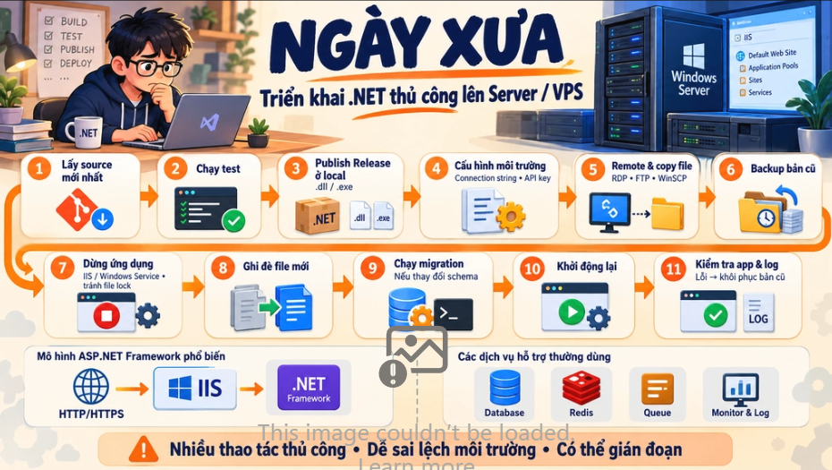
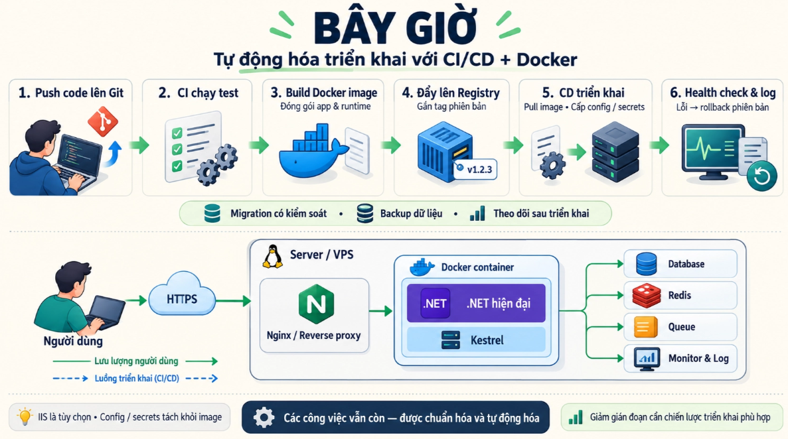

# VNZ Training Camp - P1: CI/CD

## Định nghĩa về CI/CD

CI/CD là viết tắt của **Continuous Integration / Continuous Delivery (hoặc Deployment)**: một quy trình tự động hoá việc build, test và deploy code. Mỗi lần dev push code, hệ thống tự kiểm tra và đưa lên môi trường chạy thật mà không cần ai làm tay.

## Tại sao lại cần CI/CD

→ Nếu không có CI/CD thì phải triển khai bằng tay chứ sao

→ Triển khai bằng tay thì tốn thời gian, đó là những công việc lặp đi lặp lại

→ Việc lặp đi lặp lại thì chúng ta tạo ra 1 quy trình để làm tự động các công việc đó

## Ngày xưa triển khai 1 Source Code lên Server hay VPS như thế nào

1. Lấy source code phiên bản mới nhất
2. Chạy test
3. Build ở local ra file `.dll`, `.exe` (publish ở chế độ Release)
4. Sửa config cho đúng môi trường (connection string, `appsettings.Production.json`, API key)
5. Remote vào Server/VPS và copy file lên (Remote Desktop, FTP, WinSCP)
6. Backup bản cũ để còn rollback
7. Dừng app đang chạy (stop IIS site / Windows Service), không thì file bị lock, không ghi đè được
    - Những phiên bản cũ ngày xưa thì bên trong .NET không có Web Server
    - Lúc đó cần Web Server (IIS) để nhận request HTTP/HTTPS, app .NET được chạy bên trong IIS để xử lý logic rồi trả kết quả về
    - Với .NET hiện đại, Web Server đã tích hợp sẵn bên trong (Kestrel), app tự chạy được mà không cần IIS. Khi triển khai bằng Docker, phía trước chỉ cần một lớp nhẹ lo HTTPS/domain (Nginx, Cloudflare Tunnel), không còn phụ thuộc vào IIS và Windows Server
8. Ghi đè file mới
9. Chạy migration database nếu có đổi schema
10. Khởi động lại app
11. Kiểm tra app có lên không, xem log; lỗi thì restore bản backup

→ Thì tất cả những hành động trên là những hành động bắt buộc phải làm, để triển khai ứng dụng ở trên 1 con Server hoặc VPS

→ Và đây còn hệ thống đơn giản thôi, 1 hệ thống thực tế nó còn các service khác nữa: Database (Postgres, MySQL), Cache (Redis), Queue (RabbitMQ, Kafka), Monitor & Log (Prometheus + Grafana, ELK hoặc Loki)





---

# Đào sâu vào quy trình triển khai ứng dụng liên tục với CI/CD

## 1. CI – Continuous Integration (Tích hợp liên tục)

**Định nghĩa:** Đảm bảo code của mọi người khi ghép vào nhau luôn build được và chạy đúng, được kiểm tra tự động mỗi lần có thay đổi.

### Vấn đề khi không có CI

Lấy ví dụ source code lưu trên GitHub, không có CI. Ông A push code, ông B push code, mọi thứ trơn tru, không conflict gì. Nhưng khi merge vào main, ông A kéo về thì thấy hàm `GetAll` của ông B lỗi, không chạy được, chỉ vì thiếu một dấu `;`.

> **Phản biện lần 1:** *"Anh ơi, tại ông B gà thôi, không build ở local mà đã push lên. Em thì em build, verify kỹ rồi mới push. Ví dụ này không thuyết phục."*
>

OK, giờ giả sử code của cả ông A và ông B đều ngon, build local không lỗi, merge không conflict. Vẫn có case như sau:

```csharp
// Code ông A (sau refactor)
public Task<List<Product>> GetAllAsync(int page, int size) { ... }

// Code ông B (viết dựa trên bản cũ)
var products = _productService.GetAll(); // ❌ Không còn hàm này
```

- Mỗi ông một Pull Request, sửa **hai file khác nhau**, nên Git không báo conflict, merge vào main bình thường.
- Tech lead kéo main về để deploy thủ công → **build fail ngay**.
- → Git chỉ kiểm tra *"hai người có sửa đè lên cùng một dòng không"*, chứ không biết *"ghép xong code có chạy được không"*. Không ông nào sai, nhưng kết quả ghép lại thì sai.

> **Phản biện lần 2:** *"Thì ông B chỉ cần pull code mới nhất từ main về trước khi merge là xong mà anh."*
>
- Đúng, nhưng **pull về thôi chưa đủ, phải build và test lại**. Mà thực tế gần như không ai build lại ở local mỗi lần trước khi merge.
- Kể cả có làm, vẫn bị **lệch thời gian**:
    - 9h: ông B pull main, build, test đầy đủ, ngon
    - 10h: ông A merge PR đổi `GetAll()` vào main
    - 11h: ông B bấm merge, dựa trên kết quả kiểm tra lúc 9h, đã cũ
- Muốn an toàn thì ông B phải pull + build + test **ngay sát lúc bấm merge**. Mà ngay trong vài phút ông B đang build, nếu có người khác merge vào main thì kết quả lại cũ tiếp. Team nhỏ ít gặp, team đông merge liên tục thì gặp thường xuyên, và mình không thể cấm cả công ty merge vào main.

### Chốt lại

- Mấu chốt không phải ai giỏi ai gà, mà là **không ai kiểm tra code SAU KHI GHÉP**, và việc kiểm tra đó đang phụ thuộc vào trí nhớ của con người.
    - Ví dụ: pull main về trước khi push nhưng quên build lại. Để ngăn chặn việc này, anh có setup **pre-push hook** ở dưới code của mình: trước khi push lên đều phải build và chạy test để kiểm tra lỗi build.
- Thao tác *"lấy main mới nhất về, ghép với code của mình, build, test"* chính là việc **CI làm tự động** mỗi khi có Pull Request hoặc main thay đổi. Fail thì chặn merge, biết ngay PR nào gây lỗi.

### Các công việc mà CI sẽ làm

1. **Checkout code:** Lấy code của PR, **ghép thử với main mới nhất**
2. **Restore dependency:** `dotnet restore`, `npm ci`. Thường kèm **cache** để lần sau không phải tải lại, pipeline chạy nhanh hơn.
3. **Kiểm tra format & lint**
4. **Build:** Bắt lỗi compile, lỗi tham chiếu, như case `GetAll()` bị đổi tên.
5. **Unit test:** `dotnet test`, chạy **toàn bộ** test, không phải chỉ phần mình sửa → bắt regression.
    - Case như `GetAll()` chỉ là lỗi build. Khi đã qua được bước build rồi, các lỗi về nghiệp vụ sẽ do test bắt.
6. **Integration test:** Test với database, Redis thật. CI dựng tạm Postgres, Redis bằng container ngay trong pipeline, chạy test xong là xoá. Bắt được lỗi kiểu migration xung đột.
7. **Đo code coverage:** Bao nhiêu % code được test phủ. Có thể đặt ngưỡng, vd dưới 70% thì fail (Coverlet, Codecov).
8. **Quét bảo mật:**
    - **Secret scan:** có lộ API key, password trong code không (Gitleaks)
    - **Dependency scan:** thư viện có lỗ hổng không (`dotnet list package --vulnerable`, Dependabot)
    - **SAST:** phân tích code tìm lỗi bảo mật như SQL Injection (CodeQL, SonarQube)
9. **Build Docker image**
10. **Quét image:** Kiểm tra base image và các package trong image có lỗ hổng không (Trivy).
11. **Push artifact / image lên registry:** Đẩy image lên Docker Hub, GitHub Container Registry, AWS ECR... Thường **chỉ làm khi merge vào main**, còn PR thì chỉ build để kiểm tra. Đây là điểm bàn giao sang CD.
12. **Báo kết quả:**
    - Đánh dấu ✅ / ❌ trên PR, kết hợp branch protection: đỏ là không cho merge
    - Gửi thông báo về Slack, Telegram, email khi fail

### 3 nhóm công việc chính

| Nhóm | Bước | Trả lời câu hỏi |
| --- | --- | --- |
| Code có đúng không? | Build, Unit test, Integration test, Coverage | Ghép xong có chạy, có vỡ chỗ khác không |
| Code có sạch, có an toàn không? | Format, Lint, Secret scan, Dependency scan, SAST, Image scan | Có đúng chuẩn, có lỗ hổng không |
| **Đóng gói giao cho CD** | Build image, Push registry | Sẵn sàng để deploy |

> ⇒ **Tóm lại CI là để làm gì:** CI phục vụ một yêu cầu tối thượng: bất cứ lúc nào, bất cứ ai pull code từ main về, đoạn code đó phải **build được, chạy đúng, đạt chuẩn và sẵn sàng deploy lên server**.
>

### *"Sản phẩm này không phải là thuốc và không có tác dụng thay thế thuốc chữa bệnh"*

- CI **không đảm bảo code tốt nhất**. Code vẫn có thể thiết kế dở, logic chưa tối ưu. Phần đó là việc của code review.
- CI chỉ đảm bảo code **đã vượt qua mọi kiểm tra mà team đặt ra**: build được, test pass, đúng chuẩn, không lỗ hổng đã biết. Test viết sơ sài thì CI xanh cũng chưa chắc chạy đúng.

---

## 2. CD – Continuous Delivery / Continuous Deployment (Chuyển giao / Triển khai liên tục)

**Định nghĩa:** Lấy sản phẩm đã qua CI (Docker image) và **tự động đưa lên server**, lần nào cũng theo đúng một quy trình, có kiểm tra và có đường lùi.

### Delivery hay Deployment?

Khác nhau đúng một chỗ: **ai bấm nút lên production**.

|  | Continuous Delivery | Continuous Deployment |
| --- | --- | --- |
| Lên staging | Tự động | Tự động |
| Lên production | Cần người **bấm approve** | Tự động hoàn toàn |
| Phù hợp | Đa số team, hệ thống cần kiểm soát (tài chính, B2B) | Team có bộ test rất mạnh, release nhiều lần/ngày |

### Vấn đề khi không có CD

Nhìn lại 11 bước deploy tay: CI mới lo được bước 1–3 (lấy code, test, build). Từ bước 4–11 vẫn là tay người:

- **Sửa config tay** → quên đổi connection string, app production trỏ vào database dev
- **Copy file tay** → thiếu file, copy nhầm thư mục
- **Quên backup** → lỗi xong không có đường lùi
- **Dừng app để ghi đè** → web sập trong lúc deploy (**downtime**), user đang thanh toán thì lỗi giữa chừng
- **Quên chạy migration** → app lên nhưng gọi DB là lỗi
- **Rollback tay** → production đang sập mà phải ngồi tìm bản backup, copy lại, restart

Thêm nữa: **không ai biết** production đang chạy code commit nào, ai deploy lúc mấy giờ, deploy xong có ai kiểm tra chưa.

Và chỉ 1–2 người có quyền SSH vào server, biết cách deploy. Họ nghỉ phép là cả team không release được.

> **Phản biện lần 1:** *"Anh ơi, em viết sẵn một file `deploy.sh`, mỗi lần deploy chạy một lệnh là xong, cần gì CD?"*
>

Script là bước tiến tốt, nhưng vẫn còn:

- Chạy từ **máy cá nhân**, nghĩa là SSH key, password server nằm trên máy dev. Máy mất hoặc dính malware là lộ quyền vào production.
- Vẫn phụ thuộc người nhớ chạy, nhớ chạy đúng commit, đúng môi trường.
- Không có lịch sử: ai chạy, lúc nào, kết quả ra sao.

→ CD chính là **đem script đó lên chạy trên hệ thống tự động**: secret lưu tập trung, mỗi lần deploy có log, có người approve, có rollback.

> **Phản biện lần 2:** *"Tự động deploy lên production nghe nguy hiểm quá anh."*
>
- Đúng, nên đa số team dùng **Continuous Delivery**: tự động lên **staging** trước, QA/PM test trên đó, ổn rồi mới bấm approve lên production.
- Continuous Deployment (tự lên production) chỉ nên làm khi bộ test đủ mạnh và có monitoring + rollback tự động.

### Các công việc mà CD sẽ làm

1. **Nhận image từ CI:** lấy đúng image gắn tag commit (`myapp:a1b2c3d`). Nguyên tắc **build một lần, deploy nhiều nơi**: staging và production chạy *cùng một image*, không build lại.
2. **Inject config theo môi trường:** connection string, API key lấy từ biến môi trường / secret của từng môi trường (GitHub Environments, Vault). Không ai sửa file config bằng tay nữa.
3. **Chạy migration database:** tách thành một bước riêng, chạy trước khi app mới lên. Migration nên viết theo kiểu tương thích ngược (thêm cột trước, xoá cột sau) để bản cũ vẫn chạy được nếu phải rollback.
4. **Deploy lên staging:** pull image mới, thay container cũ (`docker compose pull && docker compose up -d`).
5. **Health check / Smoke test:** gọi `/health`, test vài API chính. Fail thì dừng, không đi tiếp.
6. **Approve** (với Continuous Delivery): người có quyền bấm duyệt lên production.
7. **Deploy lên production** theo chiến lược ít downtime (xem bảng dưới).
8. **Rollback tự động:** health check production fail thì chạy lại **image tag cũ**. Rollback giờ chỉ là đổi tag, mất vài giây, không phải đi tìm file backup.
9. **Thông báo & lưu lịch sử:** báo Slack/Telegram, ghi lại commit nào, ai approve, lúc mấy giờ.

### Các chiến lược deploy

Giải quyết vấn đề downtime ở bước 7–10 của quy trình tay:

| Chiến lược | Cách làm | Ưu | Nhược |
| --- | --- | --- | --- |
| **Recreate** | Tắt bản cũ, bật bản mới | Đơn giản | Có downtime |
| **Rolling** | Thay dần từng instance | Không downtime | Có lúc 2 phiên bản chạy song song |
| **Blue-Green** | Dựng sẵn bản mới (Green) song song bản cũ (Blue), xong thì chuyển traffic | Rollback tức thì, chỉ cần chuyển lại | Tốn gấp đôi tài nguyên |
| **Canary** | Cho 5–10% user dùng bản mới trước, ổn thì tăng dần | Lỗi chỉ ảnh hưởng ít user | Cần monitoring tốt, setup phức tạp |

### Map lại với quy trình tay

| Bước tay | CD làm thay |
| --- | --- |
| 4. Sửa config | Inject secret theo môi trường |
| 5. Copy file lên server | Pull image từ registry |
| 6. Backup bản cũ | Image cũ vẫn nằm trên registry, có tag |
| 7, 8, 10. Dừng, ghi đè, khởi động lại | Thay container theo chiến lược deploy |
| 9. Chạy migration | Bước migration tự động |
| 11. Kiểm tra, lỗi thì restore | Health check + rollback tự động |

> ⇒ **Tóm lại CD là để làm gì:** CD phục vụ một yêu cầu tối thượng: đưa code đã qua CI lên server **tự động, lần nào cũng giống nhau, ai cũng làm được, và luôn có đường lùi**.
>
